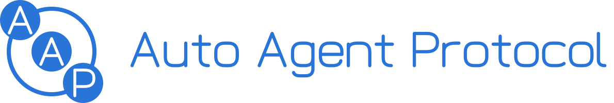
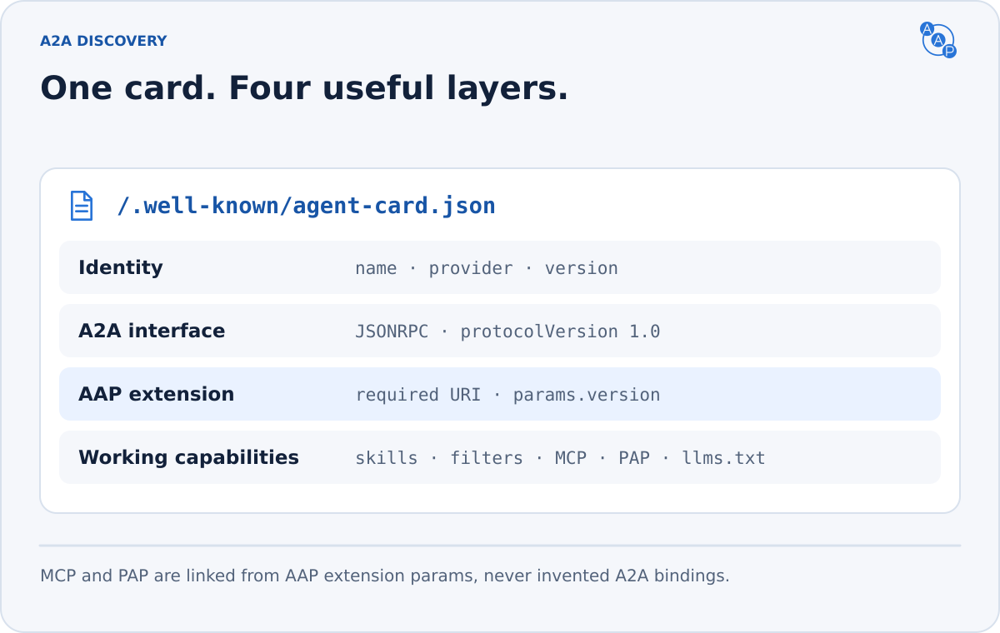

<picture>
  <source media="(prefers-color-scheme: dark)" srcset="static/img/brand/aap-wordmark-white.svg">
  
</picture>

# Auto Agent Protocol (AAP)

[](https://autoagentprotocol.org/docs/v3.0/intro)
[](https://a2a-protocol.org)
[](LICENSE)
[](https://github.com/auto-agent-protocol/auto-agent-protocol/actions/workflows/validate.yml)

Brand assets: [symbol, wordmark, and usage guidance](tools/branding/README.md).

**AAP lets AI assistants shop at your car or motorcycle dealership.**

New to the protocol? Read the [AAP FAQ](https://autoagentprotocol.org/faq) for its purpose, supported capabilities, assistant compatibility, and how to get started.

More and more car and motorcycle buyers start their search by asking an AI assistant. AAP is the free, open standard that lets any AI assistant **find your dealership, browse your real inventory, and send you a sales lead with the customer's permission** — straight into the systems you already use. You publish two discovery files on your own website, answer a few well-defined kinds of questions, and any AAP-capable agent can do business with you. No app store. No middleman. No per-partner integration projects.

Listings carry an optional `vehicle_type` (`car`, `motorcycle`, `trailer`, `rv`, `other`; absent = `car`), so the same five skills serve both automotive and powersports retail — including electric models via a generic electric-powertrain field group.


**For engineers:** AAP 3.0 combines an open [A2A v1.0](https://a2a-protocol.org) profile with a native Personal Agent Protocol guest API. A compliant dealer publishes both discovery documents, advertises the AAP extension URI (`https://autoagentprotocol.org/extensions/aap/v3.0`) on its Agent Card, and implements **one or more** of the five standard AAP automotive skills on both interfaces (a small used-car lot might only do `inventory.search` + `lead.submit`; a franchise dealership might do all five).

The A2A interface is deliberately minimal: every AAP agent exposes the **JSON-RPC 2.0 binding** — the sole A2A transport (the optional HTTP+JSON binding was removed in v1.1.0); the only A2A operation AAP uses is **`SendMessage`** — request `Message` in, response `Message` out. The optional A2A surface (streaming, tasks, push notifications, extended cards) is out of scope: dealer agents do not need to implement it and buyer agents must not require it.



## v3.0.0 Scope

v3.0.0 upgrades the Personal Agent Protocol profile to draft 0.2. It requires exact issuer audiences for both assertions, final-host discovery identity, explicit pre-1.0 version support and capability-based MCP token selection. Guest sessions still authenticate the personal agent; shoppers need no dealer account. Automotive payloads, A2A v1.0 behavior, bridge version `1`, pricing and consent are unchanged from AAP 2.0. Earlier releases remain frozen. See the [migration guide](docs/versioning.md#pap-02-migration), [PAP profile](docs/personal-agent-protocol.md) and [client walkthrough](docs/pap-client-guide.md).

- **Paired discovery** via `/.well-known/agent-card.json` (A2A) and `/.well-known/poppy.json` (Poppy)
- **Native Poppy API** with verified OAuth issuer discovery, signed-out sessions, DPoP and OpenAPI 3.1; no customer account required
- **Inventory**: facets, search, vehicle detail — across **cars and motorcycles** via an optional `vehicle_type` discriminator, with motorcycle body/segment carried in `body`, displacement in `displacement_cc`, niche specs in a free-form `other_attributes` map, and a generic electric-powertrain group (range, battery kWh, motor hp, DC fast charge, charge port) for BEV/PHEV cars and motorcycles alike
- **Transparent pricing**: one authoritative all-in `price`, optional complete vehicle fee itemization, optional rooftop fee defaults for publishers, and explicit handling for list-only and conditional-rebate data
- **Dealership information**: group name, welcome message, and one or more rooftops (locations) with address, geo, contacts, hours, timezone, capabilities, and optional default fee schedules
- **Leads**: a single unified `lead.submit` accepting a consented customer plus any combination of vehicle of interest, trade-in, and appointment
- **ADF/XML mapping** documented for legacy CRM compatibility
- **Verified contract interoperability**: official A2A JavaScript SDK HTTP round-trips for every skill, Poppy discovery/identity checks and generated OpenAPI schema parity; see [verification scope](docs/conformance.md)

v3.0.0 does **not** cover: payments, financing approval, RFQ/quote flows, trade-in valuations, buyer-specific out-the-door calculations, or reservations.


## Quick links

- **Specification**: [autoagentprotocol.org](https://autoagentprotocol.org)
- **Stable v3.0.0 agent card**: [`spec/v3.0/examples/agent-card.example.json`](spec/v3.0/examples/agent-card.example.json)
- **Editable JSON Schemas**: [`spec/latest/schemas/`](spec/latest/schemas/)
- **Editable examples**: [`spec/latest/examples/`](spec/latest/examples/)
- **OpenAPI 3.1** (built at deploy time): `https://autoagentprotocol.org/v3.0/openapi-jsonrpc.yaml`
- **Poppy OpenAPI**: `https://autoagentprotocol.org/v3.0/openapi-poppy.yaml`
- **Poppy example**: [`spec/v3.0/examples/poppy.example.json`](spec/v3.0/examples/poppy.example.json)
- **PAP client handshake and diagnostics**: [client walkthrough](docs/pap-client-guide.md)
- **Conformance and limits**: [verification guide](docs/conformance.md)
- **Changelog**: [CHANGELOG.md](CHANGELOG.md)

## The five skills

| Skill | Purpose |
|---|---|
| `dealer.information` | Dealership profile, address, hours, capabilities |
| `inventory.facets` | Aggregated counts and ranges over the dealer's inventory |
| `inventory.search` | Filtered, paginated inventory queries (cars and motorcycles) |
| `inventory.vehicle` | Detail view of one specific vehicle or motorcycle (by VIN, stock, or vehicle_id) |
| `lead.submit` | Unified consented lead — customer + optional(vehicle of interest, trade-in, appointment) |

## Packages


| Package | Description |
|---------|-------------|
| `@autoagentprotocol/types` | TypeScript types generated from JSON Schema |
| `@autoagentprotocol/schemas` | Raw JSON Schema files as importable modules |
| `@autoagentprotocol/validator` | Ajv-based validators for all AAP objects |

## Development

### Prerequisites

- Node.js 22+
- pnpm 10+

### Setup

```bash
pnpm install
```

### Commands

```bash
pnpm run validate          # Validate schemas and examples
pnpm run generate          # Generate draft artifacts in generated/latest
pnpm run generate:images   # Regenerate tracked latest SVG diagrams in docs/img
pnpm run check:images      # Verify diagram sources, palette, references, and output
pnpm run check:releases    # Verify frozen snapshots and stable packages
pnpm run test:release      # Rehearse release and freeze invariants
pnpm run build             # Build the stable production site
pnpm start                 # Serve editable docs with an unreleased banner
```

### Repository structure

```
spec/latest/               Editable JSON Schema 2020-12, examples, and skills manifest
spec/v*/                   Frozen released specs (committed, immutable)
docs/                      Editable documentation; served locally as an unreleased draft
docs/img/                  Editable, generated SVG diagrams used by the latest docs and README
versioned_docs/, versioned_sidebars/  Frozen release documentation snapshots
releases.json              Explicit release registry and stable-release pointer
releases/v*/               Frozen generated artifacts, provenance, reports, and integrity manifests
docs/skills/, bindings/    A2A binding + skill reference (committed)
packages/                  npm packages: types, schemas, validator (committed)
tools/image-specs.ts       Reviewed content source for every latest documentation diagram
tools/                     Generators and validators (committed)
src/components/            FieldCard React component (committed)

generated/latest/          Auto-generated draft types, OpenAPI, and MCP manifest (NOT committed)
static/v*/, static/latest/ Site assembly output copied from frozen snapshots (NOT committed where applicable)
build/                     Docusaurus production output (NOT committed)
```

Draft artifacts are produced by `pnpm run generate`; production assets are assembled by `pnpm run copy-static`. Published artifact snapshots are committed under `releases/v*/` so a historical release is never regenerated with newer tooling.

## Versioning

Released versions are immutable. Repository changes use `spec/latest/`; the public `latest` URL always points to the release selected by `releases.json`. There is no `next` channel. Each release has pinned schema URLs at `https://autoagentprotocol.org/v{version}/schemas/`. See the [versioning policy](https://autoagentprotocol.org/docs/latest/versioning) and [maintainer release guide](RELEASING.md).

## How AAP relates to other protocols

| Layer | Protocol | Role for AAP |
|---|---|---|
| Transport / data model (BASE) | **[A2A v1.0](https://a2a-protocol.org)** | The A2A interface carries AAP requests and responses inside `Message.parts[].data` as typed `DataParts` over JSON-RPC. |
| Discovery / sessions / APIs | **[Personal Agent Protocol](https://personalagentprotocol.org/)** (PAP draft 0.2) | Paired discovery and a native guest OpenAPI interface reuse the automotive payloads with Poppy authentication. |
| Adjacent / complementary | **ACP** (Agentic Commerce), **MCP** (Model Context Protocol) | ACP covers commerce checkout (out of scope for AAP). MCP can expose AAP skills as LLM tools — AAP publishes an official MCP reference manifest (generated from `skills.yaml` at build time and served at `https://autoagentprotocol.org/v3.0/mcp.json`). |
| Legacy / target system | **ADF/XML** | The 25-year-old dealer-CRM lead format. `lead.submit` is field-by-field mappable to ADF/XML so existing CRMs ingest AAP leads without code changes. |

## License

- Specification and schemas: [Apache-2.0](LICENSE) — chosen for its explicit patent grant, which protects every adopting dealership, platform, and SDK vendor; it is also the license of A2A itself.
- Documentation prose: [CC-BY-4.0](https://creativecommons.org/licenses/by/4.0/)

## Security

See [SECURITY.md](SECURITY.md) for how to report a vulnerability in the spec, schemas, or packages.

## Contributing

See the [Contributing guide](https://autoagentprotocol.org/docs/latest/contributing) for details on proposing changes, and [CODE_OF_CONDUCT.md](CODE_OF_CONDUCT.md) for community standards.
