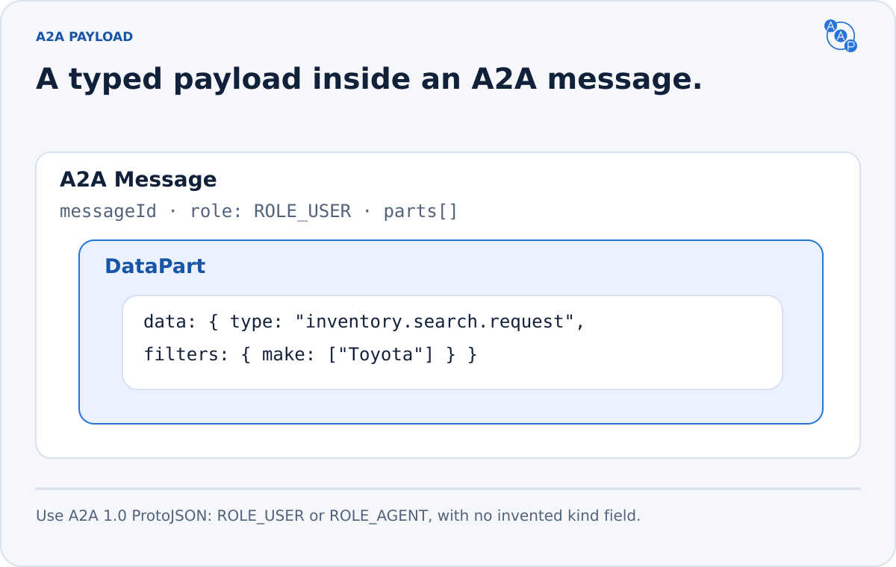

# A2A profile

{/* aap-draft-only:start */}

This is the unreleased **AAP 3.0.0** contract. Draft extension identifiers are replaced during release preparation.

{/* aap-draft-only:end */}

**AAP uses A2A's message-only pattern.** A typed automotive request goes in; a typed automotive response comes back. Inventory calls do not require a Task, Artifact or streaming lifecycle.



The baseline is [A2A 1.0](https://a2a-protocol.org/v1.0.0/specification/), with the canonical [protobuf definitions](https://github.com/a2aproject/A2A/blob/v1.0.0/specification/a2a.proto). Cards and headers use major/minor `1.0`; patch numbers do not select the automotive contract.

## What AAP adds

| A2A surface | AAP requirement |
|---|---|
| Agent Card | The actual AAP skill subset and one required, version-pinned AAP extension |
| Extension `params` | Automotive schema URLs, search capabilities and MCP/PAP/llms links |
| `SendMessage` request | First part is the typed AAP request with its vendor `mediaType` |
| Direct response Message | First part is the matching typed AAP response, with a nonempty `contextId` |
| Errors | Standard A2A detail objects, plus a typed AAP skill error when applicable |

The required extension URI for this contract is:

```text
https://draft.autoagentprotocol.invalid/extensions/aap/latest
```

Portable A2A clients activate that exact URI with `A2A-Extensions`. A contract-pinned AAP endpoint also accepts omission of `A2A-Version` and `A2A-Extensions`, selecting its configured A2A 1.0 interface and exact AAP contract before dispatch. Supplied conflicting values still fail before a skill executes. This [AAP compatibility behavior](./bindings/json-rpc.md#request-headers) extends strict upstream header handling; it does not change the required automotive semantics or allow version fallback.

## Typed data, standard envelope

```json
{
  "data": {
    "type": "inventory.search.request",
    "filters": { "make": ["Honda"], "status": ["available"] },
    "pagination": { "limit": 20 }
  },
  "mediaType": "application/vnd.autoagent.inventory-search-request+json"
}
```

The AAP request is the same object used as MCP `arguments` or a PAP JSON body. Its `type` selects the skill; the surrounding transport does not change filter, pricing or consent semantics.

AAP uses JSON-RPC `SendMessage`, `ROLE_USER` / `ROLE_AGENT`, and A2A 1.0 ProtoJSON member discriminators. There is no `kind` field on Message or Part. Each Message has a unique `messageId`; every server response also includes `contextId`, preserving the authorized interaction context or creating one for an initial request.

The first request/response part MUST contain the matching AAP DataPart. Free-text parts have no AAP protocol semantics and MUST NOT supply filters, consent or other business instructions. Do not dispatch a skill by parsing conversational prose.

## The deliberately small A2A surface

The required A2A binding is JSON-RPC 2.0. Optional A2A streaming, tasks, push notifications and extended cards are outside AAP's required operation set. Clients MUST NOT depend on them. Servers MUST advertise only capabilities they really serve and return the proper A2A error for an unsupported operation.

A2A's removed HTTP+JSON binding in earlier AAP releases is distinct from the current native PAP OpenAPI interface. MCP is a separate first-class binding; it is not an invented A2A transport name.

For complete headers, a copyable exchange and numeric errors, see the [JSON-RPC binding](./bindings/json-rpc.md). For truthful capability publication, see [discovery](./discovery.md). For the same automotive contract through the other interfaces, see [MCP](./bindings/mcp.md) and [PAP](./personal-agent-protocol.md).
