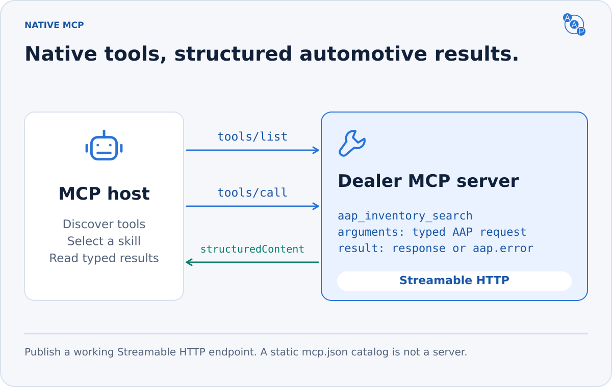

# MCP binding

{/* aap-draft-only:start */}

This is the unreleased **3.0.0** binding. Draft identifiers are replaced when the release is prepared; do not deploy them.

{/* aap-draft-only:end */}



**MCP is a first-class AAP interface.** A server can call its inventory and lead services directly. An A2A hop is optional. All bindings share the same automotive payloads, supported skill subset, inventory scope, consent checks and idempotency store. Verified caller scope remains part of duplicate detection.

## Protocol baseline

An AAP 3.0 MCP endpoint MUST implement Streamable HTTP for **MCP 2026-07-28** and **2025-11-25**. Advertise both actual revisions in discovery; additional revisions are optional. AAP's `3.0.0` release number is separate from these MCP protocol dates and from a server's software version.

| | MCP 2026-07-28 | MCP 2025-11-25 compatibility |
|---|---|---|
| Start | Optional client call to mandatory `server/discover` | `initialize`, then `notifications/initialized` |
| Version and client identity | Required metadata on every request | Negotiated during initialization |
| HTTP headers | `MCP-Protocol-Version`, `Mcp-Method`, and `Mcp-Name` for tool calls | Negotiated `MCP-Protocol-Version` after initialization |
| Completed results | `resultType: "complete"` | No `resultType` field required |
| Protocol sessions | None | Optional `Mcp-Session-Id` |

The current binding follows the [2026-07-28 specification](https://modelcontextprotocol.io/specification/2026-07-28), pinned for review to [upstream commit `dae694f`](https://github.com/modelcontextprotocol/modelcontextprotocol/tree/dae694f61a31f7a3ec2af3aff709e11f70f61e48). The compatibility path follows the [2025-11-25 lifecycle](https://modelcontextprotocol.io/specification/2025-11-25/basic/lifecycle) and [transport](https://modelcontextprotocol.io/specification/2025-11-25/basic/transports). Optional upstream features are required only when advertised.

## Publish a reachable endpoint

Publish a public HTTPS MCP URL on the dealership's own discovery surfaces. It may point to a platform-hosted tenant endpoint, for example `https://api.provider.example/aap/0.0.0-dev/demo-toyota/mcp`.

- Agent Card: `capabilities.extensions[]` → the AAP entry's `params.mcp`.
- Poppy: `extensions["autoagentprotocol.org/aap"].mcp` for a public link; a native `apis` entry only when PAP session support is implemented.
- `/llms.txt`: a Markdown link to the exact endpoint, its access requirements and the AAP contract version.

Do not guess `/mcp` or invent a universal well-known MCP path. Discovery files MUST identify the same dealership, AAP contract and implemented skill subset. See [discovery](../discovery.md).

The endpoint MUST accept POST. Each request uses `Content-Type: application/json` and `Accept: application/json, text/event-stream`. Current clients MUST handle either JSON or request-scoped SSE responses. A server may use JSON for every AAP operation. Validate a supplied `Origin` against the deployment's allowed origins; reject invalid origins with HTTP 403. A missing browser Origin header is not, by itself, evidence of an unauthorized server-side client.

## Discover and list tools

For the current revision:

```http
POST /aap/0.0.0-dev/demo-toyota/mcp HTTP/1.1
Host: api.provider.example
Content-Type: application/json
Accept: application/json, text/event-stream
MCP-Protocol-Version: 2026-07-28
Mcp-Method: server/discover
```

```json
{
  "jsonrpc": "2.0",
  "id": "discover-1",
  "method": "server/discover",
  "params": {
    "_meta": {
      "io.modelcontextprotocol/protocolVersion": "2026-07-28",
      "io.modelcontextprotocol/clientInfo": { "name": "example-buyer", "version": "1.0.0" },
      "io.modelcontextprotocol/clientCapabilities": {}
    }
  }
}
```

The result declares `supportedVersions`, `capabilities.tools`, and server identity under `_meta["io.modelcontextprotocol/serverInfo"]`. Both `server/discover` and `tools/list` results MUST include `ttlMs` (a nonnegative integer) and `cacheScope` (`public` or `private`). Use `private` when visibility depends on authorization, and never share those cached results between authorization contexts. Use `ttlMs: 0` when the result should be immediately stale. The server MUST implement this method; clients may proceed directly to another method with the same required request metadata.

Then call `tools/list`, keeping the version/client metadata and changing `Mcp-Method` to `tools/list`. Follow MCP `nextCursor` until the entire tool list is retrieved. This cursor is distinct from an inventory result's `next_cursor`.

| AAP skill | MCP tool | Side effect |
|---|---|---|
| `dealer.information` | `aap_dealer_information` | Read |
| `inventory.facets` | `aap_inventory_facets` | Read |
| `inventory.search` | `aap_inventory_search` | Read |
| `inventory.vehicle` | `aap_inventory_vehicle` | Read |
| `lead.submit` | `aap_lead_submit` | Consented dealer contact |

The release's `mcp.json` is a **reference tool catalog**, not a live server or a JSON-RPC response. A deployment MUST expose only implemented tools, in a deterministic order. Its inventory search tool MUST add actual `capabilities` under `_meta["autoagentprotocol.org/aap"]`, following `inventory-capabilities.schema.json`. That object MUST match the linked Agent Card.

### Complete schemas, standard hints

Every tool MUST expose:

- An object `inputSchema` that validates the complete typed AAP request, including `type`.
- An object `outputSchema` accepting either the matching typed response or `aap.error`.
- Self-contained JSON Schema 2020-12: referenced definitions are included under `$defs`; no remote fetch is needed to validate a call.
- Standard `annotations` for read-only, destructive, idempotent and open-world behavior. AAP metadata belongs in namespaced `_meta`, not custom annotation keys.
- A meaningful description and AAP metadata containing the release version, skill ID, request/response types and canonical schema URLs.

Read tools use `readOnlyHint: true`. `lead.submit` uses `readOnlyHint: false`, `destructiveHint: false`, and conservatively `idempotentHint: false`: its required key protects retries for at least 24 hours, not indefinitely. Include the actual retention window in the tool description. Every tool uses `openWorldHint: true`. These are descriptive hints; authorization and consent remain enforced by the server.

## Call the shared contract

Set `Mcp-Method: tools/call` and `Mcp-Name: aap_inventory_search`, alongside the headers above:

```json
{
  "jsonrpc": "2.0",
  "id": "search-1",
  "method": "tools/call",
  "params": {
    "_meta": {
      "io.modelcontextprotocol/protocolVersion": "2026-07-28",
      "io.modelcontextprotocol/clientInfo": { "name": "example-buyer", "version": "1.0.0" },
      "io.modelcontextprotocol/clientCapabilities": {}
    },
    "name": "aap_inventory_search",
    "arguments": {
      "type": "inventory.search.request",
      "filters": { "price_max": 35000, "status": ["available"] },
      "pagination": { "limit": 20 },
      "sort": { "field": "price", "order": "asc" },
      "privacy": { "anonymous": true }
    }
  }
}
```

The server MUST validate arguments, authorize the operation, execute the shared skill, and validate the response before returning it. The tool name and payload `type` MUST agree.

A successful current result contains `resultType: "complete"`, `isError: false`, the typed AAP response in `structuredContent`, and its serialized JSON in a text `content` block. The two representations MUST agree. Clients may use either without losing vehicle fields, evidence, pagination or fee semantics. The compatibility result carries the same content without requiring `resultType`.

## Errors that an agent can act on

| Failure | Response |
|---|---|
| Unknown tool or malformed JSON-RPC | MCP protocol error; do not pretend a skill succeeded. |
| Invalid arguments to a known tool, unsupported filters, expired cursor, unavailable vehicle, missing consent | Completed tool result with `isError: true`; typed `aap.error` in `structuredContent` and matching serialized text. |
| Invalid or missing authorization | HTTP 401 with MCP authorization discovery challenge; no skill execution. |
| Insufficient scope | HTTP 403 with the applicable OAuth challenge; no skill execution. |
| HTTP-level throttling | HTTP 429 and `Retry-After`. |
| Skill-level quota | `aap.error` / `RATE_LIMITED`, `isError: true`, and `details.retry_after_ms`. |

The output schema's success/error union keeps structured failures valid. `isError` MUST agree with the payload: true for `aap.error`, false for a successful skill response. Include request paths and a concrete correction in `details`; never include credentials, customer values or internal stack traces.

In the current revision, mismatched or missing required metadata headers return HTTP 400 with `HeaderMismatch` (`-32020`). An unsupported protocol date returns HTTP 400 with `UnsupportedProtocolVersionError` (`-32022`) and supported versions. The body and mirrored headers MUST agree. Correct the request instead of interpreting these errors as a signal to drop into an older protocol.

## Host schema compatibility

MCP permits JSON Schema 2020-12 composition and conditionals. Some Claude Code builds have been reported to drop tools with these keywords at the **input schema root**, or to receive an Anthropic API error: [current report](https://github.com/anthropics/claude-code/issues/95504), [earlier API error](https://github.com/anthropics/claude-code/issues/27337). This is a host limitation, not an invalid MCP contract, and does not establish failure in every Claude product or Instinct.

The generated catalog places root input constraints under `dependentSchemas.type`. Every AAP request already requires its `type` discriminator, so those constraints still validate the **whole request object** whenever it can be valid. The arguments, property descriptions, examples and accepted/rejected payloads stay the same; no wrapper, alternate skill name or second automotive schema is introduced. The generator refuses this transformation if the required discriminator is absent. Servers MUST retain complete canonical request validation, including consent, identifiers and geography.

Repository checks compare the generated and canonical validators on valid and malformed requests and exercise both pinned official MCP clients. These are not a Claude-host certification. Before advertising a supported host, verify that all implemented tools appear and that search, vehicle detail and consented lead calls reach the server. If a host still rejects `dependentSchemas`, `$defs` or other standard keywords, use a client supporting the complete schema (the pinned official clients are covered), or a separately tested host adapter that preserves the arguments and canonical server validation. Report the unsupported host/build explicitly; never silently remove tools or weaken the automotive contract.

## Existing clients

For 2025-11-25, accept `initialize` with `protocolVersion`, `clientInfo` and `capabilities`; return that supported version, `serverInfo` and `capabilities.tools`. Accept `notifications/initialized` with HTTP 202 and no body. Subsequent requests send the negotiated protocol header. Keep tool arguments, schemas and AAP results identical to the current binding.

A legacy server may issue an MCP session ID. It is transport state, never a replacement for authorization or a PAP Session Token. If issued, enforce its lifecycle under the legacy specification. The current 2026-07-28 path does not create protocol sessions. Do not require legacy initialization or a session ID on a current request.

Use the upstream [HTTP compatibility rules](https://modelcontextprotocol.io/specification/2026-07-28/basic/transports/streamable-http#backward-compatibility) when supporting both client generations. Do not retry a consented write on a different binding with a new idempotency key after an uncertain result.

## Public reads and PAP sessions

Public inventory reads SHOULD work without customer sign-in or personal information. An operator may require MCP OAuth credentials; it MUST disclose that requirement and publish protected resource metadata rather than an undocumented API-key prerequisite.

A public MCP link in the AAP Poppy extension does **not** claim native PAP authorization. Advertising `apis: [{"type":"mcp", ...}]` in `poppy.json` additionally requires the [PAP MCP rules](../personal-agent-protocol.md#6-optional-poppy-surfaces): resource-bound Session Tokens, protected resource metadata, authorization-server discovery, and scope enforcement. New MCP servers SHOULD support DPoP; the PAP exception for an existing MCP server without DPoP permits a Bearer Session Token only at that server's exact resource URL.

PAP clients MUST send their Session Token to a native PAP MCP API. Generic MCP clients use standard MCP OAuth. A token issued for MCP MUST NOT be forwarded to an A2A or OpenAPI endpoint, or to another tenant. An adapter authenticates to its downstream service according to that service's own audience and policy.

`lead.submit` always requires explicit contact consent and a stable idempotency key. MCP tool selection, OAuth consent, a PAP session or an agent's `source_agent` label cannot substitute for the buyer's contact consent.

## Implement once; verify each binding

Route every binding to the same schema validators and automotive operations. A direct MCP implementation is sufficient; an A2A adapter must additionally set the downstream `A2A-Version: 1.0` and exact `A2A-Extensions` URI. Never send those activation headers as a substitute for MCP metadata.

Record correlation ID, actual binding, MCP revision, AAP version, skill, outcome code and latency. Exclude raw arguments, customer data, tokens and proofs. Verify modern and legacy tool discovery, every implemented skill, schema errors, consent rejection, duplicate suppression, tenant isolation and throttling before publication. See [conformance](../conformance.md).
