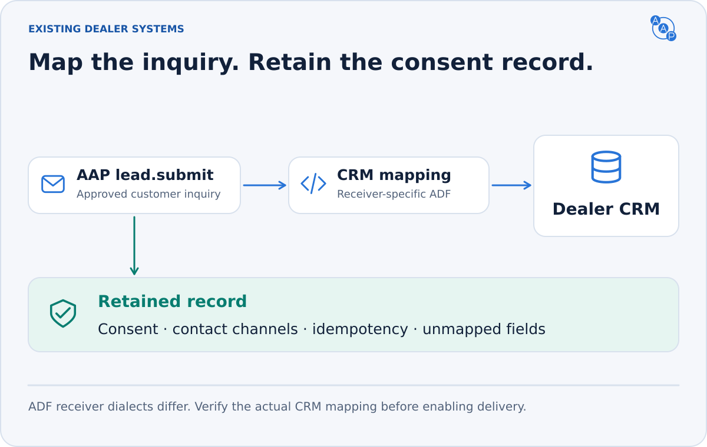

# ADF/XML mapping



**Connect the lead to an existing CRM workflow.** A dealer-side adapter maps AAP JSON to ADF/XML after validation, consent and deduplication. The buyer agent keeps using MCP, A2A or PAP.

ADF does not preserve every AAP field as structured data. Keep the original AAP request, ConsentGrant and delivery/idempotency record alongside the XML. A CRM-specific implementation must enforce allowed contact channels and verify its delivery behavior.

The [ADF 1.0 specification](https://ldti.syndication.kbb.com/reference/files/ADF_1.0_XML_Specification.pdf) is the baseline. Its prose and appendix contain inconsistencies; [Kelley Blue Book's implementation notes](https://ldti.syndication.kbb.com/reference/adf_s.html) also call out receiver variations. Validate against the receiving CRM's documented profile rather than promising universal lossless conversion.

## Mapping table

<details>
<summary>Field-by-field AAP → ADF mapping</summary>

| AAP field (`lead.submit.request`) | ADF element / attribute | Notes |
|---|---|---|
| `customer.first_name` + `customer.last_name` | `<customer><contact><name part="full">{first} {last}</name></contact></customer>` | ADF expects a full-name node; AAP keeps first/last separate. The mapper concatenates with a single space. |
| `customer.email` | `<customer><contact><email>...</email></contact></customer>` | RFC 5322 email. |
| `customer.phone` | `<customer><contact><phone>...</phone></contact></customer>` | E.164 phone (e.g. `+14155550123`). ADF allows free-form phones; AAP normalizes to E.164. |
| `customer.address.address_line_1` / `_2` | `<customer><contact><address><street line="1">...</street><street line="2">...</street></address></contact></customer>` | Optional. |
| `customer.address.city` | `<customer><contact><address><city>...</city></address></contact></customer>` | Optional. |
| `customer.address.state` | `<customer><contact><address><regioncode>...</regioncode></address></contact></customer>` | Optional. ADF uses `<regioncode>`; AAP uses `state`. |
| `customer.address.zip` | `<customer><contact><address><postalcode>...</postalcode></address></contact></customer>` | Optional. ADF uses `<postalcode>`; AAP uses `zip`. The ADF mapper writes `<country>` from `customer.address.country` when provided, defaulting to `US` otherwise. |
| `vehicle_of_interest.year` / `make` / `model` | `<vehicle interest="buy"><year>...</year><make>...</make><model>...</model></vehicle>` | ADF requires these fields. Use known request data or a verified dealer listing; never invent missing values. |
| `vehicle_of_interest.trim` | `<vehicle interest="buy"><trim>...</trim></vehicle>` | Optional. |
| `vehicle_of_interest.vin` | `<vehicle interest="buy"><vin>...</vin></vehicle>` | Optional but recommended. |
| `vehicle_of_interest.stock` | `<vehicle interest="buy"><stock>...</stock></vehicle>` | Optional. |
| `vehicle_of_interest.condition` | `<vehicle interest="buy" status="...">` (one of `new`, `used`) | ADF accepts only `new` or `used`. AAP `cpo` MAPS TO `status="used"` AND a free-text `<comments>certified pre-owned</comments>` on the vehicle. |
| `vehicle_of_interest.body` | `<vehicle interest="buy"><bodystyle>...</bodystyle></vehicle>` | Optional. Applies to any `vehicle_type`: a car body style (e.g. `sedan`, `suv`) or a motorcycle segment (e.g. `cruiser`, `touring`) — both go into ADF's `<bodystyle>` since ADF has no motorcycle-specific element. |
| `vehicle_of_interest.displacement_cc` | `<vehicle interest="buy"><comments>Displacement: {cc}cc</comments></vehicle>` | Optional. ADF has no displacement element, so the mapper folds it into vehicle `<comments>`. Any niche specs carried in `other_attributes` (e.g. `wheel_count`, `final_drive`, `engine_stroke`) are handled the same way — folded into `<comments>`. |
| `vehicle_of_interest.transmission` | `<vehicle interest="buy"><transmission>...</transmission></vehicle>` | Optional. ADF expects `A` or `M`; the mapper folds `automatic`/`manual` (and variants like `8-speed automatic`) accordingly. |
| `vehicle_of_interest.mileage` | `<vehicle interest="buy"><odometer units="mi">...</odometer></vehicle>` | Optional; typical for used. |
| `vehicle_of_interest.price` | `<vehicle interest="buy"><price type="asking" currency="USD">...</price></vehicle>` | Mapped from the AAP integer dollar amount (whole US dollars). |
| `appointment.appointment_type` | Implicit on the parent vehicle's `interest`: `test_drive` → `<vehicle interest="test-drive">`; `trade_in` → the `<vehicle interest="trade-in">` block; `sales` / `service` → the appointment lives in `<comments>` of the customer block. | ADF predates structured appointments. |
| `appointment.appointment_at` | `<customer><comments>Requested appointment: 2026-05-03 11:00 PT</comments></customer>` | Free-text in `<comments>`; CRMs route to the appointment desk. |
| `submitted_at` | `<requestdate>...</requestdate>` | ISO 8601 (e.g. `2026-04-30T10:15:10Z`). |
| `message` | `<customer><comments>...</comments></customer>` | Free-text user message. |
| `source_agent.name` | `<provider><name part="full">{source_agent.name}</name></provider>` | Identifies the originating buyer agent (e.g. `example-buyer`). `source_agent` has been an object since v1.1.0; only its `name` maps here. **Direct integration:** put `source_agent.name` in `<provider><name part="full">`. **Lead-network delivery:** when an intermediary (e.g. the AAP platform) delivers the ADF, it MAY instead set `<provider><name part="full">` to the network brand, carry `source_agent.name` in `<provider><service>`, and add `<provider><url>` for the network — `<vendor>` always stays the selling dealership either way. |
| Dealer name (from the `dealer.information` rooftop `name`) | `<vendor><vendorname>...</vendorname></vendor>` | Dealer agent fills this from its own profile, not from the buyer agent. |
| `trade_in.year` / `make` / `model` / `trim` | A second `<vehicle interest="trade-in">...</vehicle>` block with `<year>`, `<make>`, `<model>`, `<trim>` | Trade-in vehicle goes in its own ADF `<vehicle>` block. |
| `trade_in.mileage` | `<vehicle interest="trade-in"><odometer units="mi">...</odometer></vehicle>` | Strongly recommended; ADF `<odometer>`. |
| `trade_in.condition` | Vehicle `<comments>` in the portable mapping | ADF prose defines `<condition>`, but its appendix omits it from the vehicle content model. Use a receiver-approved condition element only when that CRM supports it. |
| `trade_in.vin` | `<vehicle interest="trade-in"><vin>...</vin></vehicle>` | Optional; recommended for accurate appraisal. |

</details>

Nothing in `consent` is part of ADF (the format predates structured agent consent). AAP's `ConsentGrant` is preserved alongside the lead in the dealer CRM as an audit record. AAP-specific fields without an ADF equivalent (`customer.preferred_contact`, `vehicle_of_interest.vehicle_id`, `vehicle_of_interest.msrp`/`list_price`) MAY be persisted as CRM extension fields or in `<comments>`.

> **One `<comments>` per `<vehicle>`.** ADF allows only a single `<comments>` element inside each `<vehicle>` block. Several rows above independently fold into vehicle `<comments>` — the `cpo` certified note, `displacement_cc`, and any `other_attributes` (e.g. `wheel_count`, `final_drive`, `engine_stroke`). The mapper MUST **merge** all of these into ONE `<comments>` element per vehicle (e.g. `certified pre-owned; Displacement: 1868cc; final_drive: belt`). A literal row-by-row reading that emits multiple `<comments>` per vehicle produces invalid ADF — e.g. for a CPO motorcycle that has both a certified note and displacement/`other_attributes`.

## Concrete worked example

<details>
<summary>Consented test-drive inquiry with a trade-in, then its XML mapping</summary>

Given a [`lead.submit`](../skills/lead-submit.md) request bundling a vehicle of interest, a trade-in, and a test-drive appointment:

```json
{
  "type": "lead.submit.request",
  "customer": {
    "first_name": "Anna",
    "last_name": "Lee",
    "email": "anna@example.com",
    "phone": "+14155550123",
    "preferred_contact": "email",
    "address": {
      "address_line_1": "200 Folsom St",
      "city": "San Francisco",
      "state": "CA",
      "zip": "94105"
    }
  },
  "consent": {
    "granted_at": "2026-04-30T10:15:00Z",
    "allowed_channels": ["email", "phone"],
    "consent_text": "I agree to share my contact info with Demo Toyota about this 2022 Honda Civic, my Sunday test drive, and my Toyota Corolla trade-in.",
    "scope": ["lead_submission"]
  },
  "vehicle_of_interest": {
    "vin": "1HGCV1F30KA000001",
    "year": 2022, "make": "Honda", "model": "Civic", "trim": "EX",
    "condition": "cpo",
    "body": "sedan",
    "transmission": "automatic"
  },
  "trade_in": {
    "year": 2014, "make": "Toyota", "model": "Corolla",
    "condition": "good",
    "mileage": 96000
  },
  "appointment": {
    "appointment_type": "test_drive",
    "appointment_at": "2026-05-03T18:00:00Z"
  },
  "message": "Interested in this Civic; can you confirm availability and best price with my trade?",
  "source_agent": {
    "name": "example-buyer",
    "url": "https://buyer.example",
    "agent_card_url": "https://buyer.example/.well-known/agent-card.json"
  },
  "submitted_at": "2026-04-30T10:15:10Z",
  "idempotency_key": "demo-consented-lead-1042"
}
```

The dealer-side ADF/XML payload is:

```xml
<?adf version="1.0"?>
<adf>
  <prospect>
    <requestdate>2026-04-30T10:15:10Z</requestdate>

    <vehicle interest="test-drive" status="used">
      <year>2022</year>
      <make>Honda</make>
      <model>Civic</model>
      <vin>1HGCV1F30KA000001</vin>
      <trim>EX</trim>
      <bodystyle>sedan</bodystyle>
      <transmission>A</transmission>
      <comments>certified pre-owned</comments>
    </vehicle>

    <vehicle interest="trade-in">
      <year>2014</year>
      <make>Toyota</make>
      <model>Corolla</model>
      <odometer units="mi">96000</odometer>
      <comments>Trade-in condition reported by the buyer: good.</comments>
    </vehicle>

    <customer>
      <contact>
        <name part="full">Anna Lee</name>
        <email>anna@example.com</email>
        <phone>+14155550123</phone>
        <address>
          <street line="1">200 Folsom St</street>
          <city>San Francisco</city>
          <regioncode>CA</regioncode>
          <postalcode>94105</postalcode>
          <country>US</country>
        </address>
      </contact>
      <comments>Interested in this Civic; can you confirm availability and best price with my trade? Requested test-drive: 2026-05-03 11:00 PT.</comments>
    </customer>

    <vendor>
      <vendorname>Demo Toyota</vendorname>
      <contact>
        <name part="full">Sales</name>
        <phone>+14155550100</phone>
      </contact>
    </vendor>
    <provider>
      <name part="full">example-buyer</name>
    </provider>
  </prospect>
</adf>
```

</details>

- `condition: "cpo"` becomes `<vehicle status="used">` PLUS `<comments>certified pre-owned</comments>`. Plain ADF has no certified value.
- `appointment.appointment_type: "test_drive"` becomes `interest="test-drive"` on the `vehicle_of_interest` block. AAP `trade_in` maps to a second `<vehicle interest="trade-in">`.
- `appointment.appointment_at` is folded into the customer `<comments>` since ADF has no native appointment element.
- The dealer name `Demo Toyota` is filled from the dealer agent's own profile, not from the buyer agent's request.
- The user `message` and the appointment time land in customer `<comments>`.
- This example shows **direct** delivery, so `source_agent` (`example-buyer`) is the `<provider><name>`. Under **lead-network** delivery the network brand is the `<provider><name>` and `example-buyer` rides in `<provider><service>` (see the `source_agent` row above); `<vendor>` is the selling dealership in both cases.

## What does NOT map to ADF

The ADF format predates structured agent consent. AAP's `consent` (`ConsentGrant`) is preserved alongside the lead in the dealer CRM as an audit record but does not have an ADF equivalent. Dealers typically:

- Persist the full `ConsentGrant` JSON in a separate consent table or audit log.
- Surface `consent.allowed_channels` to the dealer's BDC or CRM rules engine to decide which channels to actually use for follow-up (and to refuse unauthorized channels).

`consent` MUST NOT be silently dropped. The dealer must retain and enforce the AAP authorization record independently of ADF delivery.

## Partial leads and delivery

AAP accepts customer-only and partial-vehicle inquiries. ADF's minimum vehicle fields may therefore be unavailable. Use verified enrichment or the receiving CRM's native general-inquiry route. Do not fabricate a vehicle or label a nonconforming placeholder as standard ADF.

Escape all customer and dealer text as XML data. Preserve character encoding and explicit timezone offsets. Merge vehicle notes into one comments element, keep vendor before provider, and confirm the receiver's required contact fields.

Deduplicate before sending XML; an uncertain SMTP/HTTP acknowledgement is not permission to create another lead. Record delivery correlation separately from the shopper-facing lead ID. AAP does not prescribe the CRM's delivery transport, and an XML export does not prove an appointment was booked.
