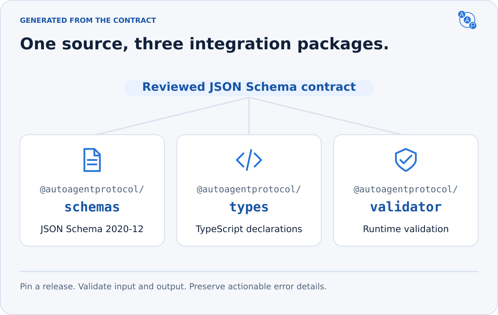
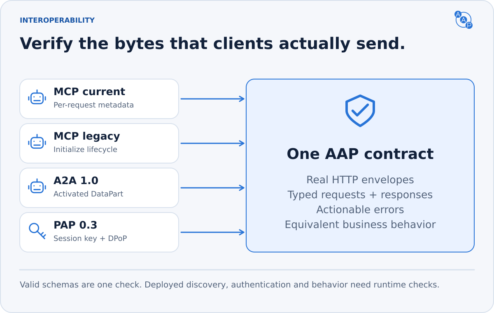

# Conformance and verification

**This page describes the unreleased AAP 3.2 draft.** Frozen AAP 3.1 keeps its [published conformance rules](https://autoagentprotocol.org/docs/v3.1/conformance). AAP 3.2.0 is the approved release target for published PAP 0.3; the next AAP major is reserved for PAP 1.0. Full dealer-deployment conformance requires MCP, A2A and PAP OpenAPI, consistent dealer-domain discovery, and every mandatory behavior for the skills advertised.



## Scope of draft conformance

| Surface | Required baseline |
|---|---|
| Shared automotive contract | Shared AAP schemas, explicit currency/odometer contexts, evidence, pricing, consent, pagination and retry semantics |
| MCP | Streamable HTTP, 2026-07-28 and 2025-11-25 compatibility; complete tool schemas and structured outcomes |
| A2A | A2A 1.0 JSON-RPC `SendMessage`, exact extension activation and canonical ProtoJSON |
| PAP | Published PAP 0.3; delegated per-request Session JWTs and native automotive OpenAPI |
| Discovery | Dealer-domain Agent Card, Poppy document and `llms.txt`, all identifying the same deployment and capabilities |

A dealer implements one or more of the five skills and exposes the same subset through all three bindings. Feature filters additionally require `inventory.facets`. A buyer client needs only the binding it uses and the selected AAP contract.

An MCP-only implementation may say “implements the selected AAP MCP binding.” It must not claim full dealer-deployment conformance. Optional PAP accounts, conversations, feedback and native PAP authorization for MCP are required only when advertised. Supporting a protocol transport alone does not establish automotive conformance or universal assistant compatibility.

## Evidence in this repository



| Verification | What it proves |
|---|---|
| JSON Schema and typed examples | Local references resolve; published request, response, discovery and authentication examples validate |
| Cross-document discovery | Contract, skill subset, endpoint identity and search capability declarations agree |
| Current and legacy official MCP clients | Real HTTP discovery and all five tool calls; complete self-contained schemas; structured skill failures |
| Pinned upstream MCP schema | Current protocol request/results include required metadata, completion state and caching fields |
| Official A2A JavaScript SDK | Real HTTP Agent Card discovery, five skills, tenant/header propagation and standard error details |
| Independent ProtoJSON decoder | Standard Any details decode and round-trip through the official protobuf parser |
| PAP contract and generated OpenAPI | Pinned upstream schemas, Company/issuer selection, delegation/Session claim rules, HTTP 400 recovery and shared automotive payloads |
| Release and website checks | Immutable snapshots, package exports, stable aliases, links, generated images and published artifacts |

The PAP helpers check decoded structures and relationships; they are not cryptographic verifiers. Optional unadvertised surfaces are not certified by the fixture subset. These checks validate the specification and protocol fixtures. They do **not** certify a live dealership, production authorization service, consent event or CRM delivery. The pinned upstream sources are linked from the [MCP](./bindings/mcp.md), [A2A](./a2a-profile.md) and [PAP](./personal-agent-protocol.md) pages.

## Required deployment acceptance cases

Run these before advertising the new draft binding or a subsequently approved release. Use isolated inventory and a non-delivering lead sink for mutation cases.

| Area | Verify |
|---|---|
| Dealer discovery | All three entry points resolve over HTTPS; redirects preserve final PAP identity; linked endpoints and versioned schemas exist |
| Fresh agent onboarding | Give a supported agent only the dealer hostname. It discovers the exact advertised MCP endpoint, lists implemented tools and completes a public inventory search without private setup instructions. Target under one minute; record elapsed time, host/build and the actual transport used |
| Capability truth | Same implemented subset and search capabilities on all bindings; no template servers or unimplemented filters |
| MCP versions | Current metadata/header agreement, `server/discover`, caching and tools; current calls without optional `clientInfo` work; omitted mirror headers are inferred from the body; legacy initialize/initialized flow; no legacy Session requirement on current calls |
| Minimal client requirements | All five skills accept omitted redundant headers under the AAP ingress rules: A2A defaults only on a contract-pinned endpoint; MCP derives copies from the body or this client's negotiated session. Supplied conflicts fail before execution. Public MCP needs no PAP credentials or browser Origin and accepts JSON-only responses; protected PAP requires its delegated Session JWT |
| A2A activation | Correct version, exact extension, tenant routing, canonical Messages; missing/mismatched values fail before execution |
| PAP identity | Real HTTPS CIMD/JWKS with no CIMD redirects; safe DNS resolution; exact client, final dealer host, domain metadata and bidirectional issuer authorization; issuer absence distinguished from failure |
| PAP Sessions and DPoP | Independently signed delegation and Session JWT; direct identity-key signing rejected; key thumbprint, ≤24-hour delegation, freshness, method/URL, exact audience; same client_id + sid preserves User/Agent IDs; key rotation accepted; expired/ended Sessions return safe HTTP 400; documented replay policy tested across replicas |
| PAP token responses | Signed-out requests obtain no guest token and omit ath; optional OAuth Bearer/DPoP access token has matching ath and client; independently validate token and any DPoP proof; reject anonymous-browsing token use |
| PAP issuer and scopes | Exact selected issuer and protected_resources domain; existing issuer with disabled sign-in keeps identity; refresh grant required, direct/device endpoints conditional; scopes may narrow but never expand; unknown hints conservative |
| Native PAP MCP, if advertised | Listed resource URL and issuer match; Session header plus ordinary resource-appropriate OAuth where required; no mandatory legacy exchange; reject cross-resource/tenant forwarding |
| PAP sign-in, if advertised | PKCE/state/issuer, confidential CIMD client assertions, direct/device grant requirements, optional DPoP, scope reduction, refresh rotation, account mismatch, revocation and explicit sign-out honored |
| Browser join, if advertised | Own-browser code and protected cookie; short-lived one-use code; separate Session-authenticated /authorize step; first redemption consumed even on failure; isolation headers; correct pre-existing-login and joined-cookie behavior under upstream §6 |
| Exclusions and feedback, if advertised | Public excluded-task lookup; alternatives only reference advertised APIs; clients accept 200 alternative and empty 202; Company text never supplies instructions or consent |
| Tenant and credential isolation | Another dealer cannot see private inventory or leads; no token forwarding across redirects, resources or tenants |
| Search completeness | Every constraint applied; unsupported filters rejected; cursor continuation reaches all matches without hidden caps; changed/expired cursors fail |
| Features and geography | Known feature vocabulary, source evidence, unknown-data handling, correct radius boundary and stable distance ordering |
| Aggregate identity | Each result's endpoint-unique vehicle ID resolves the same seller and listing; duplicate VINs/stock numbers never choose an arbitrary dealer; `dealer.information` resolves its dealer ID to the actual recipient before consent; unknown IDs fail and mismatched identities stop delivery |
| Inventory and pricing | Current eligible status, real update timestamp, stable identifier, authoritative fee-inclusive price; unknown price stays unknown |
| Currency and units | USD/mi omission defaults; explicit CAD/km vehicle, rooftop and query labels; Canadian capability defaults; unsupported currency errors; same country with different currencies or odometers; no mixed-currency price ranges or sorting; exact mi/km mileage boundaries and null handling; `_mi` fields stay miles; both contexts bind cursors; all three bindings return equivalent native numbers |
| Consent | Missing/invalid/expired grants fail before delivery; every permitted channel has contact data; no unauthorized follow-up |
| Concurrent retries | Lose the first response, then retry: one delivery and the complete original received/rejected outcome, booking details and message with replayed=true; changed payload conflicts; concurrent calls, Session renewal and correlated bindings share the result |
| Appointment outcome | `confirmed` has a real booking and time; alternatives are explicit; partial success never hides an accepted lead |
| Errors and throttling | Correct protocol envelope/status, safe field diagnostics, Retry-After/retry timing and bounded client behavior |
| Optional surfaces | Every advertised PAP sign-in, native MCP, browser, feedback or conversation feature passes its complete upstream rules |

Also reject peer-supplied metadata or endpoint URLs resolving to private, loopback or link-local addresses unless explicitly configured for a trusted local deployment. Do not automatically forward authenticated requests after endpoint redirects.

## Run the repository checks

Use Node.js 22+ and pnpm 10, with one heavy command at a time:

```bash
pnpm install --frozen-lockfile
pnpm validate
pnpm test:contract
pnpm typecheck
pnpm check:images
pnpm check:releases
pnpm test:release
pnpm --filter @autoagentprotocol/schemas build
pnpm --filter @autoagentprotocol/types build
pnpm --filter @autoagentprotocol/validator build
pnpm check:packages
pnpm build
pnpm check:branding --build
pnpm freeze-check --base origin/main
```

The independent protobuf check uses Python 3.10+ in a virtual environment:

```bash
python -m pip install -r tools/protojson-requirements.txt
python tools/validate-protojson-errors.py
```

Operators can additionally use the pinned [PAP Company implementation kit](https://github.com/personal-agent-protocol/personal-agent-protocol/tree/6fb46d381ac1b94265795132af13848ec442b6f6/kit/company) against their authenticated deployment. Schema acceptance cannot prove signature verification, replay stores, live TLS or consent.

Publish the frozen contract before a runtime advertises it. A release number describes the specification; the operator's verified behavior establishes deployment conformance.
