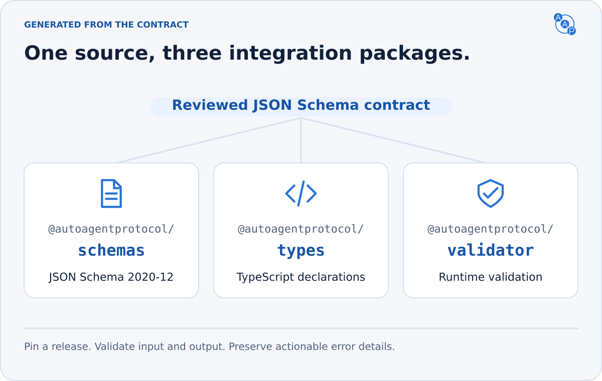
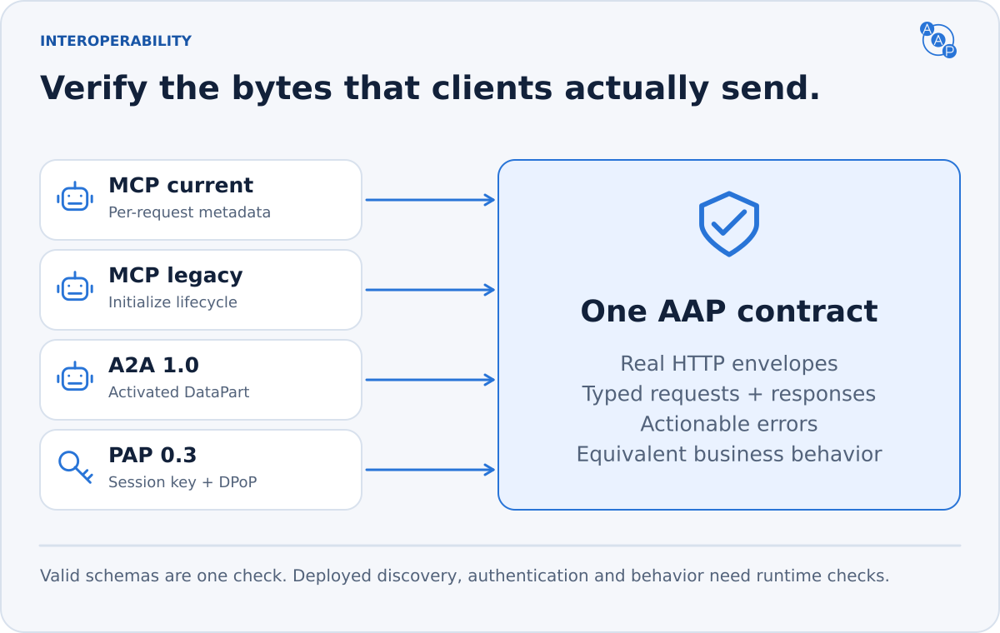

# Conformance and verification

**AAP 3.0 is a complete automotive contract with three native interfaces.** Full dealer-deployment conformance requires MCP, A2A and PAP OpenAPI, consistent dealer-domain discovery, and every mandatory behavior for the skills advertised.



## What “supports AAP 3.0” means

| Surface | Required baseline |
|---|---|
| Shared automotive contract | AAP 3.0 schemas, evidence, pricing, consent, pagination and retry semantics |
| MCP | Streamable HTTP, 2026-07-28 and 2025-11-25 compatibility; complete tool schemas and structured outcomes |
| A2A | A2A 1.0 JSON-RPC `SendMessage`, exact extension activation and canonical ProtoJSON |
| PAP | Personal Agent Protocol draft 0.2; verified guest Sessions, DPoP and native automotive OpenAPI |
| Discovery | Dealer-domain Agent Card, Poppy document and `llms.txt`, all identifying the same deployment and capabilities |

A dealer implements one or more of the five skills and exposes the same subset through all three bindings. Feature filters additionally require `inventory.facets`. A buyer client needs only the binding it uses and the selected AAP contract.

An MCP-only implementation may say “implements the AAP 3.0 MCP binding.” It must not claim full dealer-deployment conformance. Optional PAP accounts, conversations, feedback and native PAP authorization for MCP are required only when advertised. Supporting a protocol transport alone does not establish automotive conformance or universal assistant compatibility.

## Evidence in this repository



| Verification | What it proves |
|---|---|
| JSON Schema and typed examples | Local references resolve; published request, response, discovery and authentication examples validate |
| Cross-document discovery | Contract, skill subset, endpoint identity and search capability declarations agree |
| Current and legacy official MCP clients | Real HTTP discovery and all five tool calls; complete self-contained schemas; structured skill failures |
| Pinned upstream MCP schema | Current protocol request/results include required metadata, completion state and caching fields |
| Official A2A JavaScript SDK | Real HTTP Agent Card discovery, five skills, tenant/header propagation and standard error details |
| Independent ProtoJSON decoder | Standard Any details decode and round-trip through the official protobuf parser |
| PAP contract and generated OpenAPI | Correct issuer/client/session shapes, identity rules, DPoP declarations and shared automotive payloads |
| Release and website checks | Immutable snapshots, package exports, stable aliases, links, generated images and published artifacts |

These checks validate the specification and protocol fixtures. They do **not** certify a live dealership, production authorization service, consent event or CRM delivery. The pinned upstream sources are linked from the [MCP](./bindings/mcp.md), [A2A](./a2a-profile.md) and [PAP](./personal-agent-protocol.md) pages.

## Required deployment acceptance cases

Run these before advertising AAP 3.0. Use isolated inventory and a non-delivering lead sink for mutation cases.

| Area | Verify |
|---|---|
| Dealer discovery | All three entry points resolve over HTTPS; redirects preserve final PAP identity; linked endpoints and versioned schemas exist |
| Capability truth | Same implemented subset and search capabilities on all bindings; no template servers or unimplemented filters |
| MCP versions | Current metadata/header agreement, `server/discover`, caching and tools; current calls without optional `clientInfo` work; legacy initialize/initialized flow; no legacy Session requirement on current calls |
| Minimal client requirements | Public MCP reads work without A2A headers, PAP credentials or browser Origin; no extra AAP headers; legacy and current header rules remain separate; native PAP needs no A2A or MCP activation headers |
| A2A activation | Correct version, exact extension, tenant routing, canonical Messages; missing/mismatched values fail before execution |
| PAP identity | Real published client metadata/JWKS; two distinct valid assertions; exact issuer audiences; final authorized domain |
| PAP Sessions and DPoP | Create, call and renew; expiry, replay, nonce, wrong method/URL/token hash, wrong owner and wrong resource fail correctly |
| Tenant and credential isolation | Another dealer cannot see private inventory or leads; no token forwarding across redirects, resources or tenants |
| Search completeness | Every constraint applied; unsupported filters rejected; cursor continuation reaches all matches without hidden caps; changed/expired cursors fail |
| Features and geography | Known feature vocabulary, source evidence, unknown-data handling, correct radius boundary and stable distance ordering |
| Aggregate identity | Each result's endpoint-unique vehicle ID resolves the same seller and listing; duplicate VINs/stock numbers never choose an arbitrary dealer; `dealer.information` resolves its dealer ID to the actual recipient before consent; unknown IDs fail and mismatched identities stop delivery |
| Inventory and pricing | Current eligible status, real update timestamp, stable identifier, authoritative fee-inclusive price; unknown price stays unknown |
| Consent | Missing/invalid/expired grants fail before delivery; every permitted channel has contact data; no unauthorized follow-up |
| Concurrent retries | Lose the first response, then retry: one delivery and the complete original received/rejected outcome, booking details and message with replayed=true; changed payload conflicts; concurrent calls, Session renewal and correlated bindings share the result |
| Appointment outcome | `confirmed` has a real booking and time; alternatives are explicit; partial success never hides an accepted lead |
| Errors and throttling | Correct protocol envelope/status, safe field diagnostics, Retry-After/retry timing and bounded client behavior |
| Optional surfaces | Every advertised PAP sign-in, native MCP, browser, feedback or conversation feature passes its complete upstream rules |

Also reject peer-supplied metadata or endpoint URLs resolving to private, loopback or link-local addresses unless explicitly configured for a trusted local deployment. Do not automatically forward authenticated requests after endpoint redirects.

## Run the repository checks

Use Node.js 22+ and pnpm 10, with one heavy command at a time:

```bash
pnpm install --frozen-lockfile
pnpm validate
pnpm test:contract
pnpm typecheck
pnpm check:images
pnpm check:releases
pnpm test:release
pnpm --filter @autoagentprotocol/schemas build
pnpm --filter @autoagentprotocol/types build
pnpm --filter @autoagentprotocol/validator build
pnpm check:packages
pnpm build
pnpm check:branding --build
pnpm freeze-check --base origin/main
```

The independent protobuf check uses Python 3.10+ in a virtual environment:

```bash
python -m pip install -r tools/protojson-requirements.txt
python tools/validate-protojson-errors.py
```

Operators can additionally use the pinned [PAP Company implementation kit](https://github.com/personal-agent-protocol/personal-agent-protocol/tree/39b35bdf240fc07f157d6ca4e29b5a41d4b36b5d/kit/company) against their authenticated deployment. Schema acceptance cannot prove signature verification, replay stores, live TLS or consent.

Publish the frozen contract before a runtime advertises it. A release number describes the specification; the operator's verified behavior establishes deployment conformance.
