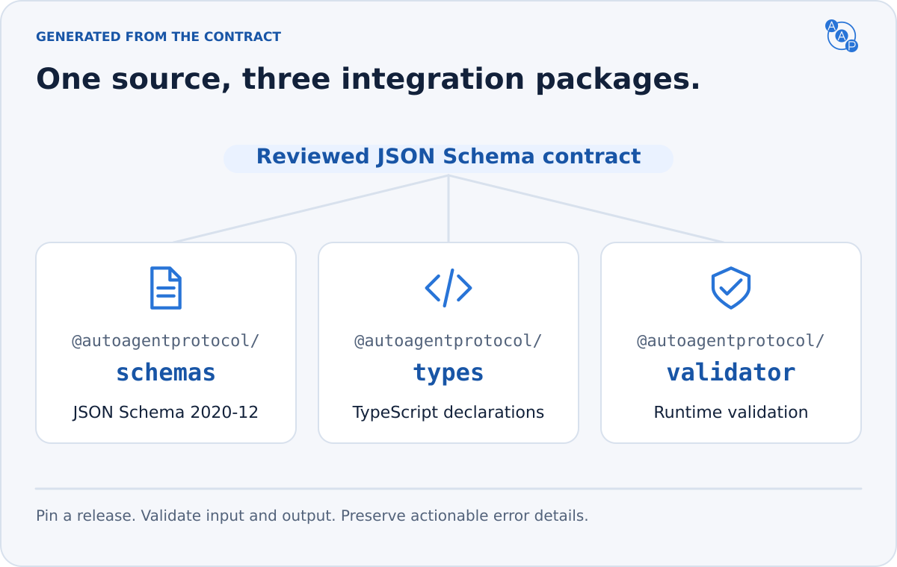
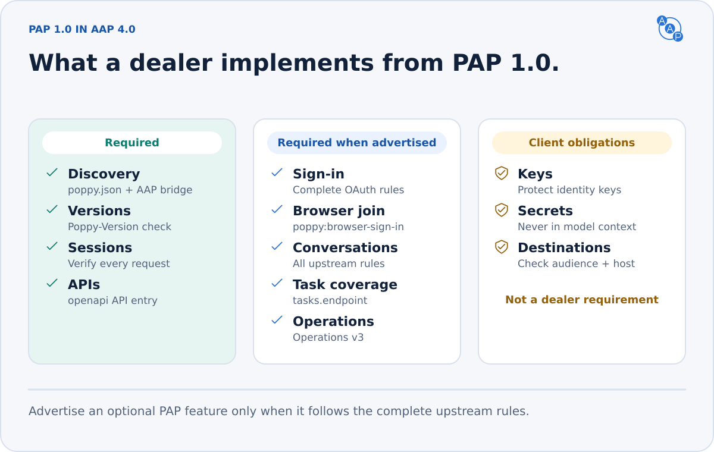
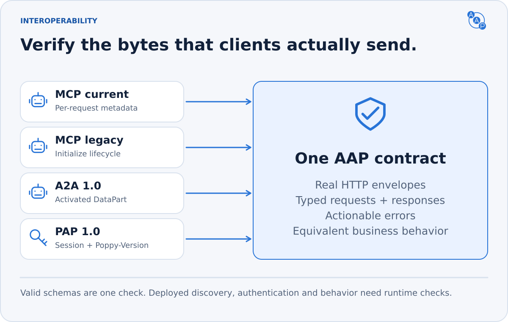

# Conformance and verification

**This page defines AAP 4.0 conformance.** Frozen AAP 3.2 keeps its [published conformance rules](https://autoagentprotocol.org/docs/v3.2/conformance). AAP 4.0.0 adopts PAP 1.0. Full dealer-deployment conformance requires MCP, A2A and PAP OpenAPI, consistent dealer-domain discovery, and every mandatory behavior for the skills advertised.



## Scope of AAP 4.0 conformance

| Surface | Required baseline |
|---|---|
| Shared automotive contract | Shared AAP schemas, explicit currency/odometer contexts, rebates, evidence, pricing, consent, pagination and retry semantics |
| MCP | Streamable HTTP, 2026-07-28 and 2025-11-25 compatibility; complete tool schemas and structured outcomes |
| A2A | A2A 1.0 JSON-RPC `SendMessage`, exact extension activation and canonical ProtoJSON |
| PAP | PAP 1.0: `Poppy-Version`, delegated per-request Session JWTs, list-form extensions and the native automotive OpenAPI; every optional surface that is advertised |
| Discovery | Dealer-domain Agent Card, Poppy document and `llms.txt`, all identifying the same deployment, skills and capabilities |

A dealer implements one or more of the five core skills, and optionally `trade_in.submit` and `credit_application.submit`, and exposes the same subset and capabilities through all three bindings. Feature filters additionally require `inventory.facets`. A buyer client needs only the binding it uses and the selected AAP contract.

An MCP-only implementation may say “implements the selected AAP MCP binding.” It must not claim full dealer-deployment conformance. Optional PAP account access, browser join, conversations, task coverage, Operations and native PAP MCP are required only when advertised. Supporting a protocol transport alone does not establish automotive conformance or universal assistant compatibility.



The [PAP compliance matrix](./personal-agent-protocol.md#2-compliance-matrix) maps every PAP 1.0 section to its AAP status.

## Evidence in this repository



| Verification | What it proves |
|---|---|
| JSON Schema and typed examples | Local references resolve; published request, response, discovery, authentication and Operations examples validate |
| Cross-document discovery | Contract, skill subset, endpoint identity, search, trade-in and credit capability declarations agree |
| Current and legacy official MCP clients | Real HTTP discovery and every tool call; complete self-contained schemas; structured skill failures |
| Pinned upstream MCP schema | Current protocol request/results include required metadata, completion state and caching fields |
| Official A2A JavaScript SDK | Real HTTP Agent Card discovery, every skill, tenant/header propagation and standard error details |
| Independent ProtoJSON decoder | Standard Any details decode and round-trip through the official protobuf parser |
| PAP contract and generated OpenAPI | Pinned upstream 1.0 schemas; version selection and `supported_versions`; `Poppy-Version` and `Poppy-Extensions` parsing; Company/issuer selection with ports; ES256/PS384 acceptance; delegation/Session claims and lookup by User ID; Session destinations; tasks response; Operations shapes; HTTP 400 recovery and shared automotive payloads |
| Release and website checks | Immutable snapshots, package exports, stable aliases, links, generated images and published artifacts |

The PAP helpers check decoded structures and relationships; they are structural, not cryptographic verifiers. Optional unadvertised surfaces are not certified by the fixture subset. These checks validate the specification and protocol fixtures. They do **not** certify a live dealership, production authorization service, consent event, credit bureau or CRM delivery. The pinned upstream sources are linked from the [MCP](./bindings/mcp.md), [A2A](./a2a-profile.md) and [PAP](./personal-agent-protocol.md) pages.

## Required deployment acceptance cases

Run these before advertising the AAP 4.0 binding. Use isolated inventory and non-delivering lead, trade-in and credit sinks for mutation cases.

| Area | Verify |
|---|---|
| Dealer discovery | All three entry points resolve over HTTPS; redirects end at the exact well-known path; `organization.domain` is the final host; linked endpoints and versioned schemas exist |
| Fresh agent onboarding | Give a supported agent only the dealer hostname. It discovers the exact advertised MCP endpoint, lists implemented tools and completes a public inventory search without private setup instructions. Target under one minute; record elapsed time, host/build and the actual transport used |
| Capability truth | Same implemented subset and search, trade-in and credit capabilities on all bindings; optional skills declared only when implemented, each with its `capabilities`; no template servers or unimplemented filters |
| MCP versions | Current metadata/header agreement, `server/discover`, caching and tools; current calls without optional `clientInfo` work; omitted mirror headers are inferred from the body; legacy initialize/initialized flow; no legacy Session requirement on current calls |
| Minimal client requirements | Every skill accepts omitted redundant headers under the AAP ingress rules: A2A defaults only on a contract-pinned endpoint; MCP derives copies from the body or this client's negotiated session. Supplied conflicts fail before execution. Public MCP needs no PAP credentials or browser Origin and accepts JSON-only responses; the PAP API requires its delegated Session JWT and `Poppy-Version` |
| A2A activation | Correct version, exact extension, tenant routing, canonical Messages; missing/mismatched values fail before execution |
| PAP versions | `protocol_version` `1.0`; every skill call without `Poppy-Version`, or with an incompatible one, returns HTTP 400 `version_unsupported` before execution and is never handled under another version; `1.x` minors accepted; no field from a later minor returned; `supported_versions`, if listed, on the same host with the same domain and issuer |
| PAP extensions | List-form `extensions` with exactly one AAP bridge `version: "1"` entry; the bridge is never required in `Poppy-Extensions`; unparsable headers declare nothing; `extension_required` is HTTP 403 JSON naming the extension |
| PAP identity | Real HTTPS CIMD/JWKS with no CIMD redirects; safe DNS resolution; exact client, final dealer host (port when not 443), domain metadata and bidirectional issuer authorization; issuer absence distinguished from failure |
| PAP Sessions | Independently signed delegations accepted with **ES256 and PS384**; direct identity-key signing rejected; key thumbprint, ≤24-hour delegation, freshness, method/URL, exact audience; Session found by `client_id`, `sid` **and User ID**, an unknown combination starting a new signed-out Session; `agent_id` unchanged; key rotation accepted; ended Sessions return safe HTTP 400; documented replay policy tested across replicas |
| PAP tokens | Signed-out requests carry no token and omit `ath`; an optional Bearer or DPoP token has matching `ath` and client; token and DPoP validated independently; anonymous-browsing token use rejected |
| PAP issuer and assertions, if an issuer exists | Exact selected issuer and `protected_resources` domain; existing issuer with `auth.disabled` keeps identity; refresh grant and revocation required, direct/device endpoints conditional; client assertions signed with ES256 and PS384 accepted; assertions lasting 5 minutes or less never rejected for lifetime |
| PAP sign-in, if advertised | Direct preferred; PKCE, exact `redirect_uri`, `iss` on every redirect; `prompt=consent` honored; PAR with `request_uri` when required; RFC 10027 §2; device link host and organization shown; consent page lists every scope; `scope` required, never broader, at least one granted; same DPoP key at refresh; one sign-in without `resource` yields a token per resource, one `resource` per request, `invalid_target`; a resource token rejected elsewhere; revocation and sign-out honored |
| Native PAP MCP, if advertised | Session header and `Poppy-Version` verified; token `resource` equals the MCP `url`; protected-resource metadata lists the Company issuer; cross-resource and cross-tenant tokens rejected |
| Website pages | Pages on `organization.domain` fetched without a browser accept the Session header without a token; a page that verifies it rejects failures with `invalid_session`; the header never reaches other hosts |
| Browser join, if advertised | Own-browser code and protected cookie; short-lived one-use code; Session-authenticated `/authorize`; signed-in join without `poppy:browser-sign-in` gets `insufficient_scope`; first redemption consumed even on failure; isolation headers; pre-existing-login and cookie rules of PAP §6; `web.unscoped` and `web.disabled` consistent |
| Task coverage, if advertised | `tasks.endpoint` answers with the Session header and no token; per-Session answers are `private` or `no-store`; alternatives reference only listed APIs; feedback limits; 202 empty or 200 alternative; skill index digests verify; Company text never supplies instructions or consent |
| Conversations, if advertised | Every entry has a `description`; request IDs, ownership, four state fields, handoff cancel, close 202, `version_mismatch` |
| Operations, if advertised | `approval_required` only for write skills and only when `"operations";v="3"` is declared; nothing performed before approval; identical resend with `Poppy-Approval` performs at most once; mismatched revision gets a new one; `approval_declined` final; consent grant still validated; same `idempotency_key`; MCP `structuredContent.operation` and `_meta` approval |
| Tenant and credential isolation | Another dealer cannot see private inventory, leads, trade-ins or credit applications; no token or Session JWT forwarding across redirects, resources or tenants |
| Search completeness | Every constraint applied; unsupported filters rejected; cursor continuation reaches all matches without hidden caps; changed/expired cursors fail |
| Features and geography | Known feature vocabulary, source evidence, unknown-data handling, correct radius boundary and stable distance ordering |
| Aggregate identity | Each result's endpoint-unique vehicle ID resolves the same seller and listing; duplicate VINs/stock numbers never choose an arbitrary dealer; `dealer.information` resolves its dealer ID to the actual recipient before consent; unknown IDs fail and mismatched identities stop delivery |
| Inventory and pricing | Current eligible status, real update timestamp, stable identifier, authoritative fee-inclusive price; unknown price stays unknown |
| Rebates | `rebates[]` only on `condition: new`; unique `program_id`; unconditional programs already inside `price` and never subtracted again; conditional programs never inside `price` and never advertised as price minus rebate; expired programs not presented; omitted means unknown |
| Currency and units | USD/mi omission defaults; explicit CAD/km vehicle, rooftop and query labels; Canadian capability defaults; unsupported currency errors; same country with different currencies or odometers; no mixed-currency price ranges or sorting; exact mi/km mileage boundaries and null handling; `_mi` fields stay miles; both contexts bind cursors; all three bindings return equivalent native numbers |
| Consent | Missing/invalid/expired grants fail before delivery; every permitted channel has contact data; no unauthorized follow-up |
| `trade_in.submit`, if advertised | Without `customer` and `consent`, an anonymous estimate stores no contact data and triggers no follow-up; a dealer requiring contact answers `CONTACT_CONSENT_REQUIRED`; consent scope exactly `trade_in_submission` with contact data per channel; `valued` carries an amount, a full range or both, `received` and `rejected` carry none; `offer` has `expires_at`, omitted `kind` means estimate; `instant_valuation: false` implies `contact_required: true` |
| `credit_application.submit`, if advertised | Capabilities read before collection; each applicant carries their own credit consent with verbatim text; joint applications only when declared, with a co-applicant; a hard inquiry never made on a soft authorization; `national_id` collected only when accepted; `national_id`, `date_of_birth` and `drivers_license` never echoed in responses, errors, logs or URLs; missing fields answered with a typed error naming them; `status` separate from any `decision` |
| Concurrent retries | Lose the first response, then retry: one delivery and the complete original outcome with `replayed: true` for leads, trade-ins and credit applications; changed payload conflicts; concurrent calls, Session renewal, version re-selection, Operations resends and correlated bindings share the result |
| Appointment outcome | `confirmed` has a real booking and time; alternatives are explicit; partial success never hides an accepted lead |
| Errors and throttling | Correct protocol envelope/status, safe field diagnostics, Retry-After/retry timing and bounded client behavior |
| Optional surfaces | Every advertised PAP sign-in, native MCP, browser, task coverage, conversation, Operations or other extension passes its complete PAP 1.0 rules |

Also reject peer-supplied metadata or endpoint URLs resolving to private, loopback or link-local addresses unless explicitly configured for a trusted local deployment. Do not automatically forward authenticated requests after endpoint redirects.

## Run the repository checks

Use Node.js 22+ and pnpm 10, with one heavy command at a time:

```bash
pnpm install --frozen-lockfile
pnpm validate
pnpm test:contract
pnpm typecheck
pnpm check:images
pnpm check:releases
pnpm test:release
pnpm --filter @autoagentprotocol/schemas build
pnpm --filter @autoagentprotocol/types build
pnpm --filter @autoagentprotocol/validator build
pnpm check:packages
pnpm build
pnpm check:branding --build
pnpm freeze-check --base origin/main
```

The independent protobuf check uses Python 3.10+ in a virtual environment:

```bash
python -m pip install -r tools/protojson-requirements.txt
python tools/validate-protojson-errors.py
```

Operators can additionally use the pinned [PAP 1.0 Company implementation kit](https://github.com/personal-agent-protocol/personal-agent-protocol/tree/8c02b4282eda53468a7c09412558bc8b060d95f6/kit/company) against their authenticated deployment. Schema acceptance cannot prove signature verification, replay stores, live TLS or consent.

Publish the frozen contract before a runtime advertises it. A release number describes the specification; the operator's verified behavior establishes deployment conformance.
