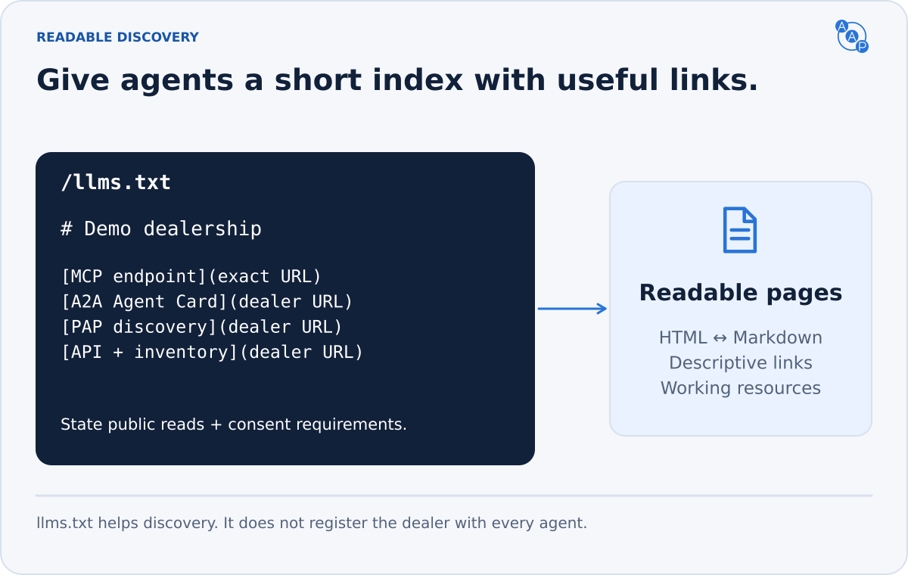
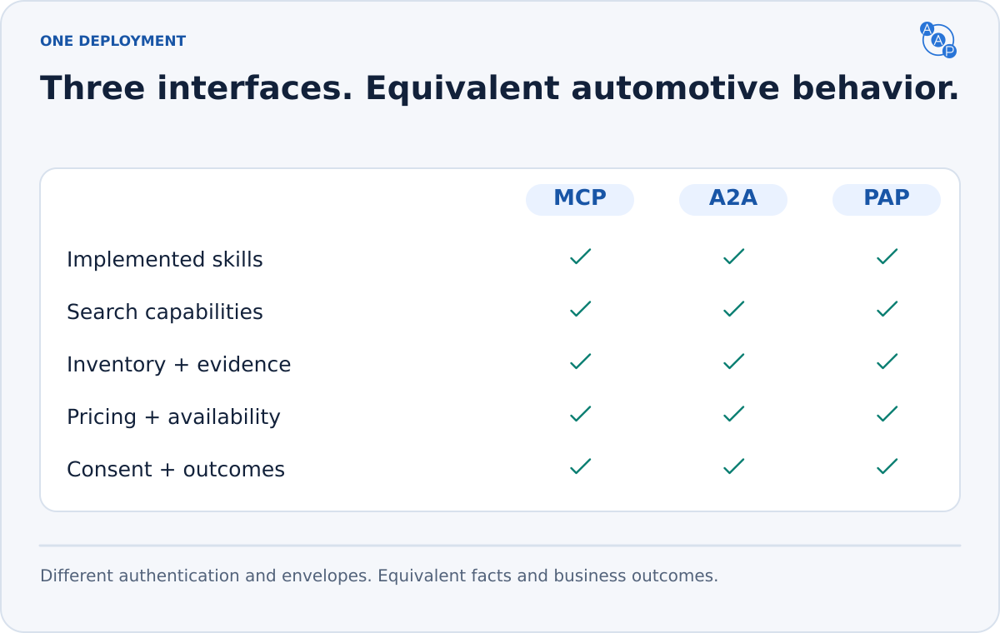

# Dealer-domain discovery

{/* aap-draft-only:start */}

:::info Unreleased AAP 3.1.0
Draft identifiers are not production identifiers. Release preparation replaces them with the pinned release URLs.
:::

{/* aap-draft-only:end */}

**Start at the dealership's website. Follow explicit links to working services.** The service can run on a provider's infrastructure; the dealership remains the discoverable identity.


## Publish three entry points

| Dealer URL | What an agent learns |
|---|---|
| `/.well-known/agent-card.json` | A2A endpoint, selected AAP version, implemented skills, MCP URL and search capabilities |
| `/.well-known/poppy.json` | PAP 0.3 organization, issuer, native OpenAPI and links to A2A/MCP |
| `/llms.txt` | A short, readable index of those interfaces and their access requirements |

All three MUST be public over HTTPS. The two discovery documents MUST return JSON. `llms.txt` MUST return UTF-8 Markdown as `text/plain` or `text/markdown`. None of these requests submits a lead or needs a shopper's personal information.

AAP does not define a universal MCP well-known path. The exact MCP endpoint comes from these documents. A static tool catalog is not an MCP server.

## Agent Card: identity and capabilities

Use the [complete Agent Card example](https://draft.autoagentprotocol.invalid/latest/examples/agent-card.example.json) and [schema](https://draft.autoagentprotocol.invalid/latest/schemas/agent-card.schema.json). Replace the example identity and URLs, then retain only implemented skills.


The card remains an ordinary [A2A 1.0 Agent Card](https://a2a-protocol.org/v1.0.0/specification/). AAP requires:

1. Exactly one AAP entry in `capabilities.extensions[]`, with `required: true` and this contract's URI:

   ```text
   https://draft.autoagentprotocol.invalid/extensions/aap/latest
   ```

2. A `JSONRPC` interface with `protocolVersion: "1.0"` in `supportedInterfaces[]`. Prefer it first. Additional A2A interfaces must expose equivalent functionality under A2A's rules. MCP and PAP are **not** A2A `protocolBinding` values.
3. One or more implemented AAP skills in `skills[]`, with unique IDs and the same subset in the AAP extension's `params.skills`.
4. Complete extension `params` following [aap-extension-params.schema.json](https://draft.autoagentprotocol.invalid/latest/schemas/aap-extension-params.schema.json):

| Params field | Required meaning |
|---|---|
| `id` | Stable deployment identifier, never a shopper identifier |
| `version`, `schema_base_url` | Selected AAP release and its immutable schema base |
| `skills` | Canonical request/response schema URLs for every implemented skill |
| `skills["inventory.search"].capabilities` | Actual filters, sort fields, defaults, limits and dealer/aggregate scope |
| `mcp` | Exact URL, `streamable-http`, supported MCP revisions and `public_read` |
| `poppy` | Canonical dealer-domain `/.well-known/poppy.json` URL |
| `llms_txt` | Canonical dealer-domain `/llms.txt` URL |

Search defaults MUST be usable: `default_sort.field` belongs to `sort_fields`, and `default_limit` does not exceed `max_limit`. Feature filters require `inventory.facets` so a client can discover supported feature codes. An unsupported filter is an explicit error, never silently ignored. See [search semantics](./skills/inventory-search.md).

A facets-only deployment omits `inventory.search` and its capabilities. It accepts USD/CAD and mi/km contexts with USD/mi defaults under the [facets-only fallback](./skills/inventory-facets.md#currency-and-odometer-context); clients can explicitly request CAD/km without a search declaration.

The card's software `version` is independent of AAP `params.version`. The A2A extension URI, not the software version, selects the automotive contract.

## Poppy: an authenticated native API

The [Poppy example](https://draft.autoagentprotocol.invalid/latest/examples/poppy.example.json) publishes PAP `0.3`, an issuer and a native OpenAPI interface. Its `extensions["autoagentprotocol.org/aap"]` links the paired Agent Card, the **same MCP URL**, AAP release and `llms.txt`.

The public MCP pointer belongs in that AAP extension. A top-level `apis` entry with `type: "mcp"` additionally promises PAP Session Tokens, protected-resource metadata and scope enforcement. Only advertise it when those behaviors exist. See [native PAP MCP](./personal-agent-protocol.md#6-optional-poppy-surfaces).

For redirects, PAP organization identity follows the **final HTTPS discovery host**, comparing case only; `www` is a distinct host. The final URL keeps exactly `/.well-known/poppy.json` without a query. The issuer must authorize that domain through `protected_resources`, with an entry exactly `https://{domain}` (hostname case ignored; no port, path or trailing slash). Keep canonical links consistent after redirects and use one issuer per independent Company. Full rules are in [PAP discovery](./personal-agent-protocol.md#2-paired-discovery).

## llms.txt: a useful index, not registration



The [llms.txt proposal](https://llmstxt.org/) provides a small Markdown index. It does not make every agent automatically discover or trust a website. AAP 3.1 requires this index as an additional entry point, alongside working protocol discovery.

Start from the [dealer llms.txt example](https://draft.autoagentprotocol.invalid/latest/examples/llms.txt.example.md). Include the dealer name, selected AAP version, exact MCP URL, public/authenticated access requirements, Agent Card, Poppy document, deployment-specific OpenAPI and a link to human-readable inventory. State that lead submission needs explicit customer contact consent.

Use descriptive Markdown links rather than an unstructured list of URLs. Keep it short; link to details. If Markdown page representations exist, advertise them with registered HTML link relations:

```html
<link rel="describedby" type="text/plain" href="/llms.txt" />
<link rel="alternate" type="text/markdown" href="/inventory.md" />
```

HTTP `Link` headers can advertise the same relationships. Only publish an alternate URL that actually serves a corresponding Markdown page. Do not describe a private `rel="mcp"` convention as a universally supported standard.

## One declaration, three equivalent surfaces



The AAP skill subset, automotive schemas, inventory visibility, search capabilities, pricing and consent rules MUST agree across MCP, A2A and PAP OpenAPI. A native PAP MCP entry, when present, MUST use the advertised MCP URL as both its `url` and `resource`.

MCP `tools/list` MUST expose the same AAP subset, with the same version and schema metadata. Its search tool's `_meta["autoagentprotocol.org/aap"].capabilities` MUST match the Agent Card. The native OpenAPI operations MUST match that subset and its `x-aap-extension` MUST match the A2A extension URI.

Cache discovery using accurate HTTP cache headers, ETags and reasonable lifetimes. Invalidate it when endpoints, versions or capabilities change. Verify the linked service before switching discovery. Do not advertise a future implementation or a template server.

## Transport and authorization

Every published endpoint and redirect MUST use HTTPS. Loopback HTTP is allowed only in a local development harness. Do not embed credentials in discovery URLs.

- **MCP:** public inventory reads are recommended. Protected access follows MCP OAuth discovery and the endpoint's declared authorization policy.
- **A2A:** follow `securitySchemes` / `securityRequirements`. Portable clients send `A2A-Version: 1.0` and the exact `A2A-Extensions` URI; a [contract-pinned AAP endpoint](./bindings/json-rpc.md#request-headers) also accepts their omission. If an interface declares `tenant`, echo it in every request.
- **PAP OpenAPI:** use a verified PAP Session Token and DPoP, including for signed-out shoppers.

A link does not authorize credential forwarding. Authenticate to the selected resource under its own rules. See [migration](./versioning.md#for-implementers) for separate version-specific cards and endpoints, and [conformance](./conformance.md) for runtime acceptance.
