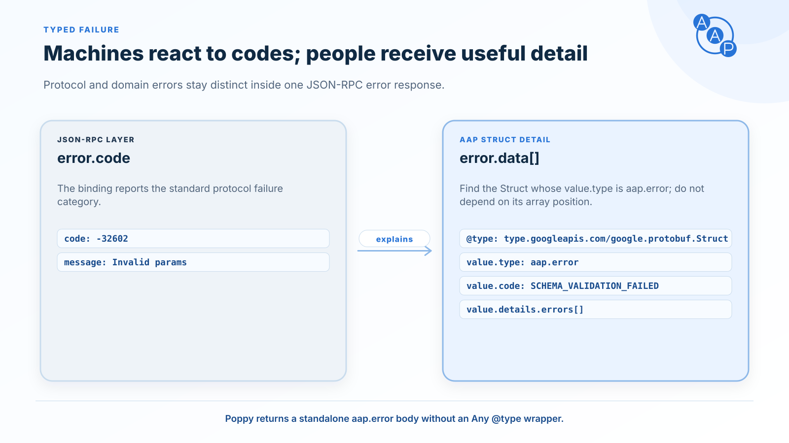

# Errors and retries

{/* aap-draft-only:start */}

This is the unreleased **AAP 3.0.0** contract. Draft identifiers are replaced when the release is prepared.

{/* aap-draft-only:end */}

**Tell the agent what failed, where, and whether retrying can help.** Skill errors use the same `aap.error` object across all three bindings. Transport and authentication errors keep their own protocol semantics.



## One automotive error

```json
{
  "type": "aap.error",
  "error_id": "error_example_001",
  "code": "UNSUPPORTED_FILTER",
  "message": "This deployment does not support features_all.",
  "retryable": false,
  "details": {
    "errors": [
      { "instanceLocation": "/filters/features_all", "keyword": "capability", "error": "Filter is not advertised." }
    ],
    "hint": "Read the published search capabilities before forming another query."
  },
  "created_at": "2026-10-24T15:00:00Z"
}
```

`type`, `error_id`, `code`, `message`, `retryable` and `created_at` are required. `details` is optional except where a code requires diagnostics or retry timing. Correlation IDs must be suitable for support without exposing shopper identity.

Validation errors MUST list every currently detectable problem in `details.errors[]`. Each item uses a JSON Pointer `instanceLocation`, a constraint `keyword` and a safe explanation in `error`. Never echo customer values, credentials or internal stack traces. Include a concrete correction when possible.

## Three envelopes

| Binding | Skill failure |
|---|---|
| MCP | Completed tool result, `isError: true`, typed error in `structuredContent` and matching serialized JSON text in `content` |
| A2A | JSON-RPC error, standard `ErrorInfo` first in `error.data[]`, typed error inside `google.protobuf.Struct.value` |
| PAP OpenAPI | Direct `aap.error` JSON body with the mapped HTTP status |

An unknown MCP tool, malformed protocol request, missing token, DPoP challenge or unsupported upstream version is a **protocol failure**. Do not pretend an automotive skill ran. MCP authorization discovery and PAP OAuth challenges are described in their binding pages.

### A2A detail encoding

For skill errors, the first `google.rpc.ErrorInfo` has `reason` equal to the AAP code and `domain: "autoagentprotocol.org"`. Its string-valued metadata includes `code`, `error_id`, `retryable` and `created_at`. Duplicate the code in metadata for SDKs that omit `reason`.

The AAP payload is a separate standard Any detail with `@type: "type.googleapis.com/google.protobuf.Struct"` and `value.type: "aap.error"`. Clients locate it by type, never by array position, validate its value, and ignore unrelated details. Other recognized detail objects may follow.

<details>
<summary>Complete A2A throttle response</summary>

```json
{
  "jsonrpc": "2.0",
  "id": "req-rate-limited",
  "error": {
    "code": -32000,
    "message": "Per-key rate limit exceeded.",
    "data": [
      {
        "@type": "type.googleapis.com/google.rpc.ErrorInfo",
        "reason": "RATE_LIMITED",
        "domain": "autoagentprotocol.org",
        "metadata": {
          "code": "RATE_LIMITED",
          "error_id": "err_01HZ9RATE01",
          "retryable": "true",
          "created_at": "2026-04-30T10:16:00Z"
        }
      },
      {
        "@type": "type.googleapis.com/google.protobuf.Struct",
        "value": {
          "type": "aap.error",
          "error_id": "err_01HZ9RATE01",
          "code": "RATE_LIMITED",
          "message": "Per-key rate limit exceeded.",
          "retryable": true,
          "details": {
            "retry_after_ms": 30000
          },
          "created_at": "2026-04-30T10:16:00Z"
        }
      }
    ]
  }
}
```

</details>

## Error code reference

| `code` | Meaning | JSON-RPC | `retryable` default |
|---|---|---|---|
| `UNSUPPORTED_SKILL` | The agent does not implement the skill identified by the typed request payload; the `SendMessage` method itself is supported. | -32602 (Invalid params) | `false` |
| `UNSUPPORTED_FILTER` | A known filter or feature code is not supported in this deployment; nothing was silently ignored. | -32602 (Invalid params) | `false` |
| `UNSUPPORTED_SORT` | The requested sort field is not advertised. | -32602 (Invalid params) | `false` |
| `INVALID_CURSOR` | Continuation is expired, malformed, belongs to another scope, or no longer matches the request. | -32602 (Invalid params) | `false` |
| `SCHEMA_VALIDATION_FAILED` | Request body fails JSON Schema validation. | -32602 (Invalid params) | `false` |
| `MISSING_REQUIRED_FIELD` | A specifically required field is absent. | -32602 (Invalid params) | `false` |
| `INVALID_CONDITION` | `vehicle_of_interest.condition` is in the trade-in vocabulary, or `trade_in.condition` is in the sale-condition vocabulary. | -32602 (Invalid params) | `false` |
| `DEALER_NOT_FOUND` | The requested seller is unknown or inaccessible on this endpoint. | -32000 (Server error) | `false` |
| `VEHICLE_NOT_FOUND` | The supplied `vin` / `stock` / `vehicle_id` does not match any listing. | -32000 (Server error) | `false` |
| `VEHICLE_UNAVAILABLE` | The vehicle exists but its `status` is no longer one of `available` \| `intransit` \| `pending`. | -32000 (Server error) | `false` |
| `CONTACT_CONSENT_REQUIRED` | `consent` is missing from a lead submission. | -32000 (Server error) | `false` |
| `INVALID_CONSENT` | `consent` is present but malformed, expired, its scope does not cover the called skill, or a contact channel is not authorized. | -32000 (Server error) | `false` |
| `APPOINTMENT_TIME_UNAVAILABLE` | The submission was rejected because no appointment time could be accepted. | -32000 (Server error) | `false` |
| `IDEMPOTENCY_CONFLICT` | An `idempotency_key` was reused with a different request payload. | -32000 (Server error) | `false` |
| `RATE_LIMITED` | Client has exceeded the dealer's rate limit. | -32000 (Server error) | **`true`** |
| `INTERNAL_ERROR` | Unhandled dealer-side error. | -32603 (Internal error) | `true` |

These are the A2A numeric mappings. MCP keeps them as typed tool errors; PAP maps unsupported skill/unknown vehicle to 404, schema/filter/sort/cursor problems to 422, consent to 403, availability/appointment/idempotency conflict to 409, throttling to 429 and internal failure to 500.

### Important distinctions

- `UNSUPPORTED_FILTER` means a known filter or feature code is unsupported here. An unknown field is `SCHEMA_VALIDATION_FAILED`. The server MUST NOT quietly ignore either.
- `INVALID_CURSOR` means restart the search; never continue from a fabricated offset. A cursor is scoped to its original request, tenant and authorization context.
- `CONTACT_CONSENT_REQUIRED` means the grant is missing. `INVALID_CONSENT` means the provided grant is unusable, expired, future-dated or does not permit the required channel.
- `VEHICLE_NOT_FOUND` means no matching listing; `VEHICLE_UNAVAILABLE` means a previously known listing cannot be offered. Refresh the search and tell the buyer.
- An accepted lead with a declined appointment returns `lead.submit.response` with both outcomes. `APPOINTMENT_TIME_UNAVAILABLE` must not conceal an accepted lead.
- `IDEMPOTENCY_CONFLICT` means the same key was reused with different content. Do not rotate the key merely to overcome an uncertain previous write; first reconcile it.

## Protocol-level A2A failures

| A2A error | JSON-RPC | Cause |
|---|---|---|
| `ExtensionSupportRequiredError` | -32008 | The exact AAP extension was not activated. |
| `VersionNotSupportedError` | -32009 | Missing/unsupported `A2A-Version` under the AAP profile. |
| `ContentTypeNotSupportedError` | -32005 | Unsupported input media type, or no acceptable output alternative. |
| `UnsupportedOperationError` | -32004 | Unsupported A2A operation. |
| `PushNotificationNotSupportedError` | -32003 | Push notification operations are not supported. |

These use A2A's standard typed `error.data` array and need no `aap.error`. See [headers and capabilities](./bindings/json-rpc.md#request-headers).

### Activation recovery

An activation error MUST name both the exact required extension URI and `A2A-Extensions` in its message. Its ErrorInfo uses `domain: "a2a-protocol.org"`, `reason: "EXTENSION_SUPPORT_REQUIRED"` and matching string metadata `extensionUri` / `requiredHeader`. Those two metadata keys are AAP-defined recovery hints.

```json
{
  "jsonrpc": "2.0",
  "id": "req-3",
  "error": {
    "code": -32008,
    "message": "Activate the supported AAP profile with A2A-Extensions: https://draft.autoagentprotocol.invalid/extensions/aap/latest",
    "data": [
      {
        "@type": "type.googleapis.com/google.rpc.ErrorInfo",
        "reason": "EXTENSION_SUPPORT_REQUIRED",
        "domain": "a2a-protocol.org",
        "metadata": {
          "extensionUri": "https://draft.autoagentprotocol.invalid/extensions/aap/latest",
          "requiredHeader": "A2A-Extensions"
        }
      }
    ]
  }
}
```

A buyer retries with that header only if it already implements the advertised contract. An error hint cannot implement the extension for the client. The server MUST check activation before skill execution; an SDK import or card flag alone does not enforce it.

## SDK error handling

Preserve the raw protocol error before an SDK converts it. Extract and validate the typed AAP payload yourself; an exception class is not a retry policy.

The pinned `@a2a-js/sdk` 1.3.0 preserves the standard detail array in this repository's real HTTP interoperability checks. Some older client adapters discard unknown detail types or codes. Verify the exact client version you ship with validation, consent and rate-limit failures. MCP clients must preserve structured error results even though `isError` is true.

## Retry without changing the outcome

Honor the returned `retryable` value. For a correctable input error, change the request deliberately; repeating identical invalid input cannot help. For transient failures, use bounded backoff.

A typed `RATE_LIMITED` MUST include `details.retry_after_ms`; an HTTP 429 MUST include `Retry-After`. Wait at least the applicable minimum, including when Retry-After is an HTTP date. Do not treat an HTTP 200 containing an MCP tool error as success.

For a lead, preserve the original payload and idempotency key across a timeout, retry, Session renewal or securely correlated binding change. Re-authentication produces fresh proofs, not a new business request. A non-retryable response does not authorize a new submission. See [safe lead retries](./skills/lead-submit.md#safe-retries).
