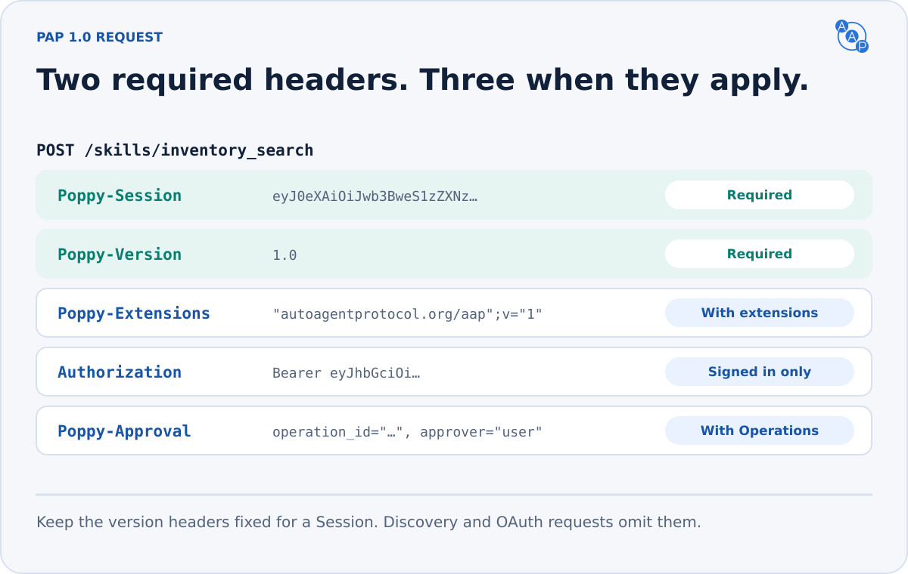

# PAP client walkthrough

**A personal agent needs three things per request: a fresh Session JWT, `Poppy-Version: 1.0`, and the typed AAP payload.** This walkthrough applies the AAP 4.0 [PAP 1.0 binding](./personal-agent-protocol.md). Frozen AAP 3.2 uses published PAP 0.3; keep its client configuration separate.



## 1. Discover the dealer and choose a version

1. Fetch `https://{dealer host}/.well-known/poppy.json` over HTTPS with bounded, address-checked fetches. Follow only HTTPS redirects, and use the document only if the final URL is exactly that path with no query.
2. Check `organization.domain` equals the final host (with its port when not 443), ignoring case only.
3. Choose the newest version, among `protocol_version` and `supported_versions`, that is compatible with one you implement (same major; before 1.0, same minor). For AAP 4.0 that is `1.0`. Load a `supported_versions` document only from the same host, without redirects, and only if its `protocol_version` matches. If nothing is compatible, stop.
4. Read `https://{organization.domain}/.well-known/oauth-protected-resource`. HTTP 404 or no authorization servers: the Company identifier is `https://{organization.domain}`. One or more servers: select the issuer (`auth.issuer` when several), fetch its metadata, and check `issuer` and `protected_resources` both ways. On a timeout or error, stop; never fall back to the domain.
5. Read the AAP bridge entry with `version: "1"` in `extensions["autoagentprotocol.org/aap"]` and the `openapi` entry in `apis`. Fetch the OpenAPI and pick an implemented operation. The bridge `mcp` link is public AAP MCP: send it a Session header only when the same URL is also listed in `apis` with `type: "mcp"`.
6. If `tasks.endpoint` is listed, GET it (step 3 headers, no access token) before starting a task, and respect excluded tasks.

## 2. Prepare signing code

Keep every key, JWT and token in code the model can't read.

- Publish client metadata at your HTTPS `client_id`, with a same-domain `jwks_uri` of public keys.
- Give each User a stable, opaque User ID for this Company identifier, never derived from personal data.
- Create a delegated ES256 key for this User ID only. Sign a `poppy-delegation+jwt` for it with a `jwks_uri` key (ES256, or PS384 when signing blindly) carrying only `iss`, the public `cnf.jwk`, `iat`, `exp` at most 24 hours later and a unique `jti`.
- Start a Session with a random, unguessable `sid` (1–256 base64url characters, at least 128 random bits). Keep `sub`, optional `agent_id`, `Poppy-Version` and `Poppy-Extensions` the same for the whole Session. Delegated keys may rotate inside it.

## 3. Send a request

For each request, sign a new `poppy-session+jwt` with the delegated key: header `alg: ES256`, `kid` = the key's RFC 7638 thumbprint, `poppy_dlg` = the delegation; claims `iss`, `aud` (Company identifier), `sid`, `sub`, `htm`, `htu` (no query or fragment), `iat`, `jti`. Signed out, omit `ath` and send no token.

```http
POST https://demo-toyota.example.com/poppy/skills/inventory_search
Poppy-Session: <fresh-delegated-session-jwt>
Poppy-Version: 1.0
Poppy-Extensions: "autoagentprotocol.org/aap";v="1"
Content-Type: application/json

{
  "type": "inventory_search_request",
  "filters": { "condition": ["used"], "price_max": 25000 },
  "pagination": { "limit": 5 },
  "sort": { "field": "price", "order": "asc" },
  "privacy": { "anonymous": true }
}
```

`Poppy-Extensions` is optional here: the AAP API never requires the bridge to be declared. Declare only extensions the chosen document lists. The [Session](https://draft.autoagentprotocol.invalid/latest/examples/poppy-session-jwt.example.json) and [delegation](https://draft.autoagentprotocol.invalid/latest/examples/poppy-delegation.example.json) examples carry fixed times and invalid signatures; never copy them into production.

Read advertised capabilities before filtering or submitting. Require evidence for equipment, keep currency and odometer contexts, report unknown data and follow every page. Never subtract conditional rebates from `price`. A valid HTTP 200 automotive response from this verified operation is evidence of PAP API success; discovery GETs alone are not.

## 4. Recover without duplicating actions

| Result | Client action |
|---|---|
| HTTP 400 `invalid_session` | Fix the cause (delegation, audience, clock, `htm`/`htu`, Session identity), then send a fresh JWT. A new Session alone doesn't help |
| HTTP 400 `session_ended` | Start a new `sid` and resend once; stop if that ends too |
| HTTP 400 `version_unsupported` | Refetch `poppy.json` without cache and choose again. If the version changed, start a new Session and resend once; otherwise stop |
| HTTP 403 `extension_required` | The named extension is needed. Declare it in a new Session if you support it; otherwise stop |
| HTTP 403 `approval_required` | Only with Operations declared: show the terms, get approval, resend the identical request with `Poppy-Approval` |
| HTTP 403 `approval_declined` | Final. Tell the User; never resend that approval |
| OAuth 401 / 403 | Token or scope problem, separate from the Session |
| HTTP 429 | Wait at least `Retry-After` |
| Uncertain write | Resend with the original `idempotency_key`; never a new key, another binding or another contract |

Session checks never replace consent. Submit no lead, trade-in contact or credit application without the User's explicit consent for that dealer, payload and channels. Test writes against a non-delivering sink.

## 5. Use optional features only when advertised

| Feature | What the client does |
|---|---|
| Account sign-in | Prefer Direct Sign-In: PKCE, `iss` check, `prompt=consent` unless the redirect returns to the opening device, PAR when required. Request every needed scope, without `resource`; then one `resource` per token request. Refresh with the same DPoP key. Send the token with a Session JWT whose `ath` matches. Never sign in an anonymous-browsing User ID |
| Native PAP MCP | Session header and `Poppy-Version` on every call; a signed-in token requested with `resource` = the MCP `url` |
| Browser join | Authorize only the code your own browser loaded, by JSON POST to `{browser_session_endpoint}/authorize`; a signed-in join needs `poppy:browser-sign-in`. Respect `web.disabled` |
| Website pages without a browser | SHOULD send the Session header (never a token) to pages on exactly `organization.domain` |
| Feedback | POST a short `task` and `description` without personal data to the `feedback.endpoint` from the tasks response |
| Operations | Declare `"operations";v="3"`; approve exact terms; the AAP consent grant and `idempotency_key` stay in the body unchanged |

Log safe request IDs, times, interface, status and validation stage only. A live integration still needs independent signer, DNS/TLS, Session-store, consent and shopping-agent acceptance; schema checks alone cannot establish those results.
