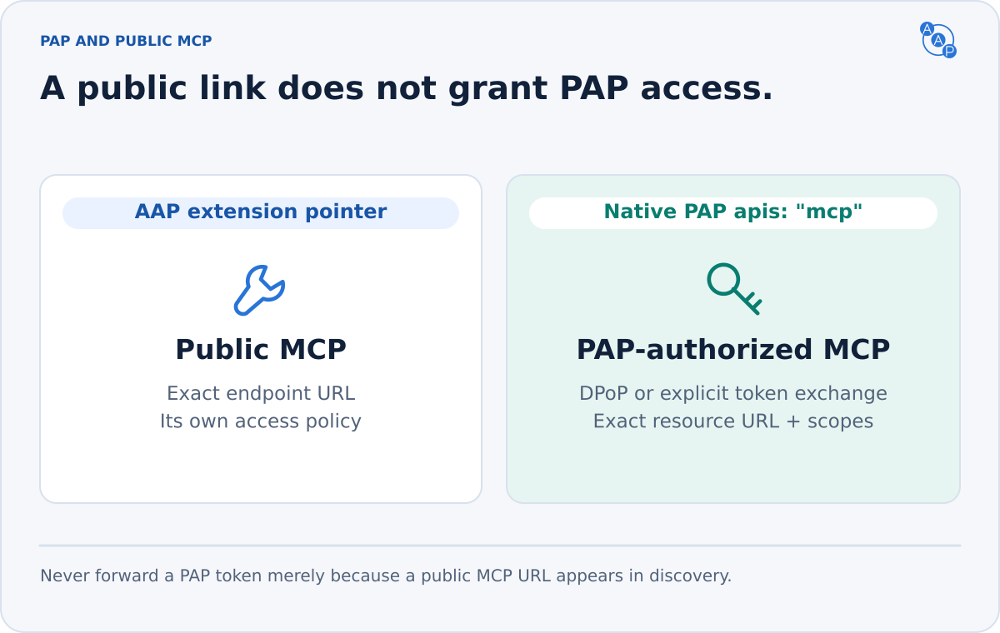
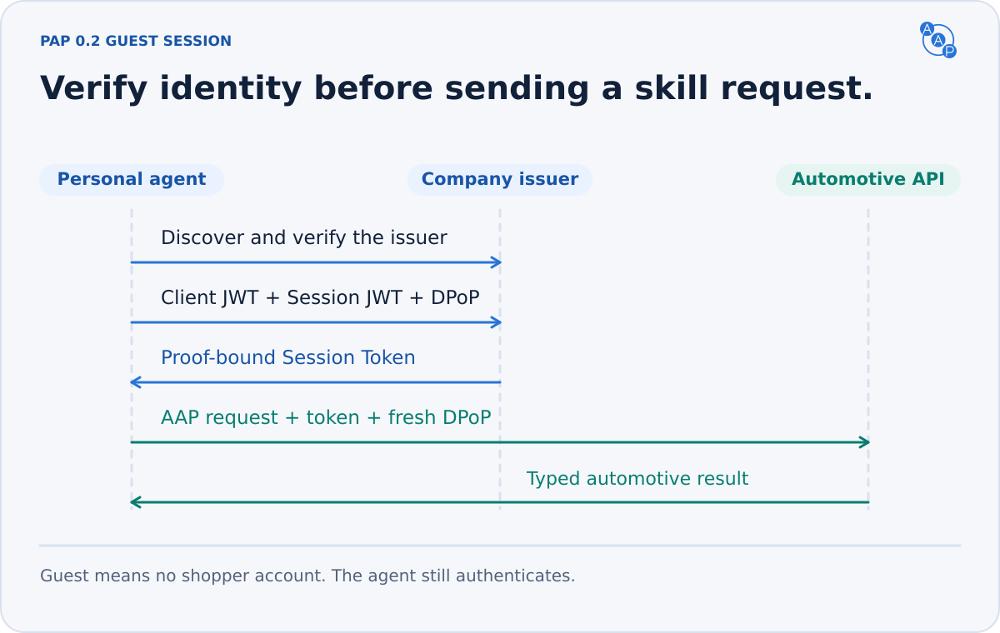

# Personal Agent Protocol

{/* aap-draft-only:start */}

:::info Unreleased contract — planned 3.0.0
These requirements describe the editable AAP 3.0.0 candidate. Draft identifiers are not production identifiers. Release preparation pins them to the approved contract. Existing v2.0 and earlier deployments retain their frozen contracts until migrated.
:::

{/* aap-draft-only:end */}

AAP 3.0 combines the [A2A v1.0 profile](./a2a-profile.md) with a native [Personal Agent Protocol](https://personalagentprotocol.org/docs/0.2/spec) (PAP, “Poppy”) **draft 0.2** guest API. The automotive payloads, pricing rules, supported skills, consent and lead semantics are the same on both interfaces. A personal agent that understands Poppy and OpenAPI can use the automotive API without understanding A2A or the AAP discovery extension.

Poppy is a draft. Compatibility here means this specific upstream revision, not a promise about future drafts, every vendor's client, or optional features that a deployment does not advertise. The baseline is [upstream commit 39b35bd](https://github.com/personal-agent-protocol/personal-agent-protocol/blob/39b35bdf240fc07f157d6ca4e29b5a41d4b36b5d/content/versions/0.2/spec.mdx), reviewed 2026-10-23. The normative A2A baseline is [v1.0.0](https://github.com/a2aproject/A2A/blob/v1.0.0/specification/a2a.proto). These upstream requirements apply in addition to this profile. AAP does not weaken their authentication or authorization rules.



## 1. Conformance and scope

An AAP 3.0 dealer deployment MUST:

1. Publish `/.well-known/agent-card.json` and `/.well-known/poppy.json` on its dealership domain over HTTPS. The spelling is **`.well-known`**, and both filenames include `.json`.
2. Implement the A2A JSON-RPC `SendMessage` profile, including required extension activation and A2A v1.0 wire semantics.
3. Publish Poppy discovery conforming to `poppy.schema.json`: organization identity, `auth.issuer`, at least one `apis` entry of `type: "openapi"`, and the `autoagentprotocol.org/aap` extension linking the matching A2A card.
4. Implement Poppy signed-out Sessions and the guest OpenAPI interface in this chapter. The OpenAPI skill set MUST equal the AAP skill subset on the linked card. Neither surface may advertise an unimplemented skill.
5. Apply the same vehicle visibility, pricing, consent, validation and business outcomes on both surfaces. Authentication and envelopes differ; automotive meaning does not.

The baseline requires no customer account, sign-in, account scopes, MCP service, browser session bridge, feedback endpoint, Company Agent conversations or Operations extension. These are optional. If advertised, their complete upstream requirements become mandatory. A Session authenticates the personal agent and identifies a pseudonymous user; “guest” does **not** mean unauthenticated API access.

A website-only Poppy document (`organization`, `web: {}` and an optional AAP extension) is valid discovery and a useful migration stage. It is **not** the complete AAP 3.0 profile: a core Poppy client ignoring the extension can only browse that website. `poppy-document.schema.json` validates PAP `0.2` reader input, retaining unknown fields and interface types. `poppy.schema.json` adds AAP publication requirements and permits only upstream-defined API and conversation types. Before PAP 1.0, a client MUST NOT use an unsupported **major.minor** version. Support for `0.1` does not imply support for `0.2`, or vice versa. Legacy clients use the frozen version-specific contract.

## 2. Paired discovery

Publish this example at the dealer's `/.well-known/poppy.json`, replacing every example domain and endpoint with an implemented service:

```json
{
  "protocol_version": "0.2",
  "organization": {
    "name": "Demo Toyota",
    "domain": "demo-toyota.example.com"
  },
  "auth": {
    "issuer": "https://demo-toyota.example.com/poppy"
  },
  "apis": [
    {
      "type": "openapi",
      "url": "https://demo-toyota.example.com/poppy/openapi.yaml",
      "resource": "https://demo-toyota.example.com/poppy",
      "description": "Dealer information, inventory facets, search, vehicle details and consented leads using Poppy guest sessions."
    }
  ],
  "web": {},
  "extensions": {
    "autoagentprotocol.org/aap": {
      "version": "1",
      "agent_card": "https://demo-toyota.example.com/.well-known/agent-card.json",
      "documentation": "https://autoagentprotocol.org/"
    }
  }
}
```

The [Agent Card](./discovery.md) remains an ordinary A2A v1.0 card. Its sole AAP extension is `https://draft.autoagentprotocol.invalid/extensions/aap/latest`, marked `required: true`. Poppy fields MUST NOT be added as invented A2A core fields. The three version identifiers have different meanings:

| Identifier | Value | Meaning |
|---|---|---|
| AAP release / A2A extension URI | `0.0.0-dev` / URI above | Automotive payload and profile contract; preparation resolves the release version |
| Poppy `protocol_version` | `0.2` | Upstream Poppy draft |
| `extensions["autoagentprotocol.org/aap"].version` | `1` | Major version of the discovery bridge's field contract, independent of AAP SemVer |

Both discovery resources MUST be accessible without session credentials and served as JSON. Discovery starts at the dealer's HTTPS well-known URL. `poppy.json` MAY redirect, but every hop MUST use HTTPS. The document's `organization.domain` MUST match the **final host after redirects**, comparing case only; `www` is a distinct host. An agent MUST verify this identity and the issuer binding before requesting or forwarding credentials. Clients SHOULD honor HTTP cache headers. The AAP bridge's `agent_card` MUST describe the same deployment and skills, even when the card is hosted elsewhere. The dealer-domain well-known card still MUST exist.

Each independent Company MUST have its own OAuth issuer. A provider hosting several independent dealers MUST allocate separate issuers, even on shared servers. Domains using one issuer represent one Company and share User IDs, Sessions and Account Tokens; their `auth` objects MUST be identical. For aliases of one Company, publish each final host in its own document and include every such domain in `poppy_domains`. For example, if `dealer.example` redirects discovery to `www.dealer.example`, the returned organization is `www.dealer.example`, and OAuth metadata must authorize that domain.
### Discovery extension version 1

The domain-prefixed name `autoagentprotocol.org/aap` follows Poppy §3.3. It formalizes the existing discovery bridge without changing its field names:

| Field | Required | Meaning |
|---|---|---|
| `version` | Yes | String `"1"`; incompatible bridge changes need a new major |
| `agent_card` | Yes | HTTPS URL of the matching A2A Agent Card; read its AAP extension to select the automotive contract |
| `mcp` | No | Existing remote MCP endpoint; a pointer does not establish Poppy session support |
| `openapi` | No | Existing OpenAPI description; its own published security applies |
| `api_catalog` | No | Existing API catalog discovery URL |
| `documentation` | No | Human/agent documentation URL |

Every URL MUST be absolute HTTPS without embedded credentials. Readers MUST ignore unknown extension names and fields. They MUST NOT assume that a linked public A2A/MCP/API endpoint accepts Poppy tokens, or forward a token to it solely because it appears in this extension. Native Poppy capabilities belong in top-level `apis`, `agent` or `web` and carry their upstream obligations. Clients unaware of this extension use the standard OpenAPI entry.

## 3. Issuer and agent identity

The `auth.issuer` MUST be HTTPS without query or fragment. Resolve OAuth metadata using [RFC 8414](https://www.rfc-editor.org/rfc/rfc8414#section-3): remove a terminating slash from an issuer path, then insert `/.well-known/oauth-authorization-server` **before** that path. This changes only the metadata location; the returned `issuer` MUST still match the original `auth.issuer` exactly, including any trailing slash. For the example issuer, fetch:

```http
GET https://demo-toyota.example.com/.well-known/oauth-authorization-server/poppy
```

```json
{
  "issuer": "https://demo-toyota.example.com/poppy",
  "token_endpoint": "https://demo-toyota.example.com/poppy/oauth/token",
  "revocation_endpoint": "https://demo-toyota.example.com/poppy/oauth/revoke",
  "poppy_domains": ["demo-toyota.example.com"],
  "grant_types_supported": ["urn:ietf:params:oauth:grant-type:jwt-bearer"],
  "token_endpoint_auth_methods_supported": ["private_key_jwt"],
  "dpop_signing_alg_values_supported": ["ES256"]
}
```

Before using the document, the personal agent MUST check that metadata `issuer` equals `auth.issuer` **exactly** and `poppy_domains` includes `organization.domain`, ignoring case only. `token_endpoint` and `revocation_endpoint` are mandatory even for the guest profile. An appended-path metadata alias MAY be offered, but it does not replace RFC 8414 discovery. Account-token revocation follows Poppy §4.9/RFC 7009 if accounts are supported; a guest-only issuer has no account tokens to revoke and MUST NOT advertise account grants. It MAY also revoke guest access tokens using RFC 7009, returning success for an unknown token without creating an account capability.

Personal agents use an HTTPS `client_id` metadata URL, a matching metadata `client_id`, public `jwks_uri`, and `private_key_jwt` authentication as specified in Poppy §4.1. `jwks_uri` and all `redirect_uris` MUST be HTTPS on the same domain as `client_id`. Companies verify signatures, allowed algorithms, audience, expiry and identity, rather than trusting request-supplied identity fields. The same published identity keys sign the separate client and Session assertions. DPoP keys are separate, are not published in that JWKS, and MUST differ for each User ID; a new key per Session is also allowed. Both assertions use the exact `auth.issuer` as their single-string audience. A token endpoint audience MUST be rejected. See the [client walkthrough](./pap-client-guide.md) for all three JWTs and a complete guest request.

When OAuth metadata advertises grant types or token authentication methods, those lists MUST include the JWT bearer grant and `private_key_jwt` used by this profile. Companies MUST accept ES256 DPoP proofs. `dpop_signing_alg_values_supported` is optional, but MUST include `ES256` if present. Clients use ES256 or an advertised algorithm. MCP servers advertise their own DPoP algorithms in protected-resource metadata.

Every protocol URL MUST use HTTPS. Outside discovery, clients MUST NOT forward tokens, proofs, assertions or credentials when an endpoint redirects. Both parties MUST reject peer-supplied loopback, private or link-local destinations unless deliberately configured to allow them. This includes URLs from discovery, metadata and responses. Remote client metadata and JWKS fetching MUST defend against SSRF, DNS rebinding and redirects into internal networks. Apply bounded fetch size, timeouts and cache lifetimes without weakening TLS, issuer or domain checks. A Company MAY require registration and reject unknown agents with OAuth `invalid_client`; do not claim unrestricted client onboarding when registration is required.

## 4. Guest sessions and proof of possession



For each User and Company issuer, the personal agent MUST generate a stable opaque User ID that is not derived from personal information, even by hashing it. Reuse it across sessions for that issuer; do not reuse it across Companies or publish the mapping. For anonymous browsing, PAP also permits an ephemeral User ID that is discarded afterward and MUST NOT be used to sign in.

To start a signed-out Session, send a URL-encoded token request with:

| Parameter / header | Requirement |
|---|---|
| `grant_type` | `urn:ietf:params:oauth:grant-type:jwt-bearer` |
| `assertion` | Signed session JWT: `iss` = client ID, `sub` = issuer-specific User ID, string `aud` = exact `auth.issuer`, `iat`/`exp` at most 300 seconds apart, fresh `jti` with at least 128 random bits |
| `client_id` | HTTPS client metadata URL |
| `client_assertion_type` | `urn:ietf:params:oauth:client-assertion-type:jwt-bearer` |
| `client_assertion` | Separate signed JWT: `iss` = `sub` = client ID, string `aud` = exact `auth.issuer`, `iat`/`exp` at most 300 seconds apart, its own fresh `jti` with at least 128 random bits |
| `DPoP` header | Fresh RFC 9449 proof for this token endpoint; no `ath` at the token endpoint |
| `resource` | Required by this AAP profile when an API entry advertises it; use that exact resource URI |
| `session_id` | Omit to create; include to renew the same signed-out Session |

The Company MUST verify both assertion signatures against the authenticated client's public JWKS, exact issuer audiences, identity and expiry. It MUST reject a reused assertion `jti` from that client until expiry, and a reused token-endpoint DPoP `jti` within its acceptance window. A valid DPoP proof binds the resulting token to its key. Token-endpoint proofs name the **token endpoint** in `htu`, not the assertion audience. A successful request therefore needs two distinct signed assertions and a third, separate proof JWT. A successful response has `Cache-Control: no-store` and:

```json
{
  "access_token": "example-opaque-session-token-not-a-credential",
  "token_type": "DPoP",
  "expires_in": 3600,
  "scope": "",
  "session_id": "session_example_001",
  "signed_in": false
}
```

`expires_in` MUST be positive. Session Tokens are opaque to the personal agent; it MUST NOT inspect token claims to implement protocol behavior. Guest tokens have no account scopes and no Account Token. The Company MAY restrict guest actions, but this AAP profile exposes its advertised automotive skills to authorized signed-out Sessions. Customer permission for `lead.submit` is still required.

A renewed Session MUST belong to the same verified client and User ID. Do not use an unverified `session_id` as authentication. A signed-in Session, if implemented, is renewed with its Account Token under Poppy §4.8. Clients use the newest token for subsequent requests; Session lifetime and token lifetime are separate.

Every native API request MUST carry `Authorization: DPoP <Session Token>` and a fresh `DPoP` proof. The resource server MUST verify signature, token expiry and audience/resource, the bound public key, `htm`, `htu` (without query/fragment), `iat`, `jti`, and `ath` (base64url-encoded SHA-256 access-token hash). The proof header MUST use `typ: "dpop+jwt"`, an accepted asymmetric algorithm and a public `jwk` without private key material. Exactly one DPoP header is allowed. At API endpoints, rejecting a reused proof `jti` is optional under PAP 0.2; token-endpoint replay rejection remains mandatory. Clients always generate fresh proofs. Clients MUST support server nonces and retry with a fresh proof when challenged, keeping nonce state per issuing server. Session tokens MUST NOT be accepted in URLs or require cookies. An Account Token MUST NOT be accepted as an API token. Tokens, assertions, private keys and proofs MUST NOT be logged or placed in model context.

Bearer Session Tokens are **only** allowed for an advertised Poppy MCP API whose protected-resource metadata does not advertise DPoP, per §6 below. A Company MUST NOT accept a Bearer Session Token at this OpenAPI interface or an A2A endpoint. An unrelated public A2A endpoint may have its own native A2A security contract; keep those credentials and audiences separate.

## 5. Automotive OpenAPI binding

This is a native Poppy API, **not** the removed A2A HTTP+JSON binding. The generated `openapi-poppy.yaml` describes OpenAPI 3.1 operations. A deployment MUST publish its own OpenAPI description with real `servers`, only implemented skills and accurate security. The protocol site's generic example URL is not a dealer service and MUST NOT be advertised as one.

AAP standardizes these routes relative to the deployment's published API base. All use `POST`, `Content-Type: application/json`, and the unchanged typed AAP request as the body. Success is HTTP 200 with the unchanged typed AAP response and `Content-Type: application/json`. No JSON-RPC envelope, A2A Message, or Poppy conversation envelope is added.

| Route | Request `type` | Response `type` |
|---|---|---|
| `/skills/dealer.information` | `dealer.information.request` | `dealer.information.response` |
| `/skills/inventory.facets` | `inventory.facets.request` | `inventory.facets.response` |
| `/skills/inventory.search` | `inventory.search.request` | `inventory.search.response` |
| `/skills/inventory.vehicle` | `inventory.vehicle.request` | `inventory.vehicle.response` |
| `/skills/lead.submit` | `lead.submit.request` | `lead.submit.response` |

A request `type` MUST match the operation selected by the path. Publish an operation for every AAP skill on the paired Agent Card, and no others under these standard skill identifiers. Schemas and the `x-aap-extension` OpenAPI field MUST identify the same AAP contract as that card. Poppy OpenAPI clients do not need `A2A-Version` or `A2A-Extensions` headers; A2A clients still MUST send both on their own binding.

```http
POST https://demo-toyota.example.com/poppy/skills/inventory.search
Authorization: DPoP <session-token>
DPoP: <fresh-proof-for-this-request>
Content-Type: application/json

{"type":"inventory.search.request","filters":{"condition":["used"]},"pagination":{"limit":20}}
```

Company content, including API descriptions and responses, MUST be treated as untrusted data. It cannot authorize actions at another Company, supply user consent, or justify sending unrelated user information.

The [skill specifications](./skills/inventory-search.md) remain normative for payloads and business behavior. `lead.submit` does not book a confirmed appointment, purchase a car, authorize a payment or bypass explicit contact consent. A Session or a `poppy:write` scope is not a substitute for `ConsentGrant`. The verified Poppy client identity is authorization context; caller-supplied `source_agent` is attribution and MUST NOT override it.

A client retrying a lead MUST preserve the original business payload and `idempotency_key`. Servers MUST scope deduplication to the dealer, verified client and stable issuer-specific User ID, not the short-lived Session Token or session ID. A same-key retry returns the same lead with the documented duplicate status; a changed payload conflicts. Shared backing handlers SHOULD prevent accidental double delivery across bindings when they can securely correlate the same caller and request; do not infer trusted identity from anonymous attribution fields.

### Errors and retries

Transport authentication is checked before a skill executes. Poppy/OAuth errors are not A2A JSON-RPC errors:

| Failure | HTTP status | Required handling |
|---|---|---|
| Missing/malformed token-request fields | 400 | OAuth `invalid_request`; no customer sign-in is implied |
| Invalid client at token endpoint | 401 | OAuth `invalid_client` |
| Invalid session assertion/grant or expired/replayed session assertion | 400 | OAuth `invalid_grant` |
| Invalid session / different owner | 400 | OAuth `invalid_session`; do not transfer session ownership |
| Token endpoint proof error / nonce challenge | 400 | OAuth `invalid_dpop_proof` / `use_dpop_nonce`; nonce as applicable |
| Missing/expired API token | 401 | `WWW-Authenticate: DPoP` with `invalid_token` |
| Invalid API proof / nonce challenge | 401 | DPoP challenge (`invalid_dpop_proof` / `use_dpop_nonce`), `DPoP-Nonce` when applicable |
| Insufficient account scope, if accounts are offered | 403 | DPoP `insufficient_scope` challenge identifying needed scopes |
| Required extension unsupported | 403 | `extension_required`, naming `extension`; JSON at the token/protocol endpoints, challenge attribute at APIs |
| Rate limit on any endpoint | 429 | `Retry-After`; client MUST wait at least that long. Token/protocol endpoints return `{"error":"rate_limited"}` |

For skill errors, return the standard standalone [`aap.error`](./errors.md) body with the following HTTP mapping. The standalone body has `type: "aap.error"`; the A2A-only `google.protobuf.Struct` wrapper and its `@type` are not part of this body. Do not wrap it in JSON-RPC `error.data` on this binding.

| AAP code | HTTP status |
|---|---|
| `UNSUPPORTED_SKILL`, `VEHICLE_NOT_FOUND` | 404 |
| `SCHEMA_VALIDATION_FAILED`, `MISSING_REQUIRED_FIELD`, `INVALID_CONDITION` | 422 |
| `CONTACT_CONSENT_REQUIRED`, `INVALID_CONSENT` | 403 |
| `VEHICLE_UNAVAILABLE`, `APPOINTMENT_TIME_UNAVAILABLE`, `IDEMPOTENCY_CONFLICT` | 409 |
| `RATE_LIMITED` | 429, with `Retry-After` |
| `INTERNAL_ERROR` | 500 |

Malformed JSON MAY return 400 before a skill can be identified. Authentication responses may have no AAP body; clients MUST inspect status/challenge headers before assuming a typed skill error. Retry only when allowed by protocol error semantics and preserve lead deduplication. Never replay a DPoP proof itself.

## 6. Optional Poppy surfaces

Only advertise implemented capabilities. Unknown extension names, fields, API types and conversation types MUST be ignored/skipped by readers as upstream specifies; that rule does not authorize publishers to invent incompatible meanings for known fields.

| Surface | Obligations when advertised |
|---|---|
| Direct Sign-In (`auth.direct`) | Poppy §4.5: authorization endpoint in metadata, authorization code + PKCE, user-controlled sign-in, exact registered redirect URI, state and issuer checks, and `session_id` on exchange |
| Device Sign-In (`auth.device`) | §4.6: device authorization endpoint, explicit user approval, expiry and polling/slow-down rules |
| Mediated Sign-In (`auth.mediated`) | §4.7: declared fields/scopes, DPoP, credential secrecy, rate limits and multi-step challenges; never use it to simulate a direct user sign-in |
| Account authorization | §§4.4, 4.8–4.9: read/write scope ceiling by sign-in method, account ownership checks, secure Account Tokens, optional rotation, revocation and session downgrade; account tokens go only to token/revocation endpoints |
| Browser session bridge | §5: signed browser assertion via POST body, audience/session/return URL and replay checks; cookie follows current session scopes, lifetime, Secure/HttpOnly and SameSite rules |
| Native MCP API | §§4.3 and 6: Streamable HTTP MCP 2025-06-18 or later, resource equals the listed MCP URL, protected-resource metadata lists this issuer, enforce scopes; DPoP if advertised by that server, Bearer otherwise; do not promote an anonymous legacy MCP server into `apis` until it supports these requirements |
| Feedback (`feedback.endpoint`) | §8: authenticated DPoP POST, guest or signed-in Session with no required scope, `kind: "missing"`, task ≤200 and description ≤2,000 characters, no identifiers or secrets, HTTP 202 with no body; receivers accept unknown future kinds |
| Company Agent conversations | §7 in full: `type: "poppy"`, DPoP, owned conversation IDs, message IDs, sender human/agent, event cursors, polling/streaming, status/responder, direct conversations, sign-in and closing behavior |
| Operations extension | Follow the upstream extension's own version and discovery contract; it is not required to invoke the five synchronous AAP skills |

Poppy 0.2 currently defines **only** `type: "poppy"` for conversations. An A2A `SendMessage` endpoint MUST NOT be labeled `poppy`, and `type: "a2a"` is not an upstream-defined interoperable conversation binding. This profile uses standard OpenAPI APIs instead. A dealer MAY implement real Poppy conversations separately, but must not claim a conversational lifecycle from the synchronous skill API.

An MCP server advertises DPoP by including `dpop_signing_alg_values_supported` in its protected-resource metadata, with `ES256` in that list. The Company MUST then issue DPoP tokens to PAP clients and reject a missing token-request proof. For a server without that metadata field, it MUST issue Bearer tokens even if a proof was supplied. Such tokens MUST work only at the exact MCP URL used as `resource`, never at another path on the same host. A DPoP token sent with the Bearer scheme MUST be rejected. MCP 401 challenges include `resource_metadata` for every accepted scheme. New MCP servers SHOULD support DPoP.

Feedback describes an unavailable task, not failed authentication or other returned errors. Clients SHOULD send at most one report per task. Companies MUST treat report text as untrusted data. `poppy-feedback-request.schema.json` validates the receiver's shape, including unknown future kinds; PAP 0.2 senders still use only `missing`.

## 7. Migration and verification

1. Preserve frozen v2.0/PAP 0.1 behavior while preparing AAP 3.0/PAP 0.2. Change validation and runtime behavior before advertising the new version. See the [breaking migration matrix](./versioning.md#pap-02-migration).
2. Change both assertion audiences to the exact issuer and explicitly reject endpoint audiences. Keep DPoP `htu` bound to the actual request endpoint. Support assertion lifetimes up to five minutes, with fresh IDs and expiry/replay checks.
3. Audit every redirect and alias: final-host organization identity, case-only domain comparison, complete `poppy_domains`, consistent `auth` for aliases, and one issuer per independent Company.
4. Verify ES256, separate per-User-ID DPoP keys, nonce handling, proof replay rules and optional MCP token selection. Do not weaken guest authentication to accommodate a client without signing capability.
5. Publish deployment-specific OpenAPI and discovery with PAP `0.2`, the new version-pinned AAP URI, and equal skill subsets. Automotive schemas, A2A v1.0 behavior, bridge version `1`, pricing and consent are unchanged from AAP 2.0.
6. Exercise a real client identity through discovery → signed guest token → inventory search → renewal. Record status/error stages safely as described in the [client guide](./pap-client-guide.md#diagnosing-an-integration). A request to documentation alone does not establish PAP API interoperability.

A direct upgrade from v1.x also requires the [AAP 2.0 A2A migration](./versioning.md#breaking-migration-checklist). Only advertise optional capabilities that pass their complete upstream requirements.

See [conformance and verification](./conformance.md) for automated checks and runtime acceptance. JSON Schema cannot prove signatures, replay prevention, consent or lead delivery. Contract publication does not provision a personal agent's identity keys, implement its PAP client, or upgrade a dealer runtime.
