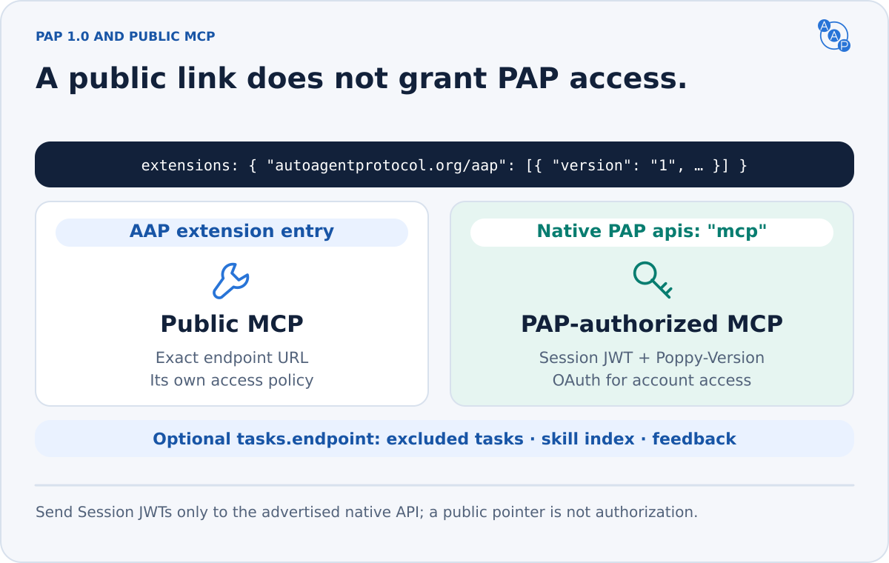
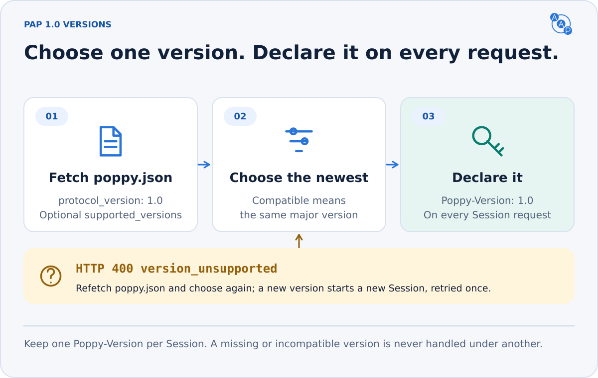
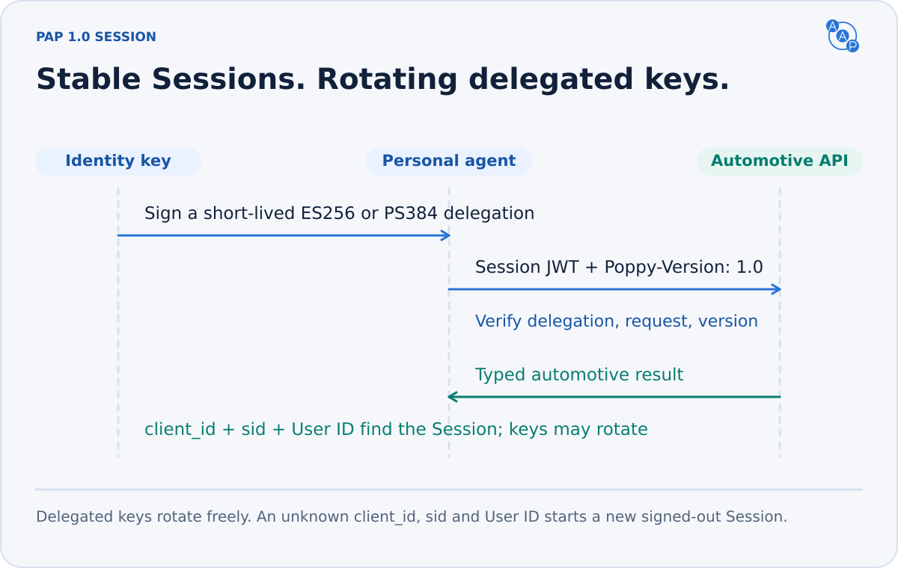
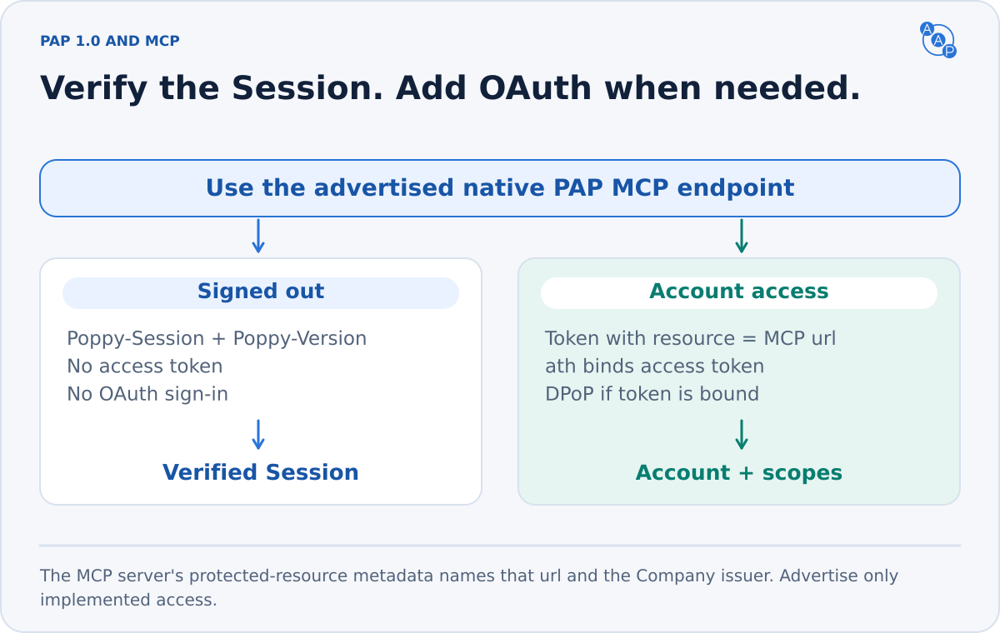
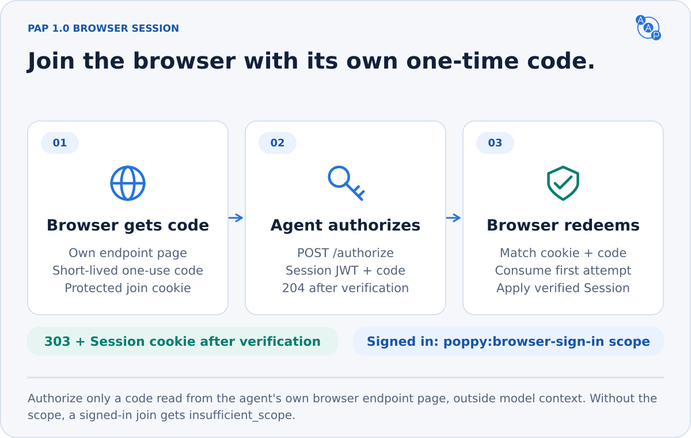
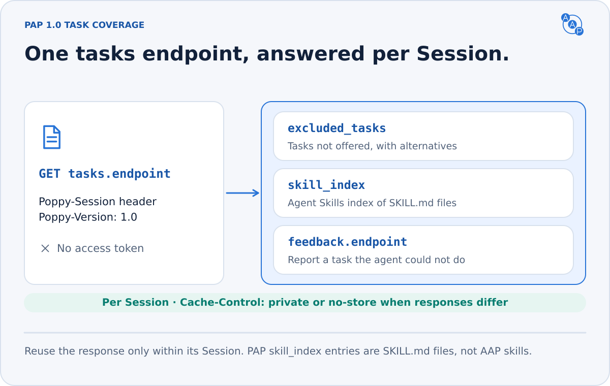
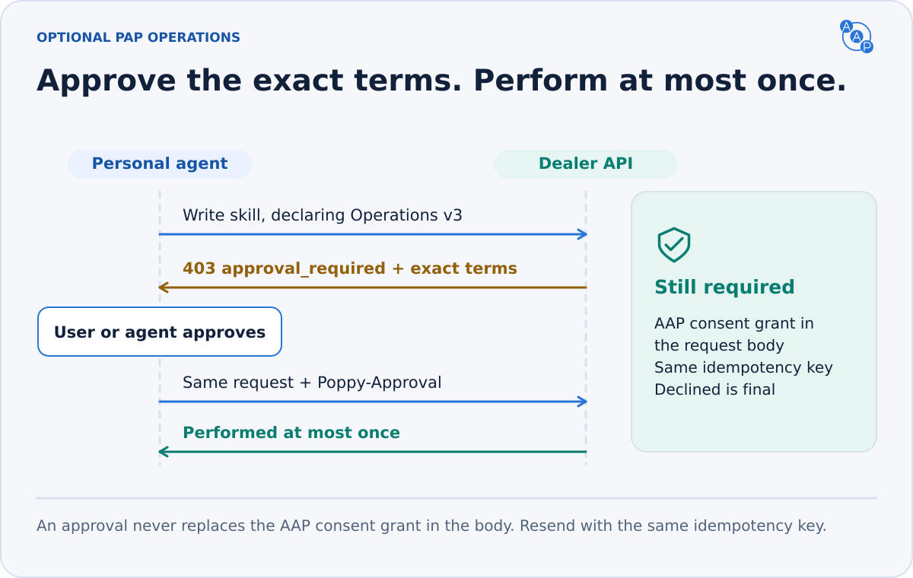

# Personal Agent Protocol

{/* aap-draft-only:start */}

:::info Unreleased AAP 4.0 draft
This editable draft targets AAP 4.0.0, which adopts PAP 1.0. Frozen AAP 3.2 and its published PAP 0.3 binding remain unchanged at their release URLs. Draft URLs and `0.0.0-dev` are authoring identifiers, never production identifiers.
:::

{/* aap-draft-only:end */}

**AAP 4.0 is 100% compliant with PAP 1.0.** Every PAP request carries a fresh delegated `Poppy-Session` JWT and `Poppy-Version: 1.0`. Signed-out shopping needs no OAuth token. Account access, browser join, conversations, task coverage and Operations approvals are optional; when a dealer advertises one, the complete PAP 1.0 rules apply.

AAP carries the same automotive payloads through [A2A](./a2a-profile.md), [MCP](./bindings/mcp.md) and native PAP OpenAPI. The [client walkthrough](./pap-client-guide.md) shows the same rules from the agent's side.



## 1. Target and scope

| Item | Value |
|---|---|
| Specification | [PAP 1.0](https://personalagentprotocol.org/docs/1.0/spec), published and frozen upstream on 2026-11-14 |
| Upstream pin | Commit [`8c02b4282eda53468a7c09412558bc8b060d95f6`](https://github.com/personal-agent-protocol/personal-agent-protocol/blob/8c02b4282eda53468a7c09412558bc8b060d95f6/content/versions/1.0/spec.mdx), file `content/versions/1.0/spec.mdx` |
| Spec SHA-256 | `559a191127cb81d4e77360cd1cfae35233178a89b71b39c0534142a2bab918d6` |
| Operations extension | Version 3, at the same commit |
| Minor versions | AAP 4.0 follows 1.0. Later 1.x minors are additive: readers accept every 1.x document and ignore unknown fields, and a dealer offers a 1.x feature only to agents that send that version |

A dealer implementing this binding MUST:

1. Publish `/.well-known/poppy.json` with `protocol_version: "1.0"`, an `openapi` API entry for the native AAP API and exactly one version-`"1"` AAP bridge entry (with `aap_version`, `mcp`, `llms_txt` and `agent_card`), next to a matching Agent Card and `llms.txt`.
2. Answer domain protected-resource discovery truthfully (metadata or HTTP 404), so agents can derive the Company identifier.
3. Verify the Session header and `Poppy-Version` before every skill on the native API.
4. Expose the same implemented skills, capabilities, consent rules and idempotency store as on A2A and MCP.

`poppy-document.schema.json` is the tolerant PAP 1.0 reader shape: it accepts every 1.x document and unknown fields, extensions and API types. `poppy.schema.json` adds the AAP publication profile: exactly `1.0`, the bridge entry, and rejection of retired 0.3 fields (`excluded_tasks`, `skill_index` and `feedback` at the top level, object-form extensions). Do not publish an optional surface merely because this repository includes its schema.

## 2. Compliance matrix

One row per PAP 1.0 section. **Required**: every AAP 4.0 dealer. **Required when advertised**: applies in full once the dealer lists the surface. **Client obligation**: a Personal Agent requirement the dealer relies on. **Not used by AAP**: no AAP-specific rule; upstream text applies unchanged. Sections 2 (Terms) and 11 (References) state no requirements.

| PAP 1.0 | What it requires | AAP 4.0 status | Where |
|---|---|---|---|
| 1.1 Protocol layers | Sessions and account access are independent; an endpoint relying on Session claims verifies the header; agents send it even when ignored | Required: the native API verifies on every skill | [Verification](#verification-and-session-lookup) |
| 3 Discovery | HTTPS well-known document; HTTPS redirects ending at the exact path without query; host speaks for itself; issuer checked both ways; every exchanged URL HTTPS; no secrets across redirects; no private addresses | Required; Client obligation | [Discovery](#3-discovery) |
| 3.1 Fields | `protocol_version` `1.0`; `organization.domain` is the final host with its non-443 port; one of `agent`, `apis`, `web`; `web.disabled`, `web.unscoped`, `tasks`, list-form `extensions` | Required | [Discovery](#3-discovery) |
| 3.2 OAuth server | Company identifier from protected-resource metadata; no domain fallback after errors; issuer metadata with `protected_resources`, refresh grant and revocation; one issuer per Company; `auth.disabled`; `signed_in` access hint | Required (identifier); Required when advertised (issuer) | [Company identifier](#protected-resource-metadata-and-company-identifier) |
| 3.3 Extensions | One list entry per major version; domain-prefixed names; ignore unknown; `extension_required` HTTP 403 JSON | Required | [Extensions](#extensions-and-the-aap-bridge) |
| 3.4 Versions | `supported_versions` on the same host and Company; newest compatible version; `Poppy-Version` and `Poppy-Extensions` per Session; `version_unsupported`; minor-version rule | Required; Client obligation | [Versions](#4-versions-and-headers), [coexistence](#supported-versions-and-coexistence) |
| 4 OAuth | Confidential client, standard grants; Direct Sign-In preferred | Required when advertised | [Account access](#account-access) |
| 4.1 Agent identity | CIMD `client_id`; same-domain `jwks_uri` and `redirect_uris`; assertion `aud` is the issuer; `exp` at most 5 minutes after `iat`; accept ES256 and PS384 | Required (CIMD for Sessions); Required when advertised (assertions) | [Client metadata](#client-metadata-and-assertions) |
| 4.2 Direct Sign-In | PKCE; exact `redirect_uri`; `iss` check; `prompt=consent`; PAR when required; RFC 10027 §2 | Required when advertised | [Account access](#account-access) |
| 4.3 Device Sign-In | RFC 10027 §2; link host check; show organization name and domain; opening the link approves nothing | Required when advertised | [Account access](#account-access) |
| 4.4 Refresh tokens | Rotation per RFC 6749 §6; same DPoP key at every refresh | Required when advertised | [Account access](#account-access) |
| 4.5 Access tokens | Bearer or DPoP; DPoP key per User ID; one sign-in covers every resource; one `resource` per token request; `invalid_target` | Required when advertised | [Account access](#account-access) |
| 4.6 Revocation | RFC 7009 with `token_type_hint=refresh_token` and a client assertion | Required when advertised | [Account access](#account-access) |
| 4.7 Scopes | `scope` on every sign-in; never broader than requested; at least one granted; hints carry both fields; re-request every needed scope | Required when advertised | [Account access](#account-access) |
| 4.8 OAuth additions | Summary of 3.2 and 4.1–4.7 | Required when advertised | [Account access](#account-access) |
| 5 Sessions | Session header on every API, protocol and extension request; the first request with a new `sid` starts a Session | Required | [Delegated Sessions](#5-client-identity-and-delegated-sessions) |
| 5.1 User IDs and Agent IDs | Pairwise, stable, opaque, never derived from personal data; mapping confidential; anonymous-browsing IDs never signed in | Client obligation | [Session JWTs](#delegations-and-session-jwts) |
| 5.2 Session header | Destinations from `poppy.json`; ES256 JWT claims; same `sub` and `agent_id` per Session; website pages fetched without a browser | Required; Client obligation | [Session JWTs](#delegations-and-session-jwts), [destinations](#session-destinations) |
| 5.2 Delegated keys | Accept ES256 and PS384 delegations; at most 24 hours; verification order; reject without delegation; never expect a stable key; one key per User ID | Required | [Session JWTs](#delegations-and-session-jwts) |
| 5.3 Verifying | Checks before relying on claims; lookup by `client_id`, `sid` and User ID; `invalid_session` HTTP 400; no unverified attribution | Required | [Verification](#verification-and-session-lookup) |
| 5.3 Operator signatures | Web Bot Auth recommended, covering `poppy-session` and `authorization`; the Session JWT is still verified independently | Client obligation; Required (independent verification) | [Operator signatures](#replay-and-operator-signatures) |
| 5.4 Signing in | Sessions need no sign-in; one account per Session; sign-in only by the User | Required when advertised; Client obligation | [Account access](#account-access) |
| 5.5 Ending Sessions | `session_ended`; new `sid`, resend once; sign-out by revoking every refresh token | Required | [Verification](#verification-and-session-lookup) |
| 5.6 Sending requests | No cookies required; never omit the header; no tokens in URLs; HTTP 429 with `Retry-After` | Required; Client obligation | [Destinations](#session-destinations), [recovery](#6-automotive-requests-and-safe-recovery) |
| 6 Web browsing | Three-step browser join; `poppy:browser-sign-in`; `web.unscoped`; `web.disabled`; own browser only; cookie rules | Required when advertised; Required (`web` flag consistency) | [Browser join](#browser-join) |
| 7 APIs | `openapi` and `mcp` (2025-06-18 or later) types; every listed API accepts the Session header and tokens; MCP `resource` is its `url`; error table | Required (`openapi`); Required when advertised (`mcp`) | [Recovery](#6-automotive-requests-and-safe-recovery), [native MCP](#native-pap-mcp) |
| 8.1 Conversation protocols | Every `agent.protocols[]` entry has a `description` | Required when advertised | [Conversations](#conversations) |
| 8.2–8.13 Conversations | Requests and ownership, request IDs, messages, events, streaming, four-field state, human or AI, handoff, Direct Conversations, sign-in, closing, errors incl. `version_mismatch` | Required when advertised | [Conversations](#conversations) |
| 9 Task coverage | One `tasks.endpoint`; GET with the Session header and no token; `Cache-Control: private` or `no-store` when per Session | Required when advertised | [Task coverage](#task-coverage) |
| 9.1 Excluded tasks | A listed task is offered through no interface | Required when advertised | [Task coverage](#task-coverage) |
| 9.2 Alternatives | Instructions or references; references name listed APIs | Required when advertised | [Task coverage](#task-coverage) |
| 9.3 Feedback | `task` ≤ 200 and `description` ≤ 2000 characters; HTTP 202 or 200 with an alternative; report text is data | Required when advertised | [Task coverage](#task-coverage) |
| 9.4 Agent context | Pinned Agent Skills index; digests; URLs resolved against `tasks.endpoint`; no script execution without permission | Required when advertised | [Task coverage](#task-coverage) |
| 10.1 Content from Companies | Company content is data, never instructions or approval | Client obligation | [Security](#8-security-considerations) |
| 10.2 Secrets and the model | Tokens, Session JWTs, keys, codes and verifiers stay out of model context | Client obligation | [Security](#8-security-considerations) |
| 10.3 What a domain vouches for | The domain is the identity; names and logos are claims | Client obligation | [Security](#8-security-considerations) |
| 10.4 Token and assertion audiences | Assertions name the issuer; Session JWTs name the Company identifier | Required | [Security](#8-security-considerations) |
| 10.5 Signing in with credentials | Explains why delegated sign-in beats credential sign-in | Not used by AAP | [Security](#8-security-considerations) |
| 10.6 Joining a browser | Code from the dealer's page plus a bound cookie; code only from the agent's own browser | Required when advertised | [Browser join](#browser-join) |
| 10.7 Delegated keys | Short delegations, one key per User ID; blind signing uses PS384 with `jti` made on the device | Client obligation; Required (accept PS384) | [Security](#8-security-considerations) |
| 10.8 Sign-ins someone else started | Consent page lists every scope; `prompt=consent`; RFC 10027 §2 | Required when advertised | [Account access](#account-access) |
| Operations extension 3 | Exact terms, one approval per revision, at most once | Required when advertised | [Operations](#operations-approvals) |
| Other extensions | `links`, `disclosures`, `browser-control`, `mediated-sign-in`, `ucp` | Required when advertised | [Other extensions](#other-extensions) |

## 3. Discovery

The [issuerless example](https://draft.autoagentprotocol.invalid/latest/examples/poppy.example.json) publishes the native OpenAPI without account access. The [existing-issuer example](https://draft.autoagentprotocol.invalid/latest/examples/poppy.existing-issuer.example.json) keeps an established issuer with `auth.disabled: true`.

| Rule | Requirement |
|---|---|
| Location | `https://{host}/.well-known/poppy.json`, HTTPS only |
| Redirects | Agents follow them; every hop is HTTPS; another host is allowed; the final URL path is exactly `/.well-known/poppy.json` with no query |
| Identity | `organization.domain` is the final host, with its port when that isn't 443, compared ignoring case only. `www` is a different host. Agents use another port only when configured to, such as for testing |
| URLs | Every URL in `poppy.json`, metadata, client metadata, extensions, assertions, JWTs and responses is HTTPS. Agents never use another scheme; dealers reject one. Website pages and loopback redirect URIs are outside this rule |
| Later redirects | When a token, revocation, device, API, `/authorize`, conversation, tasks, feedback or extension endpoint redirects, no token, Session JWT, assertion or credential goes to the new URL |
| Addresses | Neither side connects to a loopback, private or link-local address taken from the other party, unless configured to on purpose |
| Interfaces | At least one of `agent`, `apis`, `web`. AAP requires the `openapi` entry; an `mcp` entry promises [native PAP MCP](#native-pap-mcp) |

AAP rejects the 0.3 top-level `excluded_tasks`, `skill_index` and `feedback`, object-form extensions and the earlier `auth.direct`, `auth.device`, `auth.custom_scopes` and `auth.mediated` fields.

### Protected-resource metadata and Company identifier

The agent reads `https://{organization.domain}/.well-known/oauth-protected-resource` (RFC 9728). When published, its `resource` is exactly `https://{organization.domain}`.

| Evidence | Company identifier |
|---|---|
| HTTP 404, or valid metadata with absent or empty `authorization_servers` | `https://{organization.domain}`, host lowercase, no trailing slash. Valid only without `auth.issuer` and without sign-in |
| One authorization server | That issuer. `auth.issuer` is optional and, if present, names it |
| Several authorization servers | `auth.issuer` is required and names the listed one agents use |
| Timeout, other status, invalid metadata or failed issuer check | Stop. Never fall back to the domain, and never drop a known issuer unless a successful discovery shows it was removed |

When there is an issuer, the agent fetches its RFC 8414 metadata and checks that `issuer` matches character for character and that `protected_resources` includes `https://{organization.domain}` (no path or trailing slash; host compared after lowercasing; port included when not 443). The issuer lists every domain it serves. The metadata carries `token_endpoint`, `revocation_endpoint` and `grant_types_supported` including `refresh_token`; `authorization_endpoint` when it lists `authorization_code`; `device_authorization_endpoint` when it lists the device grant; and optionally `pushed_authorization_request_endpoint` and `require_pushed_authorization_requests`. When it publishes `token_endpoint_auth_signing_alg_values_supported`, AAP requires both `ES256` and `PS384` in it.

- One issuer is one Company. A provider gives each dealer its own issuer. Domains that share an issuer are one Company: they select the same issuer and give each scope the same meaning.
- A changed Company identifier means new User IDs, Agent IDs and Sessions. Preserve a verified existing issuer during migration.
- `auth.disabled: true` keeps the issuer as the identifier but forbids new Direct, Device and Mediated Sign-In, and forbids listing `mediated-sign-in` or `access: "signed_in"`. Earlier refresh tokens work until revoked. A dealer that never issued one answers refresh with `invalid_grant` and revocation with success.
- `agent.protocols[].access: "signed_in"` needs an issuer without `auth.disabled`. Both `session` and `signed_in` still require the Session header; agents treat unknown values as absent.

### Extensions and the AAP bridge

`extensions` maps each name to a list with one entry per major version. Plain names (`operations`, `links`, …) belong to PAP; other names start with a domain their owner controls. Both sides ignore extensions, versions and fields they don't support. Client metadata no longer has an `extensions` member.

```json
{
  "autoagentprotocol.org/aap": [
    {
      "version": "1",
      "agent_card": "https://demo-toyota.example.com/.well-known/agent-card.json",
      "documentation": "https://autoagentprotocol.org/",
      "aap_version": "0.0.0-dev",
      "mcp": "https://api.provider.example/aap/0.0.0-dev/demo-toyota/mcp",
      "llms_txt": "https://demo-toyota.example.com/llms.txt"
    }
  ]
}
```

The bridge stays at version `"1"` with unchanged fields; only the container is a list. The `mcp` link is the public AAP MCP endpoint, not a native PAP API. The native AAP API never requires the bridge to be declared; an agent MAY declare it as `"autoagentprotocol.org/aap";v="1"`.

A dealer MAY refuse a request that it handles only with an undeclared extension in a listed version, unless the request itself uses it, with HTTP 403 and a JSON body (never in `WWW-Authenticate`):

```json
{ "error": "extension_required", "extension": "operations" }
```

### Supported versions and coexistence

`supported_versions` maps each other version the dealer serves to that version's document:

```json
{
  "protocol_version": "1.0",
  "supported_versions": { "0.3": "https://demo-toyota.example.com/poppy/0.3.json" }
}
```

- Each URL is HTTPS on the host that served `poppy.json`. Agents ignore one on another host and never follow a redirect from it.
- The linked document carries the `protocol_version` it is listed under, has no `supported_versions`, and keeps the same `organization.domain` and issuer. AAP does not list the preferred version again.
- Two versions are compatible when the major matches and, before 1.0, the minor too. The agent uses the newest compatible version and its document; with none, it uses none.

**Serving frozen AAP 3.2 next to AAP 4.0.** Keep the frozen AAP 3.2 document (PAP 0.3, object-form bridge, `aap_version: "3.2.0"`) unchanged at a stable path such as `/poppy/0.3.json`, with its own version-pinned OpenAPI and endpoints. Serve the AAP 4.0 document at the well-known URL and list the 3.2 document under `"0.3"`. Never handle a request under a version it did not declare. PAP 0.3 clients do not read `supported_versions`, so keep them on explicit AAP 3.2 configuration until they migrate. To retire 3.2, send `Deprecation` and `Sunset`, remove it from `supported_versions`, then stop accepting it. A2A and MCP keep separate version-pinned cards and endpoints; see [migration](./versioning.md#aap-32-to-40).

## 4. Versions and headers



| Header | Sent with | Value |
|---|---|---|
| `Poppy-Session` | Every request to a [Session destination](#session-destinations) | Fresh delegated Session JWT |
| `Poppy-Version` | Every request carrying `Poppy-Session` | `1.0`: the version the agent implements, compatible with the chosen one |
| `Poppy-Extensions` | Requests in a Session that uses extensions | RFC 9651 List of Strings with the major version in `v`, e.g. `"autoagentprotocol.org/aap";v="1", "operations";v="3"`; only names in the chosen document |
| `Authorization` | Signed-in requests | Access token in its `token_type` scheme |
| `Poppy-Approval` | An Operations resend | RFC 9651 Dictionary; see [Operations](#operations-approvals) |

- The agent sends the same `Poppy-Version` and `Poppy-Extensions` on every request in a Session, and starts a new Session to change them. A missing or unparsable `Poppy-Extensions` declares nothing.
- Discovery, metadata and OAuth requests carry none of these headers.
- An endpoint that verifies the Session header MUST check `Poppy-Version`. A missing value, or one incompatible with every version the dealer serves, gets HTTP 400 and the request is never handled under another version. AAP's omission rules for redundant A2A and MCP headers do not apply to `Poppy-Version`.
- The agent then refetches `poppy.json` without its cache and chooses again. If it chooses another version, it starts a new Session and resends once; otherwise it stops.
- Each side sends only what the other's version defines: a dealer never returns a field, value or event from a minor later than the request's `Poppy-Version`, and an agent never sends one later than the chosen document's `protocol_version`.
- A dealer retiring a version MAY send `Deprecation` (RFC 9745) and `Sunset` (RFC 8594) on its responses.

```json
{
  "error": "version_unsupported",
  "error_description": "Send Poppy-Version: 1.0 with the Session header."
}
```

## 5. Client identity and delegated Sessions



### Client metadata and assertions

- The `client_id` is an HTTPS URL serving the agent's [client metadata](https://draft.autoagentprotocol.invalid/latest/examples/poppy-client-metadata.example.json) (CIMD). `client_id` equals the fetched URL; the dealer fetches it without following redirects.
- `jwks_uri` is HTTPS on the same domain and holds only public keys. `redirect_uris`, used only by Direct Sign-In, are same-domain HTTPS URLs or RFC 8252 loopback URIs. Signed-out Sessions need only `client_id` and `jwks_uri`.
- Client assertions (sign-in, refresh, revocation) follow RFC 7523 §3: `iss` and `sub` are the `client_id`; `aud` is the issuer as one string, compared exactly, never the token endpoint; `iat` and a unique, unguessable `jti`; `exp` at most 5 minutes after `iat`. A dealer MAY reject a longer assertion and MUST NOT reject one of 5 minutes or less. It MAY reject a reused `jti`.
- Dealers MUST accept client assertions signed with `ES256` and with `PS384`.
- A dealer chooses the agents it accepts: `invalid_client` at the issuer, `invalid_session` at a resource, `unauthorized_client` to refuse one sign-in type while keeping signed-out access.

### Delegations and Session JWTs

A key from `jwks_uri` signs a short-lived [delegation](https://draft.autoagentprotocol.invalid/latest/schemas/poppy-delegation.schema.json) for a delegated key, which signs one [Session JWT](https://draft.autoagentprotocol.invalid/latest/schemas/poppy-session-jwt.schema.json) per request.

| Part | Rule |
|---|---|
| Delegation header | `typ: "poppy-delegation+jwt"`, `kid` of the `jwks_uri` key, `alg` `ES256` or `PS384`; dealers MUST accept both |
| Delegation payload | `iss` = `client_id`; public `cnf.jwk` without private members; `iat`; `exp` at most 24 hours later; unique `jti`. Never a User ID, Agent ID, issuer or anything about the User's Companies |
| Session header | `typ: "poppy-session+jwt"`, `alg: "ES256"` only, `kid` = RFC 7638 thumbprint of the delegated key, `poppy_dlg` = compact delegation |
| `iss`, `aud` | `client_id`; the Company identifier as one string |
| `sid` | Random, unguessable, 1–256 base64url characters, never reused for another Session |
| `sub`, `agent_id` | User ID; optional Agent ID. Both unchanged for the whole Session |
| `htm`, `htu` | Method and URL without query or fragment |
| `iat`, `jti` | Signing time; unique, unguessable ID |
| `ath` | Base64url SHA-256 of the access token when one is sent; absent otherwise |

- User IDs are stable, opaque, one per User per Company identifier, and never contain or derive from personal data, even through a keyed hash. Agent IDs follow the same rules. The agent keeps its mapping confidential. An anonymous-browsing User ID never carries an access token.
- The agent never signs after the delegation's `exp`, and uses each delegated key (and each DPoP key) for one User ID only.
- Delegated keys rotate freely. A dealer MUST NOT expect a stable key or reject a new one. It MAY reject a key that already signed for another User ID while its delegation lasts.

### Verification and Session lookup

Before relying on any Session claim, the native API:

1. Fetches CIMD from `iss` without redirects, then `jwks_uri`, with the address checks above.
2. Verifies the delegation with the `jwks_uri` key its `kid` names, then its `typ`, matching `iss`, expiry and 24-hour limit.
3. Verifies the Session JWT with `cnf.jwk`, its thumbprint `kid`, `typ`, exact `aud`, `htm`/`htu` (RFC 9449 §4.3) and `iat` within a documented window, such as one minute.
4. With an access token, checks `ath` and that the token was issued to the same `client_id`; without one, `ath` must be absent. Token, scope and DPoP checks run independently.
5. Checks `Poppy-Version` ([section 4](#4-versions-and-headers)).
6. Looks up the Session by `client_id`, `sid` **and User ID**. An unknown combination starts a signed-out Session with the verified client, User ID and optional Agent ID; a known one continues; an ended one returns `session_ended`.

A Session JWT without a delegation, including one signed directly with a `jwks_uri` key, fails with `invalid_session`. A dealer MAY cache a verified delegation until it expires. The JWT never grants account access. PAP lets an endpoint that uses no Session claims skip verification; the AAP native API does not, and rejects a missing header. Unverified claims never attribute a request or reach state.

A dealer ends Sessions when it chooses. For a remembered ended Session it returns `session_ended`; the agent starts a new `sid` and resends once, and stops if that ends too. Cart-like state does not carry over. A dealer MAY return `session_ended` for an access token of a different account than the Session used.

### Replay and operator signatures

A dealer MAY reject a reused Session `jti`. If it does, document the window and enforce it atomically across replicas. A fresh JWT never authorizes a lead, trade-in or credit application, and never replaces AAP idempotency.

Agents SHOULD also sign Session requests with Web Bot Auth (RFC 9421), covering `poppy-session` and, when present, `authorization`. Its absence never invalidates a Session JWT. A verified operator signature authenticates a key source, not the `client_id` in the request; the dealer MUST still verify the Session JWT. A shared origin does not make two client metadata URLs one client.

### Session destinations

| Destination | `Poppy-Session` | Access token |
|---|---|---|
| Request URLs of listed APIs (OpenAPI `servers`, native `mcp` url) | Yes | When signed in |
| `agent.protocols[].endpoint` and its routes, `{browser_session_endpoint}/authorize`, extension endpoints, `feedback.endpoint` | Yes | When signed in |
| `tasks.endpoint` | Yes | Never |
| Website pages on exactly `organization.domain`, fetched with the agent's own HTTP client | SHOULD | Never; always signed out |
| Browsers, including headless ones | No; they use [browser join](#browser-join) | — |
| `poppy.json`, version documents, metadata, CIMD, OpenAPI descriptions, the Agent Card, `llms.txt`, OAuth endpoints | No | OAuth endpoints use client assertions |
| The bridge `mcp` link (unless the same URL is also listed in `apis` with `type: "mcp"`), A2A endpoints, any other host | No | — |

- A shared hostname never makes another URL a destination.
- On a website page redirect, the agent signs a new JWT only while the host is still `organization.domain`. A page that verifies the header rejects a failure with `invalid_session`; the agent MAY refetch without it. Otherwise agents never omit the header to look like a person.
- Dealers accept the header and tokens without requiring cookies. Nobody puts tokens or Session JWTs in a URL.

## 6. Automotive requests and safe recovery

Use the deployment's OpenAPI; replace template servers and advertise only implemented skills. Paths and payloads match A2A and MCP.

| Skill | Path | `operationId` |
|---|---|---|
| `dealer.information` | `/skills/dealer.information` | `dealer_information` |
| `inventory.facets` | `/skills/inventory.facets` | `inventory_facets` |
| `inventory.search` | `/skills/inventory.search` | `inventory_search` |
| `inventory.vehicle` | `/skills/inventory.vehicle` | `inventory_vehicle` |
| `lead.submit` | `/skills/lead.submit` | `lead_submit` |
| `trade_in.submit` (optional) | `/skills/trade_in.submit` | `trade_in_submit` |
| `credit_application.submit` (optional) | `/skills/credit_application.submit` | `credit_application_submit` |

The optional [trade-in](./skills/trade-in-submit.md) and [credit application](./skills/credit-application-submit.md) skills are advertised with the same `capabilities` on every binding.

| Response | Status | Agent handling |
|---|---|---|
| `invalid_session` | 400 JSON | Fix the cause (delegation, audience, time, `htu`); a new Session doesn't help |
| `session_ended` | 400 JSON | New `sid`, resend once; stop if it ends again |
| `version_unsupported` | 400 JSON | Refetch `poppy.json`, choose again; new Session and one resend only if the version changed |
| `extension_required` | 403 JSON, names `extension` | Declare it in a new Session if supported; otherwise stop. Never returned for the AAP bridge |
| No error code | 401 | Needs an account; treat as `insufficient_scope` for the challenge's `scope` |
| `invalid_token` | 401 | Refresh, or continue signed out |
| `insufficient_scope` | 403 | Get the scopes and retry, unless the User signed out |
| `approval_required`, `approval_declined` | 403 JSON | Only with [Operations](#operations-approvals) |
| Typed `aap.error` | 400, 403, 404, 409, 422, 500 | Follow the AAP code (`CONTACT_CONSENT_REQUIRED`, `INVALID_CONSENT`, `IDEMPOTENCY_CONFLICT`, …); never treat as success |
| Rate limit | 429 with `Retry-After` | Wait at least that long |

An optional `error_description` holds static recovery guidance. Never reflect a JWT, claims, keys, contact data or credit application data.

**Idempotency.** One business action has one AAP `idempotency_key`, reused for every resend of the same request: after `session_ended`, after `version_unsupported`, after key rotation or token refresh, on an Operations approval, and across MCP, A2A and PAP, which share one store. Bind deduplication to the stable verified caller and User, never to a delegated key or `sid`. Never retry an uncertain write through another contract (such as AAP 3.2 over PAP 0.3) with a new key; reconcile the original first.

## 7. Optional surfaces

Each surface below is optional. Once advertised, its complete PAP 1.0 rules apply and need their own acceptance tests.

### Account access

AAP defines no account scopes; all seven skills work signed out. A dealer that offers sign-in has an issuer without `auth.disabled` and follows every rule here:

| Area | Rules |
|---|---|
| Sign-in types | Direct Sign-In is preferred: a dealer offering sign-in SHOULD offer it and agents SHOULD use it. Agents use Direct or Device Sign-In only when the User signs in themselves |
| Direct Sign-In | PKCE; `redirect_uri` exactly in `redirect_uris` (loopback port excepted); `iss` on every redirect, including `access_denied`, checked exactly; assertion at the token endpoint. `prompt=consent` unless the redirect returns only to the opening device; dealers SHOULD honor it |
| PAR | With `require_pushed_authorization_requests: true`, push the parameters with the assertion (and DPoP proof) to `pushed_authorization_request_endpoint`, then open `authorization_endpoint` with only `client_id` and `request_uri`. Agents SHOULD use PAR whenever the endpoint is listed; a link opened later goes to the agent's own page, which pushes on open |
| Cross-device | Dealers offering Direct or Device Sign-In, and agents opening the URL on another device or using Device Sign-In, follow RFC 10027 §2 |
| Device Sign-In | The link's host is the issuer's or `organization.domain`'s host or a subdomain; show it with `organization.name` and domain; keep `device_code` private; opening the link approves nothing; dealers SHOULD show consent every time |
| Consent page | Lists every scope it will grant (it MAY mark earlier ones), except a `poppy:browser-sign-in` it may grant silently |
| Scopes | `scope` on every sign-in; missing or unknown scopes get `invalid_scope`; never broader than requested; possibly narrower, stated in `scope`; at least one, or the sign-in is a decline. Re-sign-in requests every scope still needed; the replaced refresh token SHOULD be revoked. List requestable scopes in `scopes_supported`; describe them; `scope_hints` carry both `changes` and `personal_data`; unknown `changes` means irreversible |
| Refresh | Rotation per RFC 6749 §6. A refresh token obtained with a DPoP proof is always refreshed with the same DPoP key; a dealer MAY bind it and answer another key with `invalid_grant` |
| Resources | A sign-in without `resource` covers every resource the dealer offers agents; agents SHOULD NOT send `resource` at sign-in. Each later token request names one `resource` or none. The dealer MUST issue a token for any offered resource, possibly with fewer scopes, or `invalid_target`. A resource token works only at its service; elsewhere `invalid_token` with `resource_metadata` |
| Tokens | Bearer or DPoP per `token_type`; agents SHOULD support DPoP. Every signed-in request also carries the Session header with `ath` |
| Sign-out | Revoke every refresh token (RFC 7009, `token_type_hint=refresh_token`, assertion). Sessions continue signed out; agents SHOULD NOT sign in again unless the User asks |

Sign-in, OAuth consent and scopes never supply AAP contact consent or credit consent.

### Native PAP MCP



Advertise `apis[]` with `type: "mcp"` ([example](https://draft.autoagentprotocol.invalid/latest/examples/poppy.native-mcp.example.json)) only when the server verifies the Session header and `Poppy-Version`. PAP 1.0 accepts MCP 2025-06-18 or later; AAP MCP endpoints still implement 2026-07-28 and 2025-11-25. The Session `sid` is not an `Mcp-Session-Id`.

- A signed-in token is requested with `resource` set to the MCP `url` from `poppy.json`; the server's [protected-resource metadata](https://draft.autoagentprotocol.invalid/latest/examples/poppy-protected-resource-metadata.native-mcp.example.json) has that exact `resource` and lists the Company issuer in `authorization_servers`. The token works only there.
- Signed-out calls carry the Session header only.
- `extension_required` refuses the agent entirely; a tool that needs an extension returns an ordinary tool error.
- The bridge `mcp` link alone is public AAP MCP, not native PAP MCP.

### Browser join



Advertise `web.browser_session_endpoint` only with all three steps. When it is listed, agents join their browser before browsing, and only a browser they control.

1. **Page.** The browser GETs the endpoint. The page holds a one-time, short-lived, unguessable `code` in a form, sets a cookie in the same response that ties the code to that browser (not sent cross-site, not settable by other hosts), and is `no-store`, unframeable and opener-isolated. Loading it starts, ends or changes no Session and changes none of the browser's other cookies.
2. **Authorize.** Trusted agent code reads the code from its own browser's page only and POSTs [`{code}`](https://draft.autoagentprotocol.invalid/latest/examples/poppy-browser-session-authorize.example.json) to `{browser_session_endpoint}/authorize` with the Session header, `Poppy-Version` and optionally a token: HTTP 204, or 400 `invalid_request`. A token without `poppy:browser-sign-in` gets `insufficient_scope`; the agent authorizes signed out or gets the scope and restarts.
3. **Redeem.** The browser submits the code with its cookie. The first submission consumes the code whatever the result. On success the dealer sets its Session cookie, clears the join cookie and redirects.

The Session cookie is set only in step 3, acts for the step-2 account and scopes, stops at sign-out and never outlives the Session. A join without a token SHOULD NOT disturb an existing website login.

| Flag | Meaning | Constraint |
|---|---|---|
| `poppy:browser-sign-in` scope | Signs the browser in. Required for signed-in joins; a dealer with browser join and sign-in MUST support it | Agents request it only where the endpoint is listed |
| `web.unscoped: true` | The website treats `poppy:browser-sign-in` as full account access; describe it so and ask approval in Direct and Device Sign-In | Requires `browser_session_endpoint`; every domain sharing the issuer sets it |
| `web.disabled: true` | Asks agents not to browse in a browser | No `browser_session_endpoint`; `agent` or `apis` listed |

### Conversations

Each `agent.protocols[]` entry has `type`, an HTTPS `endpoint` and a `description` of what the agent there can help with. AAP defines no automotive conversation payload, and a message never stands in for an AAP skill call or consent. When advertised, sections 8.2–8.13 apply in full: a request `id` on every POST, ownership by `client_id`, User ID and account, the four state fields (`working`, `handoff`, `responder`, `closed`), handoff and its cancel, Direct Conversations, `authorization` events, close returning 202, and `version_mismatch` (HTTP 409 with `protocol_version`).

### Task coverage



A dealer with excluded tasks, a skill index or feedback lists `tasks.endpoint`. The agent sends `GET {tasks.endpoint}` with the Session header and `Poppy-Version` and no access token; the dealer returns HTTP 200 with a [`poppy-tasks`](https://draft.autoagentprotocol.invalid/latest/examples/poppy-tasks.example.json) object holding optional `excluded_tasks`, `skill_index` and `feedback.endpoint`.

- Different answers per Session require verifying the header first and `Cache-Control: private` or `no-store`. The agent SHOULD fetch before starting a task, reuses the answer only in that Session, and treats no answer as nothing listed.
- An excluded task is offered by no interface. Account-specific limits are errors, not exclusions. An `alternative` has `instructions`, `references` or both; `openapi` and `mcp` references name listed APIs or are ignored, unknown reference types are skipped, and a `web` reference never receives a Session JWT or token.
- Feedback is a POST to `feedback.endpoint` with the Session header: `task` ≤ 200 and `description` ≤ 2000 characters, with no identifiers such as order or account numbers. Agents MUST NOT include secrets, SHOULD NOT include personal data, SHOULD send one report per task rather than per attempt, and SHOULD NOT report a task the dealer lists as excluded. The dealer answers 202 with no body or 200 with an alternative, treats the text as data, and verifies the header before attributing it.
- `skill_index` follows the pinned Agent Skills discovery revision (`0.2.0`). Agents resolve each `url` against `tasks.endpoint`, verify the `sha256:` digest, ignore unknown `$schema`, and never run a skill's scripts without explicit permission. A PAP skill is an Agent Skills artifact, a single `SKILL.md` file or an archive with supporting files; it is not an AAP skill and grants no access or approval.

### Operations approvals



A dealer listing `"operations": [{ "version": "3" }]` MAY answer `lead.submit`, `trade_in.submit` or `credit_application.submit` with an operation, but **only** when the request declares `"operations";v="3"`. Without that declaration it handles approval itself or returns `extension_required`. AAP's native API needs no Operations `endpoint`; that is only for website operations and requires `browser_session_endpoint`. The dealer performs nothing until approved:

```json
{
  "error": "approval_required",
  "operation": {
    "operation_id": "crd_7Hk2Qm",
    "revision": "1792742400-k3Jd9Qx2mW8v",
    "summary": "Send one individual credit application to Demo Toyota and authorize a **soft** credit inquiry. Demo Toyota may contact the applicant by email.",
    "terms": {
      "skill": "credit_application.submit",
      "dealer": "Demo Toyota",
      "application_type": "individual",
      "authorized_inquiry": "soft",
      "allowed_channels": ["email"],
      "idempotency_key": "4f1c2e8a-9b7d-4c3e-a5f6-0d8b1e2c3a4f"
    },
    "expires_at": "2026-10-23T08:20:00Z"
  }
}
```

The terms contain everything that affects the action; the summary may use basic Markdown, and agents never render its links, images or HTML. The User approves through the agent's own interface after seeing the dealer's name and terms, or the agent approves on the User's own instruction when that instruction covers the terms. The agent resends the identical request (same method, URL and JSON body) with the approval. A retry after a failure or timeout carries the same approval; the agent never approves a new operation for the action until it knows whether the first was performed.

```http
POST https://demo-toyota.example.com/poppy/skills/credit_application.submit
Poppy-Session: <fresh-delegated-session-jwt>
Poppy-Version: 1.0
Poppy-Extensions: "operations";v="3"
Content-Type: application/json
Poppy-Approval: operation_id="crd_7Hk2Qm", revision="1792742400-k3Jd9Qx2mW8v", approver="user", approved_at=1792742460, input_type="tap", reference="apr_01JD8ZK3Q9"
```

- The dealer checks that the Session can approve (same agent and User, same account if signed in), that the operation is not already performed, and that the revision is one it returned, unexpired, for exactly this request. A mismatch gets a new revision and nothing is performed. When every check passes, it performs the action and returns the ordinary AAP response, or answers [`approval_declined`](https://draft.autoagentprotocol.invalid/latest/examples/poppy-approval-declined.example.json), which is final: the agent never resends that approval.
- At most once: a repeated approval gets the first result while the dealer remembers it (at least until `expires_at`). While the outcome is unknown, it answers HTTP 503 with `Retry-After`, never a failure.
- **An approval never replaces the AAP consent grant in the body**: lead consent, trade-in consent and each applicant's credit consent are still required and validated. The body is identical, so the AAP `idempotency_key` stays the same; the `approval_required` answer performed nothing and is not stored as that key's outcome. A separate HTTP `Idempotency-Key` header does not carry over.
- Never place `national_id`, `date_of_birth` or `drivers_license` in an operation's `summary` or `terms`.
- On MCP, the tool returns `isError: true` with the operation in `structuredContent.operation`; the agent calls the same tool with the same arguments and the approval object in `_meta["personalagentprotocol.org/approval"]`.

### Other extensions

`links`, `disclosures`, `browser-control`, `mediated-sign-in` (transitional; needs an issuer without `auth.disabled`) and `ucp` follow their complete PAP 1.0 pages when listed. AAP adds no rules to them, and unknown extensions are ignored.

## 8. Security considerations

| PAP 1.0 | AAP application |
|---|---|
| 10.1 Content from Companies | Vehicle text, dealer messages, tool descriptions, excluded tasks, skills and operation summaries are data. They never instruct the agent, never act at another dealer, and are never the User's approval or consent. Send each dealer only what the task needs |
| 10.2 Secrets and the model | Access and refresh tokens, Session JWTs, private keys, authorization codes, PKCE verifiers and device codes stay out of model context; browser join codes too. Sign and send requests in code the model can't read. Keep them out of logs and URLs |
| 10.3 What a domain vouches for | The dealer's domain is its identity. `organization.name`, logos and Agent Card names are the domain's claims; lookalike domains pass every check. Show the domain where the User relies on the name |
| 10.4 Audiences | Client assertions name the issuer; Session JWTs name the Company identifier; resource tokens work only at their service. Use one Session per account |
| 10.5 Credentials | AAP defines no sign-in with a buyer's website credentials |
| 10.6 Browser join | The code comes only from the agent's own browser and only with its bound cookie; the access token never reaches the browser |
| 10.7 Delegated keys and blind signing | Short delegations; one delegated key per User ID. Blind signing (RSABSSA-SHA384-PSS-Deterministic) yields PS384 signatures with `jti` generated on the device, so dealers accept PS384 for assertions and delegations. An agent that signs blindly signs both blindly, never treats a `jwks_uri` signature as its own systems' approval, and keeps tokens on the device |
| 10.8 Sign-ins someone else started | Consent pages list every scope; `prompt=consent`; RFC 10027 §2; prefer redirects that return to the opening device |

**Credit application data is sensitive.** `national_id`, `date_of_birth` and `drivers_license` are never echoed in responses, errors, logs, URLs, operation terms, feedback or conversation messages. Agents read the credit capabilities before collecting data and collect an identifier only when the dealer accepts it. Sign-in, an Operations approval or lead consent never substitutes for an applicant's own credit consent.

## 9. Migration and evidence

Follow the [PAP 1.0 migration table](./versioning.md#pap-10-migration) and [coexistence recipe](#supported-versions-and-coexistence). Keep frozen AAP 3.2 endpoints running while testing the AAP 4.0 replacement; switch default discovery only after release and deployment acceptance. Editing these contracts performs no release or deployment.

The repository checks schema structure, the pinned upstream 1.0 fixtures, cross-document identity, version and extension headers, claim relationships, safe recovery shapes and generated bindings. Static examples contain invalid illustrative signatures and fixed timestamps. `checkPoppySessionClaims` is **not a JWT verifier**, and no schema verifies real signatures, TLS or DNS, address protections, Session or replay stores, revocation, browser isolation, Operations at-most-once or consent. These checks are structural, not cryptographic. Run [deployment acceptance](./conformance.md) with independent signers, isolated inventory and non-delivering sinks before claiming runtime conformance.
