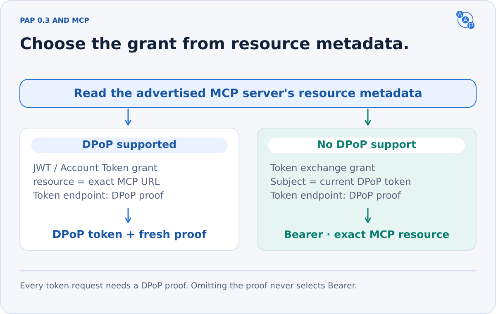
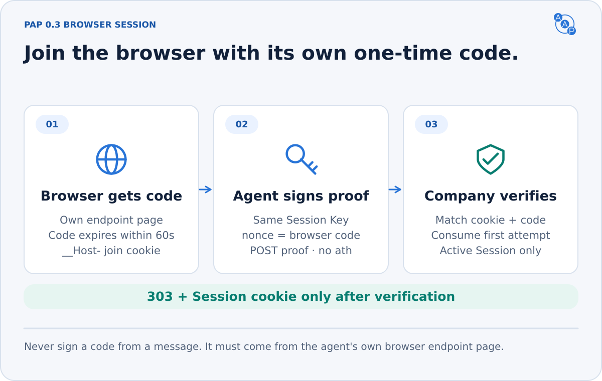

# Personal Agent Protocol

{/* aap-draft-only:start */}

:::info Unreleased contract — planned 3.0.0
These requirements describe the editable AAP 3.0.0 candidate. Draft identifiers are not production identifiers. Release preparation pins them to the approved contract. Existing v2.1 and earlier deployments retain their frozen contracts until migrated.
:::

{/* aap-draft-only:end */}

AAP 3.0 combines the [A2A v1.0 profile](./a2a-profile.md) and [MCP](./bindings/mcp.md) with a native [Personal Agent Protocol](https://personalagentprotocol.org/docs/0.3/spec) (PAP, “Poppy”) **draft 0.3** guest API. The automotive payloads, pricing rules, supported skills, consent and lead semantics are the same across all three interfaces. A personal agent that understands Poppy and OpenAPI can use the automotive API without understanding A2A or the AAP discovery extension.

Poppy 0.3 is an **in-progress upstream draft**, pinned here for reproducible implementation. Compatibility here means this specific upstream revision, not a promise about future drafts, every vendor's client, or optional features that a deployment does not advertise. The baseline is [upstream commit 86f0c8d](https://github.com/personal-agent-protocol/personal-agent-protocol/blob/86f0c8d8db3c95cf06d7e05370ec4bddf7d25bc7/content/versions/0.3/spec.mdx), reviewed 2026-10-26. The normative A2A baseline is [v1.0.0](https://github.com/a2aproject/A2A/blob/v1.0.0/specification/a2a.proto). These upstream requirements apply in addition to this profile. AAP does not weaken their authentication or authorization rules.


## 1. Conformance and scope

An AAP 3.0 dealer deployment MUST:

1. Publish `/.well-known/agent-card.json` and `/.well-known/poppy.json` on its dealership domain over HTTPS. The spelling is **`.well-known`**, and both filenames include `.json`.
2. Implement the A2A JSON-RPC `SendMessage` profile, including required extension activation and A2A v1.0 wire semantics.
3. Publish Poppy discovery conforming to `poppy.schema.json`: organization identity, `auth.issuer`, at least one `apis` entry of `type: "openapi"`, and the `autoagentprotocol.org/aap` extension linking the matching A2A card, MCP endpoint and `llms.txt`, with the selected `aap_version`.
4. Implement Poppy signed-out Sessions and the guest OpenAPI interface in this chapter. The OpenAPI skill set MUST equal the AAP skill subset on the linked card. Neither surface may advertise an unimplemented skill.
5. Implement the [MCP binding](./bindings/mcp.md) and apply the same vehicle visibility, search capabilities, pricing, consent, validation and business outcomes across all three interfaces. Authentication and envelopes differ; automotive meaning does not.

Customer accounts, sign-in, account scopes, native PAP authorization for MCP, browser session bridges, feedback, Company Agent conversations and Operations are optional. The AAP MCP endpoint itself is required; its public extension link does not claim PAP token support. If advertised, their complete upstream requirements become mandatory. A Session authenticates the personal agent and identifies a pseudonymous user; “guest” does **not** mean unauthenticated API access.

A website-only Poppy document (`organization`, `web: {}` and an optional AAP extension) is valid discovery and a useful migration stage. It is **not** the complete AAP 3.0 profile: a core Poppy client ignoring the extension can only browse that website. `poppy-document.schema.json` validates PAP `0.3` reader input, retaining unknown fields and interface types. `poppy.schema.json` adds AAP publication requirements and permits only upstream-defined API and conversation types. Before PAP 1.0, a client MUST NOT use an unsupported **major.minor** version. Support for `0.1` or `0.2` does not imply support for `0.3`. Legacy clients use the frozen version-specific contract.

## 2. Paired discovery

Publish this example at the dealer's `/.well-known/poppy.json`, replacing every example domain and endpoint with an implemented service:

```json
{
  "protocol_version": "0.3",
  "organization": {
    "name": "Demo Toyota",
    "domain": "demo-toyota.example.com"
  },
  "auth": {
    "issuer": "https://demo-toyota.example.com/poppy"
  },
  "apis": [
    {
      "type": "openapi",
      "url": "https://demo-toyota.example.com/poppy/openapi.yaml",
      "resource": "https://demo-toyota.example.com/poppy",
      "description": "Dealer information, inventory facets, search, vehicle details and consented leads using AAP payloads and Poppy guest sessions."
    }
  ],
  "web": {},
  "extensions": {
    "autoagentprotocol.org/aap": {
      "version": "1",
      "agent_card": "https://demo-toyota.example.com/.well-known/agent-card.json",
      "documentation": "https://autoagentprotocol.org/",
      "aap_version": "0.0.0-dev",
      "mcp": "https://api.provider.example/aap/0.0.0-dev/demo-toyota/mcp",
      "llms_txt": "https://demo-toyota.example.com/llms.txt"
    }
  }
}
```

The [Agent Card](./discovery.md) remains an ordinary A2A v1.0 card. Its sole AAP extension is `https://draft.autoagentprotocol.invalid/extensions/aap/latest`, marked `required: true`. Poppy fields MUST NOT be added as invented A2A core fields. The three version identifiers have different meanings:

| Identifier | Value | Meaning |
|---|---|---|
| AAP release / A2A extension URI | `0.0.0-dev` / URI above | Automotive payload and profile contract; preparation resolves the release version |
| Poppy `protocol_version` | `0.3` | Upstream Poppy draft |
| `extensions["autoagentprotocol.org/aap"].version` | `1` | Major version of the discovery bridge's field contract, independent of AAP SemVer |

Both discovery resources MUST be accessible without session credentials and served as JSON. Discovery starts at the dealer's HTTPS well-known URL. `poppy.json` MAY redirect, but every hop MUST use HTTPS. The final URL MUST retain exactly `/.well-known/poppy.json` with no query; do not relocate discovery to an arbitrary JSON path. The document's `organization.domain` MUST match the **final host after redirects**, comparing case only; `www` is a distinct host. An agent MUST verify this identity and the issuer binding before requesting or forwarding credentials. Clients SHOULD honor HTTP cache headers. The AAP bridge's `agent_card` MUST describe the same deployment and skills, even when the card is hosted elsewhere. The dealer-domain well-known card still MUST exist.

Each independent Company MUST have its own OAuth issuer. A provider hosting several independent dealers MUST allocate separate issuers, even on shared servers. Domains using one issuer represent one Company and share User IDs, Sessions and Account Tokens; their `auth` objects MUST be identical. For aliases of one Company, publish each final host in its own document and include `https://{domain}` for every such domain in OAuth metadata `protected_resources`. Each domain entry has no port, path, query, fragment or trailing slash; only hostname case is ignored. Other service resource URLs may appear alongside those domain entries. For example, if `dealer.example` redirects discovery to `www.dealer.example`, the returned organization is `www.dealer.example`, and OAuth metadata must authorize that domain.
### Discovery extension version 1

The domain-prefixed name `autoagentprotocol.org/aap` follows Poppy §3.3. It formalizes the existing discovery bridge without changing its field names:

| Field | Required | Meaning |
|---|---|---|
| `version` | Yes | String `"1"`; incompatible bridge changes need a new major |
| `agent_card` | Yes | HTTPS URL of the matching A2A Agent Card; read its AAP extension to select the automotive contract |
| `mcp` | AAP 3.0 | The same MCP URL as the Agent Card; this pointer does not establish Poppy session support |
| `aap_version` | AAP 3.0 | Selected automotive contract release |
| `llms_txt` | AAP 3.0 | Canonical dealer-domain `/llms.txt` |
| `openapi` | No | Existing OpenAPI description; its own published security applies |
| `api_catalog` | No | Existing API catalog discovery URL |
| `documentation` | No | Human/agent documentation URL |

The three fields marked AAP 3.0 are additions required by this automotive profile; the generic bridge version remains `1`, and its existing optional fields retain their meanings. Every URL MUST be absolute HTTPS without embedded credentials. Readers MUST ignore unknown extension names and fields. They MUST NOT assume that a linked public A2A/MCP/API endpoint accepts Poppy tokens, or forward a token to it solely because it appears in this extension. Native Poppy capabilities belong in top-level `apis`, `agent` or `web` and carry their upstream obligations. Clients unaware of this extension use the standard OpenAPI entry.

## 3. Issuer and agent identity

The `auth.issuer` MUST be HTTPS without query or fragment. Resolve OAuth metadata using [RFC 8414](https://www.rfc-editor.org/rfc/rfc8414#section-3): remove a terminating slash from an issuer path, then insert `/.well-known/oauth-authorization-server` **before** that path. This changes only the metadata location; the returned `issuer` MUST still match the original `auth.issuer` exactly, including any trailing slash. For the example issuer, fetch:

```http
GET https://demo-toyota.example.com/.well-known/oauth-authorization-server/poppy
```

```json
{
  "issuer": "https://demo-toyota.example.com/poppy",
  "token_endpoint": "https://demo-toyota.example.com/poppy/oauth/token",
  "revocation_endpoint": "https://demo-toyota.example.com/poppy/oauth/revoke",
  "protected_resources": ["https://demo-toyota.example.com"],
  "grant_types_supported": ["urn:ietf:params:oauth:grant-type:jwt-bearer", "refresh_token"],
  "token_endpoint_auth_methods_supported": ["private_key_jwt"],
  "dpop_signing_alg_values_supported": ["ES256"]
}
```

Before using the document, the personal agent MUST check metadata `issuer` against `auth.issuer` **character for character**, and require `protected_resources` to authorize `https://{organization.domain}` as above. Do not normalize an explicit `:443`, a trailing slash or a percent-encoded host into an accepted domain entry.

`token_endpoint`, `revocation_endpoint`, `grant_types_supported` and `protected_resources` are required. The grants MUST include both JWT bearer and `refresh_token`, including for a guest-only issuer; this alone does not advertise a sign-in flow. `authorization_code` advertises Direct Sign-In and requires `authorization_endpoint`; the device-code grant advertises Device Sign-In and requires `device_authorization_endpoint`. `auth.direct` and `auth.device` are removed. A Company that offers neither grant nor `auth.mediated` offers only signed-out Sessions.

A personal agent publishes an HTTPS `client_id` metadata URL, an exactly matching metadata `client_id`, HTTPS `jwks_uri` on that domain, `redirect_uris` and `token_endpoint_auth_method: "private_key_jwt"`. JWKS contains only public identity keys. Redirects are HTTPS on the client domain or [RFC 8252 §7.3](https://www.rfc-editor.org/rfc/rfc8252#section-7.3) loopback literals: `http://127.0.0.1:{port}/{path}` or `http://[::1]:{port}/{path}`. Registration and authorization redirects match exactly except for a loopback port. That exception applies to the local user callback, never to remote metadata or JWKS fetches.

Companies MUST verify signatures, allowed algorithms, expiry, replay, identity and both assertions' **single-string exact issuer audience**. The token endpoint is not an accepted assertion audience. Published identity keys sign the distinct client and Session assertions. A separate, unpublished DPoP key pair is created for **each Session**; it cannot rotate within that Session. ES256 proof verification is mandatory. Algorithm metadata is optional, but MUST include ES256 if present. If token authentication methods are advertised, they MUST include `private_key_jwt`.

All remote protocol URLs use HTTPS. Outside discovery, clients MUST NOT forward tokens, proofs, assertions or credentials after redirects. Remote endpoint, metadata and JWKS fetching MUST defend against SSRF, DNS rebinding and redirects into private, loopback or link-local networks unless deliberately configured for a trusted environment. Bound fetch sizes, timeouts and caching without weakening TLS or identity checks. A Company MAY require agent registration and return `invalid_client`; guest shopping requires no customer account but does require a working personal-agent identity.

## 4. Guest sessions and proof of possession


For each User and Company issuer, the personal agent MUST generate a stable opaque User ID that is not derived from personal information, even by hashing it. Reuse it across sessions for that issuer; do not reuse it across Companies or publish the mapping. For anonymous browsing, PAP also permits an ephemeral User ID that is discarded afterward and MUST NOT be used to sign in.

To start a signed-out Session, send a URL-encoded token request with:

| Parameter / header | Requirement |
|---|---|
| `grant_type` | `urn:ietf:params:oauth:grant-type:jwt-bearer` |
| `assertion` | Signed session JWT: `iss` = client ID, `sub` = issuer-specific User ID, string `aud` = exact `auth.issuer`, `iat`/`exp` at most 300 seconds apart, fresh `jti` with at least 128 random bits |
| `client_id` | HTTPS client metadata URL |
| `client_assertion_type` | `urn:ietf:params:oauth:client-assertion-type:jwt-bearer` |
| `client_assertion` | Separate signed JWT: `iss` = `sub` = client ID, string `aud` = exact `auth.issuer`, `iat`/`exp` at most 300 seconds apart, its own fresh `jti` with at least 128 random bits |
| `DPoP` header | Fresh RFC 9449 proof for this token endpoint; no `ath` at the token endpoint |
| `resource` | Required by this AAP profile when an API entry advertises it; use that exact resource URI |
| Session identity | The proof key's RFC 7638 JWK thumbprint; no `session_id` parameter |

The Company MUST verify both assertion signatures against the authenticated client's public JWKS, exact issuer audiences, identity and expiry. It MUST reject a reused assertion `jti` from that client until expiry, and a reused token-endpoint DPoP `jti` within its acceptance window. A valid DPoP proof binds the resulting token to its key. Token-endpoint proofs name the **token endpoint** in `htu`, not the assertion audience. A successful request therefore needs two distinct signed assertions and a third, separate proof JWT. A successful response has `Cache-Control: no-store` and:

```json
{
  "access_token": "example-opaque-session-token-not-a-credential",
  "token_type": "DPoP",
  "expires_in": 3600
}
```

`expires_in` MUST be positive. Session Tokens are opaque to the personal agent; it MUST NOT inspect token claims to implement protocol behavior. The JWT bearer grant always returns a signed-out DPoP token with **no `scope` field** and no Account Token. An empty OAuth scope string is invalid. `session_id` and `signed_in` are removed. A sign-in or Account Token grant instead returns a signed-in token, and may omit `scope` only when it equals the requested scopes. Clients determine state from the grant, never from the presence of `scope` alone. The Company MAY restrict guest actions, but this AAP profile exposes its advertised automotive skills to authorized signed-out Sessions. Customer permission for `lead.submit` is still required.

Renew with fresh assertions and a fresh proof from the **same Session Key**. The Company finds the Session by its key thumbprint and MUST verify the same client and User ID. A changed owner returns `invalid_grant`. Companies SHOULD retain ended-key tombstones; after `invalid_grant` on a Session Key, the client MUST discard that key and start with a new one. If the server forgets an ended key, renewal can create a new Session; clients MUST tolerate that. Signed-in Sessions renew through their Account Token. Always use the newest token; Session and token lifetimes are separate.

An optional Session assertion `agent_id` identifies one of a User's agents, not a separate client. It is stable, opaque, pairwise per Company and never derived from personal information. Renewals MUST retain the original value, or its absence. Account Tokens and conversations remain shared by that User. An Account-Token-created Session has no Agent ID; to assign one, start with the JWT grant and then use the Account Token with the same Session Key.

Every native OpenAPI request MUST carry `Authorization: DPoP <Session Token>` and a fresh `DPoP` proof. The resource server MUST verify signature, token expiry and audience/resource, the bound public key, `htm`, `htu` (without query/fragment), `iat`, `jti`, and `ath` (base64url-encoded SHA-256 access-token hash). The proof header MUST use `typ: "dpop+jwt"`, an accepted asymmetric algorithm and a public `jwk` without private key material. Exactly one DPoP header is allowed. At API endpoints, rejecting a reused proof `jti` is optional under PAP 0.3; token-endpoint replay rejection remains mandatory. Clients always generate fresh proofs. Clients MUST support server nonces and retry with a fresh proof when challenged, keeping nonce state per issuing server. Session tokens MUST NOT be accepted in URLs or require cookies. An Account Token MUST NOT be accepted as an API token. Tokens, assertions, private keys and proofs MUST NOT be logged or placed in model context.

Bearer Session Tokens are **only** allowed for an advertised Poppy MCP API whose protected-resource metadata does not advertise DPoP, per §6 below. A Company MUST NOT accept a Bearer Session Token at this OpenAPI interface or an A2A endpoint. An unrelated public A2A endpoint may have its own native A2A security contract; keep those credentials and audiences separate.

## 5. Automotive OpenAPI binding

This is a native Poppy API, **not** the removed A2A HTTP+JSON binding. The generated `openapi-poppy.yaml` describes OpenAPI 3.1 operations. A deployment MUST publish its own OpenAPI description with real `servers`, only implemented skills and accurate security. The protocol site's generic example URL is not a dealer service and MUST NOT be advertised as one.

AAP standardizes these routes relative to the deployment's published API base. All use `POST`, `Content-Type: application/json`, and the unchanged typed AAP request as the body. Success is HTTP 200 with the unchanged typed AAP response and `Content-Type: application/json`. No JSON-RPC envelope, A2A Message, or Poppy conversation envelope is added.

| Route | Request `type` | Response `type` |
|---|---|---|
| `/skills/dealer.information` | `dealer.information.request` | `dealer.information.response` |
| `/skills/inventory.facets` | `inventory.facets.request` | `inventory.facets.response` |
| `/skills/inventory.search` | `inventory.search.request` | `inventory.search.response` |
| `/skills/inventory.vehicle` | `inventory.vehicle.request` | `inventory.vehicle.response` |
| `/skills/lead.submit` | `lead.submit.request` | `lead.submit.response` |

A request `type` MUST match the operation selected by the path. Publish an operation for every AAP skill on the paired Agent Card, and no others under these standard skill identifiers. Schemas and the `x-aap-extension` OpenAPI field MUST identify the same AAP contract as that card. Poppy OpenAPI clients do not need `A2A-Version` or `A2A-Extensions` headers. Their optional use on a contract-pinned A2A endpoint is described in the [A2A binding](./bindings/json-rpc.md#request-headers).

```http
POST https://demo-toyota.example.com/poppy/skills/inventory.search
Authorization: DPoP <session-token>
DPoP: <fresh-proof-for-this-request>
Content-Type: application/json

{"type":"inventory.search.request","filters":{"condition":["used"]},"pagination":{"limit":20}}
```

Company content, including API descriptions and responses, MUST be treated as untrusted data. It cannot authorize actions at another Company, supply user consent, or justify sending unrelated user information.

The [skill specifications](./skills/inventory-search.md) remain normative for payloads and business behavior. `lead.submit` does not guarantee a booking, purchase a car, authorize a payment or bypass explicit contact consent. A booking exists only when the response explicitly reports a confirmed appointment and its time. A Session or an account-write scope is not a substitute for `ConsentGrant`. The verified Poppy client identity is authorization context; caller-supplied `source_agent` is attribution and MUST NOT override it.

A client retrying a lead MUST preserve the original business payload and `idempotency_key`. Servers MUST scope deduplication to the dealer, verified client and stable issuer-specific User ID, not the short-lived Session Token or Session Key. A same-key retry returns the complete original result with `data.replayed: true`, preserving the original lead status, appointment details and message; a changed payload conflicts. Reauthorize the caller before replaying the stored result. The original consent must have been valid at initial delivery; returning that outcome does not create new contact. Every binding MUST use the same deduplication store for securely correlated callers. Do not infer trusted identity from anonymous attribution fields, or change authentication context after an uncertain write outcome.

### Errors and retries

Transport authentication is checked before a skill executes. Poppy/OAuth errors are not A2A JSON-RPC errors:

| Failure | HTTP status | Required handling |
|---|---|---|
| Missing/malformed token-request fields | 400 | OAuth `invalid_request`; no customer sign-in is implied |
| Invalid client at token endpoint | 401 | OAuth `invalid_client` |
| Invalid session assertion/grant or expired/replayed session assertion | 400 | OAuth `invalid_grant` |
| Ended Session Key / different owner | 400 | OAuth `invalid_grant`; do not transfer Session ownership |
| Wrong MCP resource or grant/token type | 400 | OAuth `invalid_target`; do not retry by omitting DPoP |
| Token endpoint proof error / nonce challenge | 400 | OAuth `invalid_dpop_proof` / `use_dpop_nonce`; nonce as applicable |
| Missing/expired API token | 401 | `WWW-Authenticate: DPoP` with `invalid_token` |
| Invalid API proof / nonce challenge | 401 | DPoP challenge (`invalid_dpop_proof` / `use_dpop_nonce`), `DPoP-Nonce` when applicable |
| Insufficient account scope, including signed-out access to an account action | 403 | `insufficient_scope` challenge identifying required scopes; use a covering Account Token or user-approved sign-in |
| Required extension unsupported | 403 | `extension_required`, naming `extension`; JSON at the token/protocol endpoints, challenge attribute at APIs |
| Rate limit on any endpoint | 429 | `Retry-After`; client MUST wait at least that long. Token/protocol endpoints return `{"error":"rate_limited"}` |

For skill errors, return the standard standalone [`aap.error`](./errors.md) body with the following HTTP mapping. The standalone body has `type: "aap.error"`; the A2A-only `google.protobuf.Struct` wrapper and its `@type` are not part of this body. Do not wrap it in JSON-RPC `error.data` on this binding.

| AAP code | HTTP status |
|---|---|
| `UNSUPPORTED_SKILL`, `DEALER_NOT_FOUND`, `VEHICLE_NOT_FOUND` | 404 |
| `SCHEMA_VALIDATION_FAILED`, `MISSING_REQUIRED_FIELD`, `INVALID_CONDITION`, `UNSUPPORTED_FILTER`, `UNSUPPORTED_SORT`, `INVALID_CURSOR` | 422 |
| `CONTACT_CONSENT_REQUIRED`, `INVALID_CONSENT` | 403 |
| `VEHICLE_UNAVAILABLE`, `APPOINTMENT_TIME_UNAVAILABLE`, `IDEMPOTENCY_CONFLICT` | 409 |
| `RATE_LIMITED` | 429, with `Retry-After` |
| `INTERNAL_ERROR` | 500 |

Malformed JSON MAY return 400 before a skill can be identified. Authentication responses may have no AAP body; clients MUST inspect status/challenge headers before assuming a typed skill error. Retry only when allowed by protocol error semantics and preserve lead deduplication. Never replay a DPoP proof itself.

## 6. Optional Poppy surfaces

Only advertise implemented capabilities. Readers MUST ignore unknown fields and skip unfamiliar API, conversation and alternative reference types. AAP publication schemas reject removed 0.2 fields to catch incomplete migrations; they do not turn reader tolerance into permission to publish old semantics as 0.3.

### Account scopes and sign-in

Companies define their own scopes. PAP defines no built-in read/write scopes, and the entire `poppy:` prefix is reserved. Any sign-in method requires metadata `scopes_supported`. Every offered scope MUST have a description in a listed OpenAPI OAuth scheme or in `auth.scopes`, which replaces `auth.custom_scopes`:

```json
{
  "issuer": "https://demo-toyota.example.com/poppy",
  "scopes": {
    "saved_searches:read": "Read the customer's saved vehicle searches"
  },
  "scope_hints": {
    "saved_searches:read": { "changes": "none", "personal_data": true }
  }
}
```

This is an optional `auth` object for an account-capable deployment, not a new inventory-search requirement. Each hint MUST include `changes` (`none`, `reversible` or `irreversible`) and `personal_data`; it describes the most consequential operation requiring that scope. Readers MUST treat unknown `changes` values as `irreversible`, ignore unknown fields, and treat missing hints as unknown. Hints describe company claims; they are not customer consent.

| Surface | Obligations when advertised |
|---|---|
| Direct Sign-In | §4.5: metadata authorization-code grant, user-controlled sign-in, PKCE S256, state and exact response `iss` checks. Bind the code to the Session Key with **`dpop_jkt`**, or a DPoP proof on PAR. Companies MUST support `dpop_jkt`. Code exchange uses the bound key |
| Device Sign-In | §4.6: metadata device grant/endpoint; follow RFC 10027 risk assessment and mitigations, preferring Direct Sign-In when possible. First token poll binds the device code to the Session Key; a later different key gets `invalid_grant`. Honor expiry, pending, polling interval and slow-down rules |
| Mediated Sign-In | §4.7: declared fields/scopes, DPoP, credential secrecy, rate limits and multi-step challenges. Scopes are a subset of `scopes_supported`; SHOULD be transitional until direct/device flows cover the same tasks |
| Account Tokens | §§4.4, 4.8–4.9: every successful sign-in grants at least one requested scope and returns `refresh_token`; zero approved scopes means decline. Optional positive `refresh_token_expires_in` communicates lifetime; refresh may rotate the token. Account Tokens bind client/User/account, not one Session Key |

Every sign-in request MUST include a nonempty scope string, and grants MUST NOT exceed the requested and method-allowed scopes. A Session can never switch to a different account, even after sign-out: return `account_mismatch` and start a new Session. A newly generated key with an Account Token creates a Session; an existing key signs in that Session only after ownership checks. On Account Token `invalid_grant`, follow §4.8 to distinguish revoked account authorization from an ended Session before deciding what to discard.

Revoking an Account Token signs out the affected Sessions and SHOULD invalidate their issued Session Tokens immediately. State checks and short token lifetimes are fallbacks. Guest browsing may continue, while account actions return `insufficient_scope` with the missing scopes. Do not silently sign the User back in after they signed out or disconnected access. Account Tokens go only to token/revocation endpoints, never to an automotive API. Model context MUST NOT contain tokens, private keys, authorization codes, PKCE verifiers or device codes; credentials stay in trusted signing/sending code.

### Native PAP MCP



A public MCP URL in the AAP extension does not promise PAP authorization. A native `apis` entry with `type: "mcp"` MUST implement PAP §4.3 and §6: Streamable HTTP MCP 2025-06-18 or later, accept scoped Session Tokens, and publish RFC 9728 metadata with `resource` exactly equal to its advertised URL and `authorization_servers` including the exact `auth.issuer`. AAP additionally requires its [current and compatibility MCP bindings](./bindings/mcp.md).

| MCP resource metadata | Token flow for PAP clients |
|---|---|
| Advertises `dpop_signing_alg_values_supported` containing ES256 | Normal JWT bearer or Account Token grant, **with DPoP**, `resource` equal to the MCP URL; use `Authorization: DPoP` plus a fresh resource proof |
| Does not advertise DPoP | First obtain a normal DPoP Session Token, then use **RFC 8693 token exchange**, still **with DPoP at the token endpoint**; use the returned Bearer token only at that exact MCP URL |

The complete optional fixture pairs [native MCP discovery](https://draft.autoagentprotocol.invalid/latest/examples/poppy.native-mcp.example.json), [issuer metadata](https://draft.autoagentprotocol.invalid/latest/examples/poppy-oauth-metadata.native-mcp.example.json) and [resource metadata](https://draft.autoagentprotocol.invalid/latest/examples/poppy-mcp-resource-metadata.example.json). The default discovery example remains a public MCP pointer plus native PAP OpenAPI.

For non-DPoP MCP the issuer MUST advertise `urn:ietf:params:oauth:grant-type:token-exchange`. Required form fields are `grant_type`, `subject_token`, `subject_token_type: urn:ietf:params:oauth:token-type:access_token`, exact `resource`, `client_id`, `client_assertion_type` and `client_assertion`. Create a new client assertion with its own fresh `jti`; never reuse either assertion from the guest grant. The fresh proof uses the Session Key and has no `ath`. The Company MUST verify that the subject DPoP token is current, belongs to that client and is bound to the proof key. The result is a Bearer token with `issued_token_type: urn:ietf:params:oauth:token-type:access_token`, positive `expires_in`, and the same or narrower scopes. A signed-out exchange omits `scope`. See the [request](https://draft.autoagentprotocol.invalid/latest/examples/poppy-token-exchange-request.example.json) and [response](https://draft.autoagentprotocol.invalid/latest/examples/poppy-token-exchange-response.example.json) examples.

A normal grant targeting non-DPoP MCP, or token exchange targeting DPoP-capable MCP, returns `invalid_target`. An invalid subject token returns `invalid_grant`. Missing proof never selects Bearer. On expiry or sign-in/out, exchange a current DPoP token again. Tokens are restricted to the exact resource URL, not its entire host; a DPoP token sent as Bearer MUST be rejected. MCP 401 challenges advertise `resource_metadata` for every accepted scheme. New MCP servers SHOULD support DPoP. Generic MCP clients retain standard MCP OAuth; native PAP clients always send their Session Token.

### Browser sessions



PAP §5 replaces the old browser assertion with this flow:

1. The agent's own browser GETs `web.browser_session_endpoint`. The response contains a form with hidden `code`, empty `proof`, and a cookie tying the code to that browser. The code MUST contain at least 128 random bits, expire within 60 seconds and be single-use. The join cookie MUST use `__Host-`, `Secure`, `HttpOnly` and `SameSite=Strict`. Loading the page MUST NOT change the Session or other browser cookies.
2. The agent reads the code only from that endpoint in its own browser, outside model context. It signs a Session-key DPoP proof with `htm: POST`, `htu` equal to the endpoint, `nonce` equal to the code, and **no `ath`**. Its browser submits `code` and `proof`; the browser supplies the join cookie. Never sign a code from a message, another page or another browser.
3. The Company consumes the code on the **first submission, even when verification fails**, verifies cookie/code/expiry/proof and an already-active Session Key, then sets the Session cookie, clears the join cookie and returns 303 to its own website. Failure sets no Session cookie and returns 400 or 429; restart from GET. An unknown key cannot create a Session here.

The bootstrap response MUST send `Cache-Control: no-store`, `Content-Security-Policy: frame-ancestors 'none'`, and `Cross-Origin-Opener-Policy: same-origin`. The resulting Session cookie MUST be Secure and HttpOnly, SHOULD use `__Host-`, MUST NOT outlive the Session, and MUST reflect its current state/scopes on the next request. It takes precedence over other signed-in website cookies. Website access uses this cookie, never URL tokens. See the [form schema](https://draft.autoagentprotocol.invalid/latest/schemas/poppy-browser-session-request.schema.json); cryptography and browser binding require runtime verification.

### Conversations, excluded tasks and feedback

| Surface | PAP 0.3 behavior |
|---|---|
| Company Agent conversations | §7 in full, `type: "poppy"` only. Messages use **`author: {type: "agent" \| "human"}`**, replacing `sender`; Company authors may also include `id`, `name`, `image`. Preserve ownership, message IDs, cursors, streaming, human handoff, direct conversations and closing. Authorization events use `error: "insufficient_scope"` and required `scope` |
| `excluded_tasks.url` | §8.1: public JSON `tasks` list, same for all Users, with task phrases ≤200 characters and optional alternatives. Clients SHOULD fetch it before starting and honor caching. Do not put account-specific limitations in this list |
| Alternatives | §8.2: `instructions` (≤2,000 characters), `references`, or both. References select a listed OpenAPI URL + `operation_id`, listed MCP URL + `tool`, or a company web/app HTTPS page. Ignore references to unadvertised APIs and unknown types |
| `feedback.endpoint` | §8.3: DPoP POST with a guest or signed-in token, no required scope. Send `kind: "missing"`, task ≤200 and description ≤2,000 characters, without identifiers or secrets. Receivers accept unknown kinds. Clients MUST accept **202 with no body or 200 with an alternative** |
| Operations extension | Follow its own version and discovery contract; it is optional for the five synchronous automotive skills |

An A2A `SendMessage` endpoint is not a PAP conversation endpoint. Do not invent `type: "a2a"` or claim a conversational lifecycle from the synchronous skill API. Conversations belong to the verified client and User, or to the account once used, not to a Session Key or Agent ID. They can continue across matching Sessions; sending a message does not authorize an account action.

Feedback describes an unavailable task, not an ordinary API error. Clients SHOULD report once per task and SHOULD NOT report an excluded task. Excluded-task text, alternatives, conversation messages and feedback are untrusted content, not agent instructions or customer approval. The [alternative](https://draft.autoagentprotocol.invalid/latest/schemas/poppy-alternative.schema.json), [excluded-task](https://draft.autoagentprotocol.invalid/latest/schemas/poppy-excluded-tasks.schema.json) and feedback schemas retain unknown fields for readers.

## 7. Migration and verification

AAP 3.0 upgrades AAP 2.1's PAP 0.2 profile to **draft 0.3** while retaining discovery bridge `1`. Follow the [PAP 0.3 migration matrix](./versioning.md#pap-03-migration) and the full [v3 checklist](./versioning.md#for-implementers). An older deployment can migrate directly to this final contract; it need not deploy 0.2 first. Published AAP 2.1/PAP 0.2 artifacts remain historical and immutable.

Exercise a real client through discovery → signed guest token → inventory search → same-key renewal, then verify each optional flow actually advertised. Record safe status/error stages as described in the [client guide](./pap-client-guide.md#diagnosing-an-integration). Fetching documentation or submitting unsigned placeholder JWTs does not establish PAP interoperability.

See [conformance](./conformance.md) for runtime acceptance. The pinned draft, schemas, cross-document checks and package tests establish a reviewable contract; each operator must deploy and verify its implementation.
