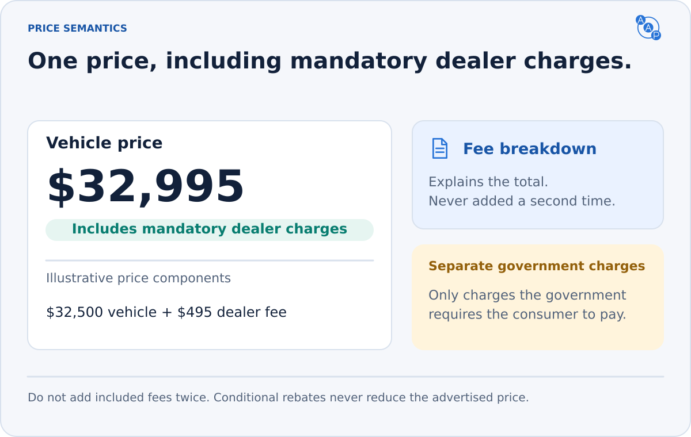

# Pricing and fee disclosure

**Compare `price`. Never add its included fees again.** AAP uses one authoritative advertised vehicle amount across MCP, A2A and PAP.



## Four fields, four meanings

Every amount is an integer in **whole units of its explicitly identified currency**. AAP supports `USD` and `CAD`. A vehicle's `currency` applies to its `price`, `list_price`, `msrp` and every `fees[].amount`. Omission retains the original **USD** meaning; a Canadian address does not change it.

| Field | Meaning | Buyer-agent treatment |
|---|---|---|
| `price` | Advertised amount after universally available discounts, including all mandatory dealer charges and required add-ons | Use for comparisons, price filters and price sorting |
| `fees` | Optional complete itemization of mandatory charges already included in `price` | Show as an included breakdown; never add again |
| `list_price` | Informational base/list amount before relevant discounts and charges | Context only; never a substitute for `price` |
| `msrp` | Manufacturer's suggested retail amount | Reference only |

## Currency and odometer units

Canadian publishers may retain their native numbers: for example, `{"price": 35500, "currency": "CAD", "mileage": 45000, "mileage_unit": "km"}` means **CA$35,500** and **45,000 km**. The same numbers with omitted labels mean **US$35,500** and **45,000 miles**. Country is geographic information, not a currency or odometer conversion rule. Imported vehicles can use an odometer unit different from their location's usual unit.

Each rooftop's `currency` labels its own default fees, again defaulting to USD. Do not inherit rooftop currency onto a vehicle or merge rooftop and vehicle fee arrays. A vehicle snapshot and each partial `vehicle_of_interest` or `trade_in` description carries its own labels.

Search and facets accept top-level `currency` and `mileage_unit` contexts. The effective currency selects one denomination for the matching inventory, price comparisons and price ranges; it never performs foreign-exchange conversion. Odometer filtering and ordering compare readings in the effective query unit using exactly **1 mile = 1.609344 kilometres**, without rounding before comparison. Returned vehicle readings keep their labelled native units. See [inventory search](./skills/inventory-search.md#currency-and-odometer-context) for defaults and result labels.

`radius_mi`, `distance_mi`, `electric_range_mi` and their range filters always remain **miles**, regardless of country or `mileage_unit`.

`price` excludes only charges a government requires the **consumer** to pay, such as applicable tax, title or registration. A tax or fee owed by the dealer and passed to the buyer remains included, as does a dealer fee merely permitted by government. Optional products are outside the mandatory fee breakdown.

A price cannot depend on an additional down payment, dealer financing, trade-in, military service, loyalty or another eligibility condition. Conditional incentives may be explained separately; they MUST NOT reduce `price`. Display authoritative price prominently and label reference amounts clearly.

## Missing is different from zero

| Representation | Meaning |
|---|---|
| `price` present, `fees` omitted | Authoritative amount known; no breakdown supplied |
| `fees: []` | No mandatory dealer charges or required add-ons |
| Nonempty `fees` | Complete effective breakdown for this vehicle |
| `price` omitted | Authoritative price unknown, even if list amount and fees are present |

A listing without a price remains valid. It does not match a price-bound filter and does not contribute to `price_range`. Do not estimate or reconstruct its price from other fields.

## Included charges are not a calculation recipe

```json
{
  "vehicle_id": "vehicle_example_001",
  "list_price": 24990,
  "price": 26280,
  "fees": [
    { "name": "Documentation fee", "amount": 500 },
    { "name": "Required protection product", "amount": 1000 }
  ],
  "status": "available",
  "updated_at": "2026-10-24T14:00:00Z"
}
```

This fictional dealer applied a $210 discount available to every buyer. Show **$26,280**, including the itemized $1,500. Do not show $27,780 or reconstruct $26,490 from the list amount. The protocol does not require `list_price + sum(fees) == price`.

Each fee has a specific nonempty `name` and a nonnegative integer `amount`. Names must be unique within the array. Fee items cannot encode discounts, optional products or excluded government-required consumer charges.

## Resolve rooftop defaults before publication

A rooftop may publish its default fee schedule through `dealer.information`. The inventory publisher resolves those defaults and any vehicle-specific changes before returning a listing.

When vehicle `fees` is supplied, it is a complete replacement snapshot. Buyers MUST NOT join, merge or infer fees from the rooftop, another listing or a cached configuration. Vehicle price remains authoritative even when the optional breakdown is unavailable.

| Source data | Publish |
|---|---|
| Complete advertised amount | `price`; add `fees` only when its complete breakdown is known |
| Base/list amount only | `list_price`, with `price` omitted |
| Base amount + known fees, no certified total | Informational `list_price` and `fees`; omit `price` |
| Amount reduced by an eligibility-dependent rebate | Use the non-conditional advertised amount, or omit `price` if unknown |
| Rooftop defaults + vehicle exceptions | One complete effective vehicle fee array, when supplied |

These semantics describe an advertised vehicle amount. Buyer-specific government charges and a final transaction quote are outside this inventory contract.

## Current enforcement context

Reviewed **2026-10-24**. The FTC's September 2026 staff FAQs explain mandatory-fee inclusion, prominent actual prices, conditional discounts and transparent in-transit listings. They distinguish government-required consumer charges from dealer obligations passed on to buyers. The document states that it represents staff views and is not binding on the public or Commission. [FTC automotive pricing FAQs](https://www.ftc.gov/business-guidance/resources/automobile-industry-pricing-transparency-faqs).

The separate CARS Rule was withdrawn effective February 12, 2026 after the court's vacatur. AAP does not present it as an active rule. [Federal Register withdrawal](https://www.govinfo.gov/content/pkg/FR-2026-02-12/pdf/2026-02866.pdf).

AAP's field meanings are protocol requirements. They do not certify an advertisement or replace an operator's obligations under applicable law.
