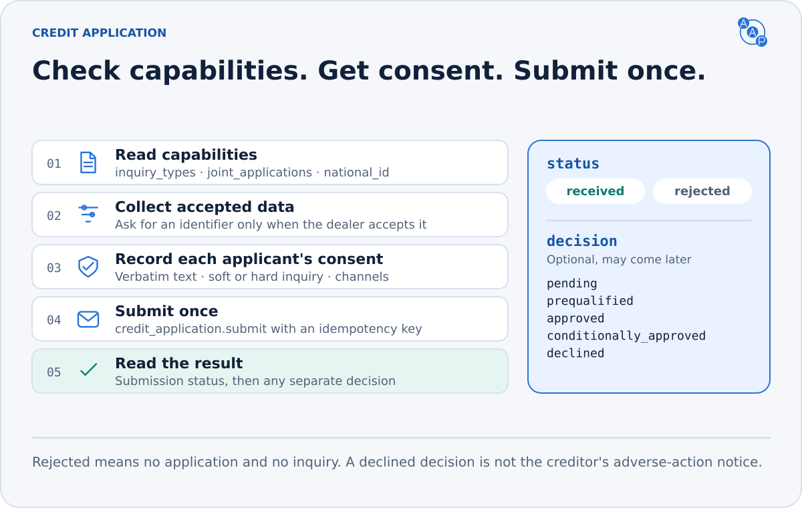
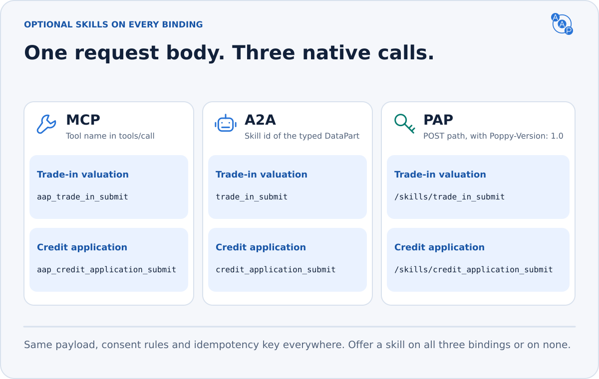
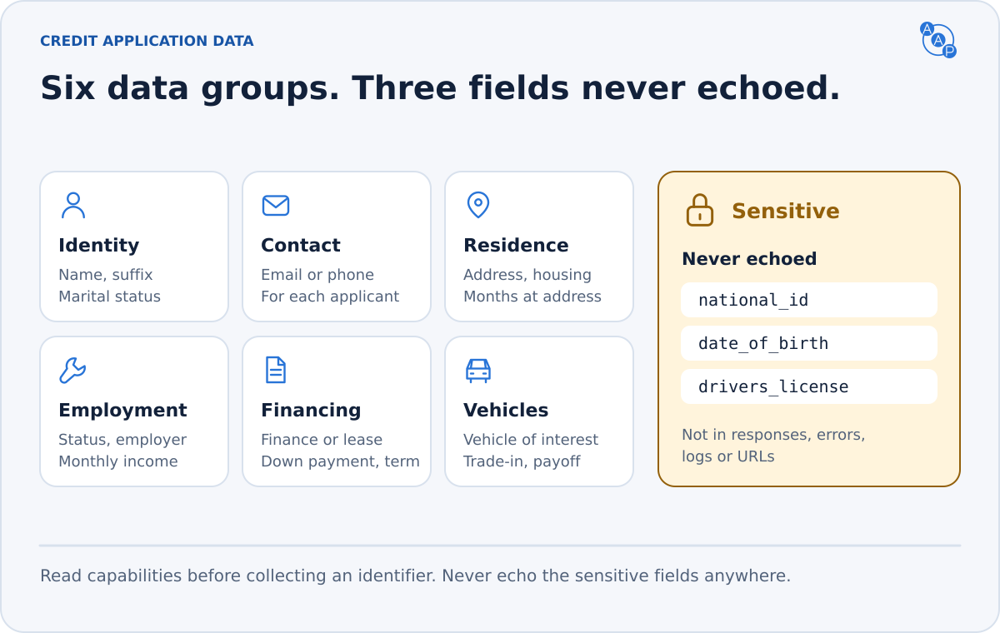
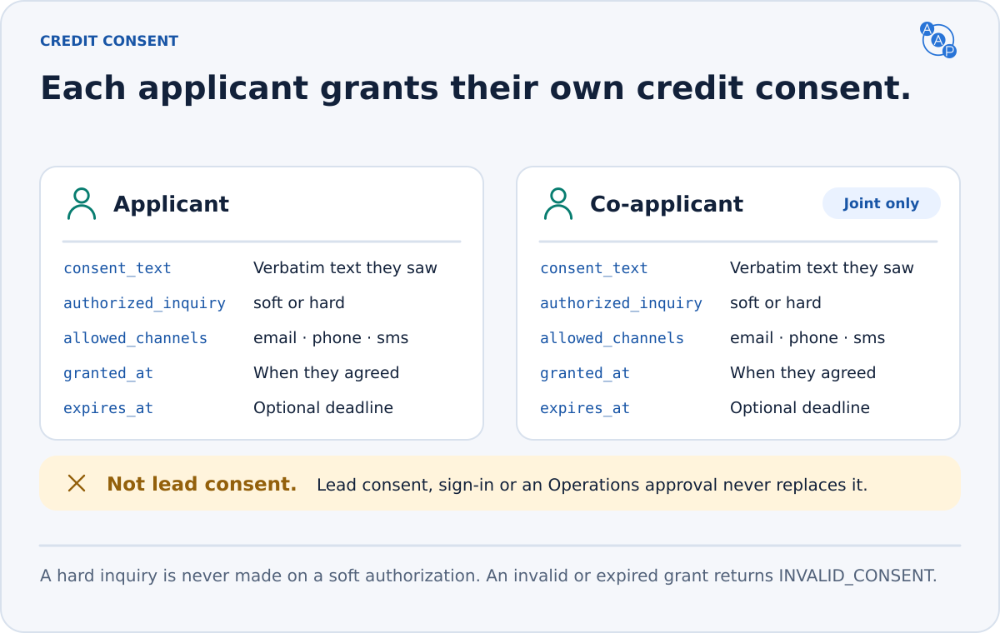
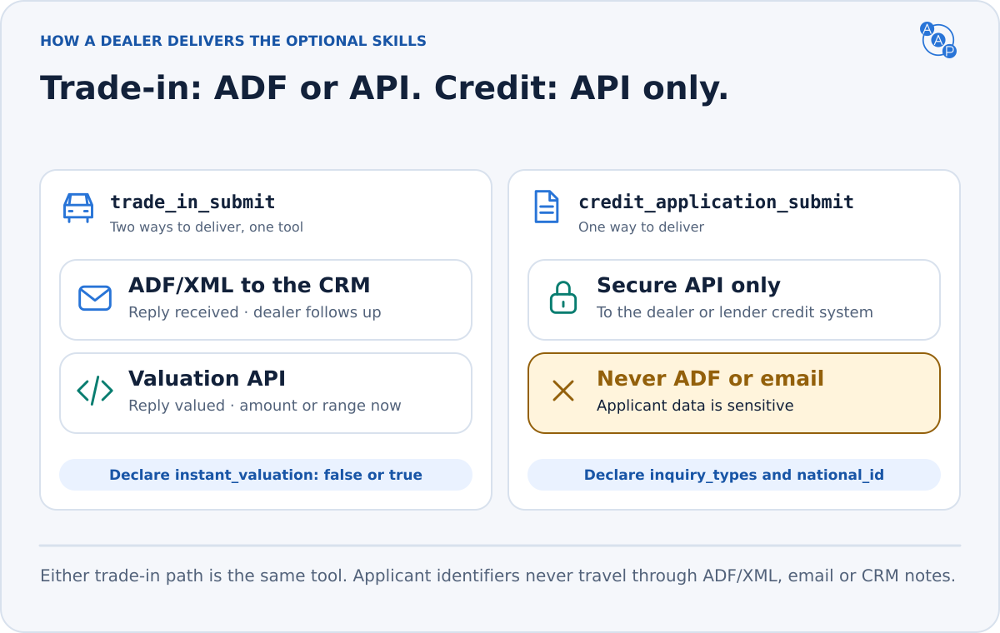

# `credit_application_submit`

{/* aap-draft-only:start */}

:::info Unreleased AAP 4.0 draft
This optional skill is part of the editable AAP 4.0 contract. Draft identifiers are replaced with immutable URLs during release preparation; do not deploy them.
:::

{/* aap-draft-only:end */}

**Send one complete credit application to the dealer, once, with every applicant's own authorization.** This is an optional skill: call it only on a dealer that declares it. The request carries sensitive personal data.



| Step | What the agent does |
|---|---|
| 1. Read capabilities | Learn the accepted inquiry types, joint support, `national_id` policy and currencies before asking the buyer anything. |
| 2. Collect only what is needed | Ask for the required fields and the optional ones the buyer offers; never collect an identifier the dealer does not accept. |
| 3. Record each applicant's consent | Show each applicant the disclosure and record their own `consent` with the inquiry type they authorized. |
| 4. Submit once | Send the request with one `idempotency_key`; keep the key and payload for any retry. |
| 5. Read status and decision separately | `status` reports the submission; an optional `decision` reports the credit outcome. |



| Interface | Invocation |
|---|---|
| MCP | `aap_credit_application_submit` with the typed request as `arguments` |
| A2A | `SendMessage` with the typed request in `DataPart.data`; media types `application/vnd.autoagent.credit-application-submit-request+json` → `application/vnd.autoagent.credit-application-submit-response+json` |
| PAP | `POST /skills/credit_application_submit` (operationId `credit_application_submit`) with the typed request body, the delegated Session JWT and `Poppy-Version: 1.0` |

All three use the same [request schema](https://draft.autoagentprotocol.invalid/latest/schemas/credit-application-submit-request.schema.json), [applicant schema](https://draft.autoagentprotocol.invalid/latest/schemas/credit-applicant.schema.json), [credit consent schema](https://draft.autoagentprotocol.invalid/latest/schemas/credit-consent.schema.json), [response schema](https://draft.autoagentprotocol.invalid/latest/schemas/credit-application-submit-response.schema.json) and deduplication store. The MCP tool is a write tool: `readOnlyHint: false`, `destructiveHint: false`, `idempotentHint: false`, `openWorldHint: true`.

## Read the capabilities first

Read `params.skills["credit_application_submit"].capabilities` on the AAP Agent Card extension, or `tools/list` → `aap_credit_application_submit` → `_meta["autoagentprotocol.org/aap"].capabilities`. Both follow `credit-application-capabilities.schema.json` and MUST agree. A dealer declares the skill identically on all three bindings or not at all.

| Capability | Values | Effect |
|---|---|---|
| `inquiry_types` | required, nonempty subset of `soft`, `hard` | An applicant consent whose `authorized_inquiry` is not listed returns `INVALID_CONSENT`. |
| `joint_applications` | required boolean | `true` when `application_type: "joint"` is accepted. Do not send a joint application otherwise: the dealer answers `SCHEMA_VALIDATION_FAILED` naming `/application_type`, before any record or credit inquiry. |
| `national_id` | required: `required`, `optional`, `not_accepted` | `required`: a missing `applicant.national_id` returns `MISSING_REQUIRED_FIELD`. `optional`: accepted when present. `not_accepted`: the dealer collects it itself; a request containing one returns `SCHEMA_VALIDATION_FAILED` and the value is discarded. |
| `currencies` | optional, default `["USD"]` | Currencies the skill accepts and returns. |

```json
{ "inquiry_types": ["soft", "hard"], "joint_applications": true, "national_id": "optional", "currencies": ["USD"] }
```

## Request fields



### Envelope

| Field | Required | Meaning |
|---|---|---|
| `type` | yes | `credit_application_submit_request` |
| `application_type` | yes | `individual` or `joint` |
| `applicant` | yes | Primary applicant, with their own `consent` |
| `co_applicant` | iff `joint` | Second applicant, with their own `consent` and a `relationship`; forbidden for `individual` |
| `currency` | no | Currency of every amount in the application (income, housing payment, down payment, requested amount, payoff); omitted = `USD` |
| `message` | no | Free-text note, up to 4,000 characters; never identifiers, account numbers or other sensitive data |
| `submitted_at` | no | When the agent finalized the submission; preserve it on a retry |
| `source_agent` | yes | Attribution, not authorization |
| `idempotency_key` | yes | Client-generated key, 1–128 characters (UUID recommended) |

### Applicant identity

| Field | Required | Meaning |
|---|---|---|
| `first_name`, `last_name` | yes | Legal names |
| `middle_name`, `suffix` | no | Middle name or initial; suffix up to 10 characters, such as `Jr.` |
| `date_of_birth` | yes | `YYYY-MM-DD`. Sensitive. |
| `national_id` | no (capability decides) | `{type, value}`: `type` is `ssn`, `itin` or `sin`; `value` is nine digits without spaces or dashes. Sensitive. |
| `drivers_license` | no | `{number, state, expires_on?}`; `state` is a US state or Canadian province code. Sensitive. |
| `marital_status` | no | `married`, `unmarried` or `separated`; provide only where the creditor may lawfully ask |
| `relationship` | co-applicant only | `spouse`, `relative` or `other`; invalid on the primary applicant |

### Contact

| Field | Required | Meaning |
|---|---|---|
| `email`, `phone` | at least one | Phone in E.164. Each channel in the applicant's `consent.allowed_channels` needs its value: `email` → `email`; `phone` and `sms` → `phone`. |

### Residence

| Field | Required | Meaning |
|---|---|---|
| `address` | yes | `address_line_1`, `city`, `state`, `zip` required; `address_line_2`, `country` optional |
| `housing_status` | yes | `own`, `mortgage`, `rent`, `family` or `other` |
| `monthly_housing_payment` | yes | Integer, whole currency units; `0` when none |
| `months_at_address` | yes | Whole months, 0–1200 |
| `previous_address`, `months_at_previous_address` | no | Lenders typically need them under 24 months at the current address; the months need the address |

### Employment and income

| Field | Required | Meaning |
|---|---|---|
| `employment_status` | yes | `employed`, `self_employed`, `military`, `retired`, `student`, `unemployed` or `other` |
| `employer_name` | when `employed`, `self_employed` or `military` | Current employer or business name |
| `occupation`, `employer_phone`, `months_at_employer` | no | Job title, E.164 phone, whole months |
| `gross_monthly_income` | yes | Integer, before tax, whole currency units |
| `other_monthly_income`, `other_income_source` | no; the source is required with the amount | Alimony, child support or separate maintenance need not be revealed unless the applicant wants it considered |
| `previous_employer_name`, `months_at_previous_employer` | no | Lenders typically need them under 24 months with the current employer; the months need the name |

### Co-applicant

A joint application carries a second applicant object with the same fields and rules, plus a required `relationship`. The co-applicant grants their own credit consent; the primary applicant cannot consent for them. See the [joint example](https://draft.autoagentprotocol.invalid/latest/examples/credit-application-submit-request.joint.example.json).

### Financing

| Field | Required | Meaning |
|---|---|---|
| `financing.deal_type` | no | `finance` or `lease` |
| `financing.down_payment` | no | Cash down, whole currency units |
| `financing.requested_term_months` | no | 1–120 |
| `financing.requested_amount` | no | Amount to finance, whole currency units |

### Vehicles

| Field | Required | Meaning |
|---|---|---|
| `vehicle_of_interest` | no | Shared Vehicle shape; sale condition `new`, `used` or `cpo` |
| `trade_in` | no | Shared Vehicle shape with wear condition `excellent`, `good`, `fair` or `poor`, plus `payoff_amount` and `lienholder` |

```json
{
  "type": "credit_application_submit_request",
  "application_type": "individual",
  "applicant": {
    "first_name": "Ada",
    "middle_name": "M",
    "last_name": "Lovelace",
    "date_of_birth": "1988-12-10",
    "email": "ada@example.com",
    "phone": "+14155550123",
    "address": {
      "address_line_1": "1280 Howard Street",
      "address_line_2": "Apt 5",
      "city": "San Francisco",
      "state": "CA",
      "zip": "94103",
      "country": "US"
    },
    "housing_status": "rent",
    "monthly_housing_payment": 2850,
    "months_at_address": 41,
    "employment_status": "employed",
    "employer_name": "Analytical Engines Inc.",
    "occupation": "Software Engineer",
    "employer_phone": "+14155550188",
    "months_at_employer": 30,
    "gross_monthly_income": 9800,
    "consent": {
      "granted_at": "2026-11-19T10:40:00Z",
      "consent_text": "I, Ada M Lovelace, authorize Demo Toyota and the lenders it works with to obtain my consumer credit report through a soft inquiry and to use the information in this application to evaluate my request for vehicle financing. Demo Toyota may contact me about this application by email.",
      "authorized_inquiry": "soft",
      "allowed_channels": ["email"],
      "expires_at": "2026-12-19T10:40:00Z"
    }
  },
  "financing": {
    "deal_type": "finance",
    "down_payment": 4000,
    "requested_term_months": 60,
    "requested_amount": 30890
  },
  "vehicle_of_interest": {
    "vin": "JTMRWRFV5SD012345",
    "stock": "DT-3107",
    "year": 2026,
    "make": "Toyota",
    "model": "RAV4",
    "trim": "XLE",
    "condition": "new",
    "price": 34890
  },
  "source_agent": { "name": "example-buyer", "url": "https://buyer.example" },
  "submitted_at": "2026-11-19T10:41:00Z",
  "idempotency_key": "01JD9CREDIT0ADALOVELACE0001"
}
```

The names, dates and consent text are fictional; they are not a reusable grant. See also the [minimal example](https://draft.autoagentprotocol.invalid/latest/examples/credit-application-submit-request.minimal.example.json).

## Credit consent



Every applicant object carries its own `consent`. It authorizes this one payload: sending the application to the dealer and its lenders, the named kind of credit inquiry, and follow-up on the selected channels.

| Field | Required | Meaning |
|---|---|---|
| `granted_at` | yes | When this applicant authorized the application; RFC 3339 with a timezone offset |
| `consent_text` | yes | The verbatim text this applicant agreed to, including the credit-report authorization; never blank |
| `authorized_inquiry` | yes | `soft`: prequalification that does not affect the credit score. `hard`: a full application inquiry. |
| `allowed_channels` | yes | Nonempty subset of `email`, `phone`, `sms`; each needs that applicant's contact value |
| `expires_at` | no | Deadline for using the grant; must follow `granted_at` |

- The dealer and its lenders MUST NOT make a hard inquiry on a `soft` authorization.
- Credit consent is not lead consent: it has no `scope`, and a `lead_submission` or `trade_in_submission` grant cannot stand in for it.
- A Session, tool selection, sign-in or OAuth authorization, or a PAP Operations approval is not credit consent.
- A malformed, expired or inapplicable grant, or an inquiry type the dealer does not offer, returns `INVALID_CONSENT`.

## How a dealer implements it

**By API only.** A dealer processes a credit application through an API integration with its own or its lender's credit system.



| Path | Use |
|---|---|
| Secure API to the dealer or lender credit system | Yes. The only delivery path for this skill. |
| ADF/XML, email, or CRM lead notes | No. ADF has no fields for applicant data, commonly travels as email, and offers no confidentiality. A dealer SHOULD NOT relay a credit application this way and MUST NOT place `national_id`, `date_of_birth` or `drivers_license` in ADF/XML, email or CRM notes. |

A dealer without such an integration does not declare `credit_application_submit`. A buyer who wants financing there sends a [`lead_submit`](./lead-submit.md) inquiry and applies with the dealer directly.

## Sensitive data

| Rule | Applies to |
|---|---|
| Transmit only inside this request body, to the dealer endpoint selected from verified discovery. | Whole request |
| Never place in URLs, query strings, logs, error details or responses. | `national_id`, `date_of_birth`, `drivers_license` |
| Never repeat in the free-text `message`. | Identifiers, account numbers and other sensitive data |
| Collect only when the dealer accepts it: `required` → ask; `optional` → ask only if the applicant wants to provide it; `not_accepted` → do not ask. | `national_id` |
| Examples and tests use the obviously invalid identifier `000000000`. | `national_id.value` |

The response never repeats applicant data. A validation error names the field path (for example `/applicant/national_id/value`), never its value. AAP states protocol rules only: dealers and lenders remain responsible for their own legal and regulatory obligations, including privacy, data security, credit reporting and adverse-action notices.

## Response

```json
{
  "type": "credit_application_submit_response",
  "data": {
    "application_id": "app_dt_55120",
    "status": "received",
    "decision": {
      "outcome": "prequalified",
      "lender_name": "Example Auto Finance",
      "apr": 6.49,
      "term_months": 60,
      "amount_financed": 30890,
      "monthly_payment": 604.31,
      "currency": "USD",
      "expires_at": "2026-12-19T10:41:00Z",
      "conditions": "Prequalification from a soft inquiry. Final approval needs a full application, identity verification and proof of income."
    },
    "dealer": { "name": "Demo Toyota", "phone": "+14155550100" }
  },
  "message": "A finance manager will email you within one business hour to review your options."
}
```

| `status` (submission) | Meaning |
|---|---|
| `received` | Accepted for processing. A `decision` may be included, or may arrive later through the dealer. |
| `rejected` | Not accepted: no application was created and no credit inquiry was made. Never carries a `decision`. |

| `decision` field | Meaning |
|---|---|
| `outcome` (required) | `pending` (under review), `prequalified` (soft-inquiry indication, not a commitment), `approved` (on the stated terms), `conditionally_approved` (subject to `conditions`) or `declined` |
| `lender_name` | Lender that produced the outcome |
| `apr` | Annual percentage rate, in percent (0–100) |
| `term_months` | 1–120 |
| `amount_financed` | Integer, whole units of `currency` |
| `monthly_payment` | Estimated payment, to the cent |
| `currency` | Currency of `amount_financed` and `monthly_payment`; omitted = `USD` |
| `expires_at` | Last moment the stated terms stand |
| `conditions` | Stipulations the applicant must see, such as proof of income, up to 2,000 characters |

- There is **no continuation URL and no action-required status**. Any further step happens between the dealer and the applicant outside this skill, on the channels the applicant permitted.
- A `declined` outcome in this response is **not** the adverse-action notice the creditor must send.
- Tell the applicant exactly what the response says: `prequalified` is not an approval, and `approved` holds only on the stated terms until `expires_at`. Show `conditions` with the terms.

See the [received without decision](https://draft.autoagentprotocol.invalid/latest/examples/credit-application-submit-response.received.example.json) and [rejected](https://draft.autoagentprotocol.invalid/latest/examples/credit-application-submit-response.rejected.example.json) examples.

## Errors and safe retries

| Code | When |
|---|---|
| `UNSUPPORTED_SKILL` | The dealer does not implement `credit_application_submit`. |
| `INVALID_CONSENT` | An applicant's consent is malformed, expired or inapplicable, or names an inquiry type not in `inquiry_types`. |
| `MISSING_REQUIRED_FIELD` | A field the dealer requires is absent, such as `national_id` under `national_id: "required"`; the error names the field path. |
| `SCHEMA_VALIDATION_FAILED` | The request does not match the schema, or contains a `national_id` the dealer does not accept. |
| `INVALID_CONDITION` | A sale condition on `trade_in`, or a wear condition on `vehicle_of_interest`. |
| `IDEMPOTENCY_CONFLICT` | The same key was reused with a different payload. |
| `RATE_LIMITED`, `INTERNAL_ERROR` | Retryable; keep the same key and payload. |

Dealers deduplicate for at least **24 hours** by dealer and verified caller, including the stable PAP User ID where applicable; anonymous calls use dealer and key. The same key and payload on any binding return the complete original response with `data.replayed: true`. A replay creates no new application, inquiry or delivery, and it reports the original outcome, not a live status lookup. Preserve the key and payload after a timeout or Session renewal; never resubmit with a new key while the first outcome is uncertain.

A dealer that advertises PAP Operations may answer this write skill with `approval_required`; resend the identical request with `Poppy-Approval` and the same idempotency key. The approval never replaces any applicant's credit consent. See [PAP](../personal-agent-protocol.md) and [errors](../errors.md).
