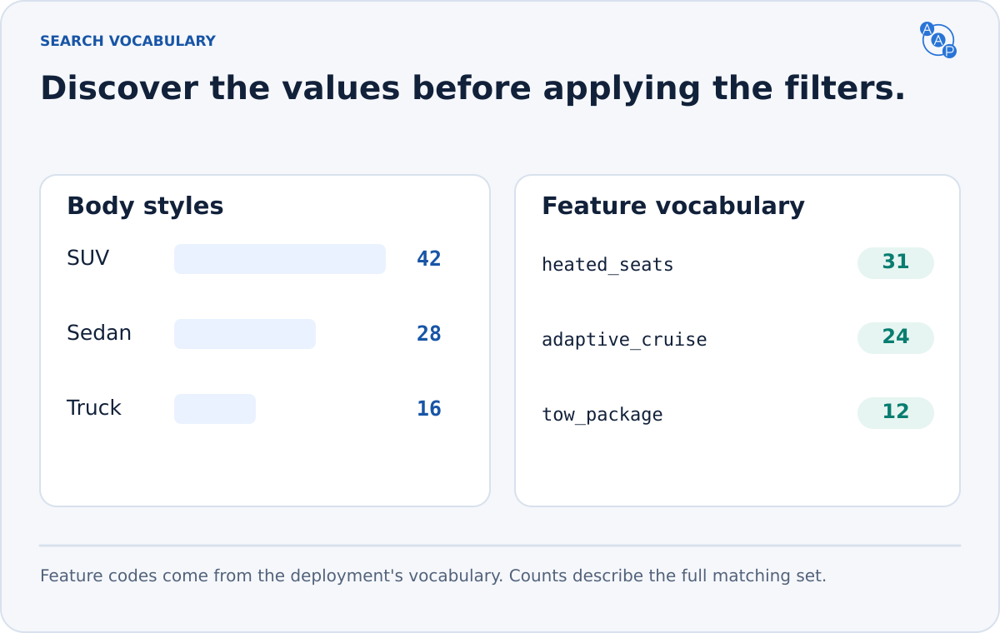

# `inventory.facets`

**Ask what can be searched before guessing a filter value.** Facets expose counts, numeric ranges and the deployment's supported feature codes.



| MCP tool | Shared request → response |
|---|---|
| `aap_inventory_facets` | `inventory.facets.request` → `inventory.facets.response` |

The same typed payload works through MCP, A2A and PAP. It needs no customer information or contact consent.

## Scope the inventory

```json
{
  "type": "inventory.facets.request",
  "filters": { "condition": ["used"], "status": ["available"] }
}
```

Omit `filters` for the entire visible inventory. Otherwise, apply the [search filter semantics](./inventory-search.md) before aggregating. Counts cover the **full matching set**, not one page or a capped sample.

When search is implemented, facets use its advertised filter capabilities and the same visibility. A facets-only endpoint accepts unfiltered requests and MUST reject supplied filters with `UNSUPPORTED_FILTER`; it cannot advertise search capabilities it does not implement.

## Read counts and ranges

```json
{
  "type": "inventory.facets.response",
  "data": {
    "makes": [{ "value": "Honda", "count": 8 }, { "value": "Toyota", "count": 12 }],
    "conditions": [{ "value": "used", "count": 20 }],
    "price_range": { "min": 18995, "max": 34995 },
    "features": [
      { "code": "heated_front_seats", "label": "Heated front seats", "count": 11 },
      { "code": "adaptive_cruise_control", "label": "Adaptive cruise control", "count": 0 }
    ]
  }
}
```

| Facet group | Examples |
|---|---|
| Identity and condition | makes, models, trims, years, conditions, statuses |
| Vehicle and location | vehicle_types, bodies, rooftops, exterior_colors, interior_colors |
| Powertrain | fuels, transmissions, drivelines, charge_ports, dc_fast_charge |
| Numeric ranges | price_range, mileage_range, year_range, displacement_cc_range, electric_range_mi_range |
| Equipment vocabulary | features: stable code, readable label and verified-present count |

Term entries use `{value, count}`; values are strings, integers or booleans as appropriate. Counts are nonnegative exact counts. `dc_fast_charge` uses actual booleans. Range fields use `{min, max}` with `min <= max` and the source field's units.

Only known authoritative prices contribute to `price_range`; omit it when none are known. Missing facets mean unavailable data. Empty/zero buckets are allowed when meaningful; do not invent an observed value.

## Feature codes have stable meaning

A deployment supporting `features_all` or `features_any` MUST implement this skill and publish its full supported feature vocabulary in `features`. Include supported codes with zero matches so an empty result is distinguishable from an unsupported code. Filtering may change counts, but not a code's meaning.

Count only vehicle-specific evidence with `status: "present"`. Unknown or absent equipment does not contribute. Feature codes are unique within the vocabulary and use lowercase snake_case. A model's usual equipment or a trim label is not evidence for a particular vehicle.

Clients discover a code here, submit it to search, then inspect the returned evidence. An unadvertised code returns `UNSUPPORTED_FILTER`; it must not quietly become a keyword query.

See the [full facet example](https://draft.autoagentprotocol.invalid/latest/examples/inventory-facets-response.example.json), [motorcycle example](https://draft.autoagentprotocol.invalid/latest/examples/inventory-facets-response.motorcycle.example.json) and [schema](https://draft.autoagentprotocol.invalid/latest/schemas/facets.schema.json).
