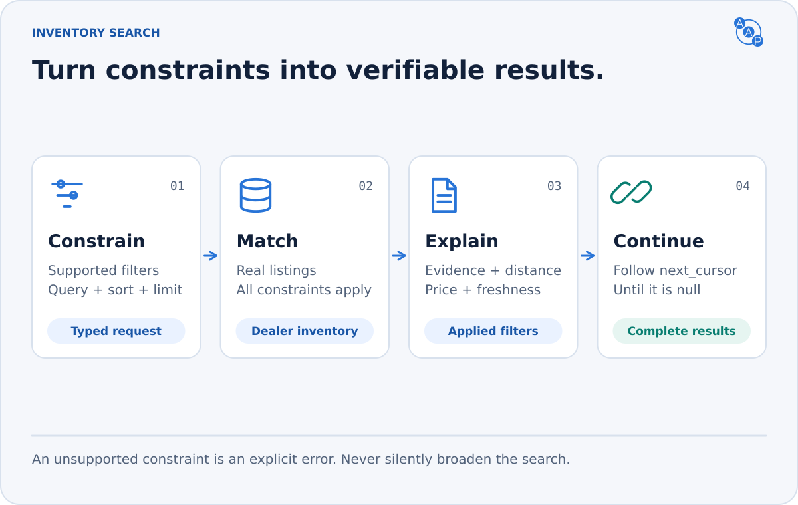
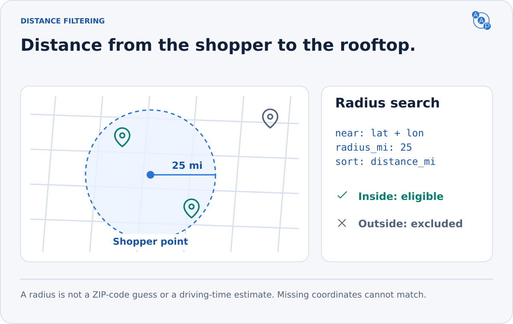

# `inventory.search`



**One request shape across MCP, A2A and PAP.** Search without sharing customer contact details. Results state what was filtered, what is known about each vehicle, and how to continue.

| MCP tool | AAP request → response |
|---|---|
| `aap_inventory_search` | `inventory.search.request` → `inventory.search.response` |

## Ask for constraints explicitly

```json
{
  "type": "inventory.search.request",
  "filters": {
    "body": ["suv"],
    "price_max": 35000,
    "status": ["available"],
    "features_all": ["adaptive_cruise_control", "heated_front_seats"],
    "near": { "latitude": 37.7749, "longitude": -122.4194, "radius_mi": 50 }
  },
  "pagination": { "limit": 20 },
  "sort": { "field": "distance_mi", "order": "asc" },
  "privacy": { "anonymous": true }
}
```

The coordinates above are an illustrative San Francisco origin. A client resolves the user's place name before calling; the server MUST NOT guess a location from an ambiguous string.

| Constraint | Fields | Meaning |
|---|---|---|
| Vehicle | `make`, `model`, `trim`, `condition`, `vehicle_type`, `body` | Arrays of accepted values; sale condition is `new`, `used` or `cpo`. |
| Powertrain | `transmission`, `fuel`, `driveline`, `charge_port`, `dc_fast_charge` | The listing must contain the requested value. Both `true` and `false` are constraints. |
| Ranges | `year_min/max`, `price_min/max`, `electric_range_mi_min/max`, `displacement_cc_min/max`, `mileage_max` | Inclusive bounds. Inverted ranges are invalid. Prices are whole US dollars. |
| Equipment | `features_all`, `features_any` | Advertised feature codes with verified, vehicle-specific evidence. |
| Location | `near`, `rooftops` | Radius around a point, or exact rooftop names on a dealer-scoped endpoint. |
| Availability | `status` | `available`, `intransit`, `pending`; no sold or out-of-stock units. |
| Identity | `vin`, `stock` | Exact identifiers. |
| Appearance | `exterior_color`, `interior_color` | Arrays of accepted color values. |
| Keywords | `query` | Explicit keyword matching, described below. |

Filter fields combine with **AND**. Values in an array combine with **OR**, except `features_all`, which requires every value. Empty arrays are invalid. Missing listing values never satisfy a constraint. Free-text array values match facet values without case sensitivity; schema enums, feature codes and rooftop names are exact. Providers MUST reject unsupported filters with `UNSUPPORTED_FILTER`, unsupported ordering with `UNSUPPORTED_SORT`, and unknown keys or invalid values with `SCHEMA_VALIDATION_FAILED`. They MUST NOT silently remove, broaden or reinterpret constraints.

### Know what this endpoint supports

Read `params.skills["inventory.search"].capabilities` on the AAP Agent Card extension, or `tools/list` → the search tool's `_meta["autoagentprotocol.org/aap"].capabilities`. Both follow `inventory-capabilities.schema.json` and MUST agree. PAP clients can follow their discovery document's Agent Card link.

The capabilities name the endpoint's `scope` (`dealer` or `aggregate`), supported `filters`, `sort_fields`, `default_sort`, `default_limit`, `max_limit`, and support for an offset entry point. An aggregate endpoint MUST reject `rooftops`: names are not globally unique. Aggregate results MUST include the owning `dealer_id` and a stable `vehicle_id` unique within that endpoint. That ID must resolve the same listing through `inventory.vehicle`; a dealer-local stock number alone is insufficient.

A deployment advertising feature filters MUST also expose [`inventory.facets`](./inventory-facets.md). Its `features` facet supplies the feature codes, labels and counts; include supported codes with zero matches when necessary to preserve the vocabulary. An unknown code produces `UNSUPPORTED_FILTER` with its request path and a recovery hint.

### Equipment needs evidence


`features` remains a readable equipment list. `feature_evidence` records a code, label, status, source and a short source excerpt for a specific vehicle. Only `status: "present"` satisfies feature filters. Every matching result MUST include evidence for all `features_all` codes and at least one matching `features_any` code.

A trim name or a model-year default is insufficient. Missing or `unknown` evidence does not prove presence or absence. A verified `absent` claim also needs a source. Clients SHOULD show the evidence when explaining why a vehicle matches.

### Distance is to the vehicle's rooftop



`near` contains `latitude`, `longitude` and `radius_mi`. Use straight-line distance on a sphere with mean Earth radius **3958.7613 miles** and the haversine formula. Coordinates are WGS84 latitude/longitude. Apply the inclusive radius using the unrounded distance; report `distance_mi` with precision of 0.001 miles or better. JSON numbers need no trailing zeros. This is not driving distance or a delivery promise.

Each result MUST include `distance_mi` when `near` is present. Listings without known physical rooftop coordinates do not match. `sort.field: "distance_mi"` requires `near`; a deployment default sort cannot depend on a missing origin.

### Keywords do not invent filters

Trim `query`, split on whitespace, and match each token case-insensitively as a substring in at least one of `make`, `model`, `trim`, `vin`, `stock` or `features`. All tokens must match somewhere in those fields. Quotes and operators have no special meaning. An all-whitespace query is invalid.

For “hybrid SUV under $35k,” send `fuel`, `body` and `price_max`. Do not rely on the string `"hybrid SUV under 35k"` to create them. The response echoes the effective query in `applied_filters` and lists its actual `query_terms`.

## Read a result without guessing

```json
{
  "type": "inventory.search.response",
  "data": {
    "total": 1,
    "limit": 20,
    "next_cursor": null,
    "applied_filters": { "price_max": 35000 },
    "sort": { "field": "price", "order": "asc" },
    "vehicles": [{
      "dealer_id": "demo-dealer",
      "vehicle_id": "vehicle-1042",
      "year": 2024,
      "make": "Example Motors",
      "model": "Tourer",
      "condition": "used",
      "status": "available",
      "price": 32995,
      "updated_at": "2026-10-24T10:00:00Z"
    }]
  }
}
```

This compact response illustrates a price-only request. The complete [feature-and-radius request](https://draft.autoagentprotocol.invalid/latest/examples/inventory-search-request.features-near.example.json) and [matching response](https://draft.autoagentprotocol.invalid/latest/examples/inventory-search-response.features-near.example.json) include evidence and distance.

| Result field | Contract |
|---|---|
| `applied_filters` | Every effective constraint, including any documented defaults. No hidden relaxation. |
| `sort` | Effective field and direction. Missing values sort last in either direction. |
| `total` | Exact count across all pages, or `null` when unavailable. Never a capped count or estimate. |
| `limit` | Effective page size, from 1 through the advertised maximum, at most 100. |
| `next_cursor` | Opaque next-page token; `null` only when the matching set is exhausted. |
| `vehicles` | Current listings with `status`, `updated_at` and at least one of `vin`, `vehicle_id` or `stock`. |
| `facets` | Optional counts and ranges across the full matching set, before pagination. |

`price` includes mandatory dealer charges and excludes government-required consumer charges. Any `fees` are already included. An omitted price is unknown: do not reconstruct it from `list_price` and fees. See [pricing](../pricing-and-ftc.md).

`available`, `intransit` and `pending` are different states. A result is not a reservation. `updated_at` reflects the source's last relevant update; servers MUST NOT invent a fresh timestamp merely because an agent requested the listing.

## Continue through the full inventory


For the first page, omit `cursor` and `skip`. Pass the returned `next_cursor` in `pagination.cursor` for the next page, keeping effective filters, sort and limit unchanged. If the first request omitted defaults, carry the returned `applied_filters`, `sort` and `limit` forward explicitly. Stop only when `next_cursor` is `null`. A page-size limit MUST NOT become a limit on the entire traversable matching set.

- Cursor and `skip` are mutually exclusive. A deployment may accept `skip` as an advertised entry point; its response still supplies cursor continuation. If `offset` is false, a supplied `skip` returns `SCHEMA_VALIDATION_FAILED` at `/pagination/skip`, with a hint to start without an offset. A limit above the advertised `max_limit` also returns `SCHEMA_VALIDATION_FAILED`; it is never silently clamped.
- Bind cursors to the endpoint tenant, authorization scope, normalized filters, sort and page size. Do not put customer information in a cursor. Verify scope on every request; a cursor is not authorization.
- Use a stable identifier (dealer + vehicle for aggregate scope) to break sort ties, and preserve ordering for the cursor's lifetime. Document cursor expiry. An expired, altered or mismatched cursor returns `INVALID_CURSOR` with a hint to restart the search.
- Concurrent changes may remove listings. Do not return stale or unavailable vehicles merely to fill a snapshot page. An empty page with a non-null cursor can occur; clients may continue. Clients SHOULD detect repeated cursors and bound retries.
- `privacy.anonymous: true` means no customer contact information is attached. It does not disable server authentication or make a PAP session unidentifiable.

## Cars, motorcycles and other inventory

The same contract covers `car`, `motorcycle`, `trailer`, `rv` and `other`; omitted `vehicle_type` means `car`. Use `body` and displacement for motorcycles, and electric range, battery and charging fields for EVs of any vehicle type. Populate only relevant fields. See [`inventory.vehicle`](./inventory-vehicle.md) for the shared vehicle shape.
