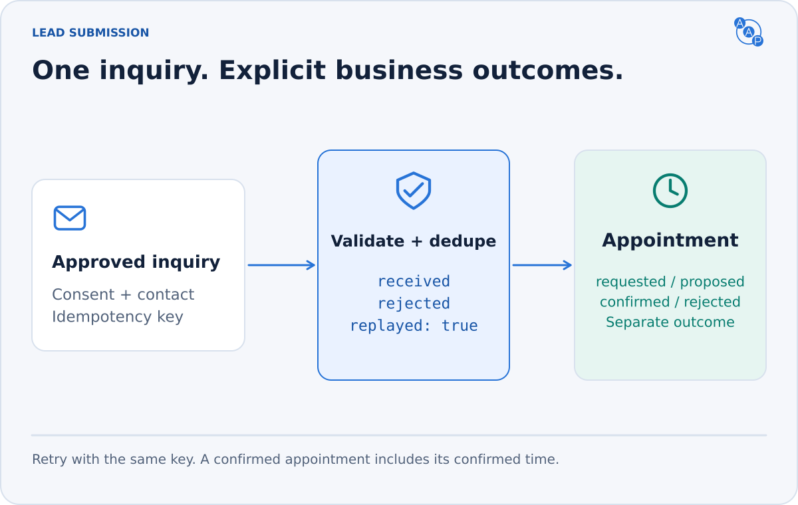
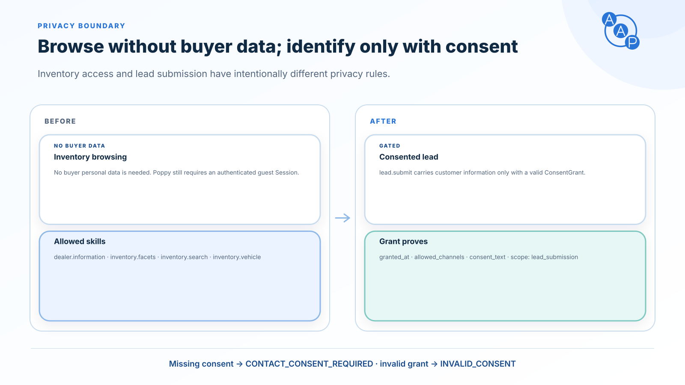

# `lead.submit`

**Send one inquiry with the buyer's permission.** Include a vehicle of interest, a trade-in, an appointment request, or any combination. Customer contact is a side effect; browsing is not permission to submit.



| Interface | Invocation |
|---|---|
| MCP | `aap_lead_submit` with the typed request as `arguments` |
| A2A | `SendMessage` with the typed request in `DataPart.data` |
| PAP | `POST /skills/lead.submit` with the typed request body and Session/DPoP authentication |

All three use the same [request schema](https://draft.autoagentprotocol.invalid/latest/schemas/lead-submit-request.schema.json), [response schema](https://draft.autoagentprotocol.invalid/latest/schemas/lead-submit-response.schema.json), consent rules and deduplication store. A transport may allow an anonymous caller; a lead still contains identified customer information and explicit consent.

## A complete, small request

```json
{
  "type": "lead.submit.request",
  "customer": {
    "first_name": "Ada",
    "last_name": "Lovelace",
    "email": "ada@example.com",
    "preferred_contact": "email"
  },
  "consent": {
    "granted_at": "2026-10-24T15:00:00Z",
    "allowed_channels": ["email"],
    "scope": ["lead_submission"],
    "consent_text": "Please send my inquiry and email address to Demo Toyota so they can reply by email."
  },
  "source_agent": { "name": "example-buyer", "url": "https://buyer.example" },
  "message": "Could you email me about your available hybrid SUVs?",
  "idempotency_key": "82ac790c-1926-4e64-944d-5cc0eaebf27f"
}
```

The consent text and timestamp record the actual user's decision; this fictional example is not a reusable grant. Names, email/phone and the permitted channels must come from the user.

## Add only what the buyer provided

| Optional field | Meaning |
|---|---|
| `vehicle_of_interest` | Partial vehicle information; a known VIN, stock or `vehicle_id` helps identify a listing. Sale condition is `new`, `used` or `cpo`. |
| `trade_in` | Partial trade-in description. Wear condition is `excellent`, `good`, `fair` or `poor`. No valuation is promised. |
| `appointment` | Requires `appointment_type`: `sales`, `service`, `test_drive` or `trade_in`. Time, duration and notes are optional. |
| `message` | The buyer's note, up to 4,000 characters. |
| `submitted_at` | Submission timestamp; preserve it on a retry. |

Vehicle blocks need no invented identifiers or specifications. An incomplete vehicle or appointment may need staff follow-up; do not pretend it is a confirmed booking. Motorcycle demo rides use `test_drive` with `vehicle_type: "motorcycle"`.

See the [vehicle + trade-in example](https://draft.autoagentprotocol.invalid/latest/examples/lead-submit-request.example.json) and [ADF mapping](../compatibility/adf-mapping.md) for CRM delivery.

## Consent is a separate gate



Before submission, the buyer agent MUST obtain permission to send the selected customer information, inquiry and contact channels to this dealer. It MUST preserve the disclosure in `consent_text` and record `granted_at`. `scope` is exactly `["lead_submission"]`; `allowed_channels` contains at least one of `email`, `phone`, `sms`.

For a listing found through an aggregate endpoint, resolve its `dealer_id` with [`dealer.information`](./dealer-information.md#resolve-a-seller-from-aggregate-inventory) before obtaining consent. Retain its `dealer_id` and `vehicle_id` in `vehicle_of_interest` and name the resolved receiving dealership in the disclosure. The operator MUST reject an ambiguous or changed recipient before delivery; it must never broadcast the inquiry to other dealers without their own explicit customer authorization.

Each permitted channel needs its contact value: `email` requires `customer.email`; `phone` and `sms` require `customer.phone`. A specific `preferred_contact` must be permitted by the grant. `any` means any **permitted** channel. Do not include unrelated customer information.

The dealer MUST validate the grant before delivering contact data, reject a future grant timestamp or an expired/inapplicable grant, and use only permitted channels. `expires_at`, when supplied, must follow `granted_at`. Missing consent returns `CONTACT_CONSENT_REQUIRED`; an unusable grant returns `INVALID_CONSENT`. If the dealer cannot honor the allowed channels, it must reject the submission rather than expand consent.

OAuth authorization, a PAP Session, an MCP tool hint and caller-supplied `source_agent` are not customer consent. `source_agent` is attribution; verified transport identity controls authorization.

## Read the outcome literally

```json
{
  "type": "lead.submit.response",
  "data": { "lead_id": "lead_example_001", "status": "received" },
  "message": "Your inquiry was received. The dealer will reply by email."
}
```

| Lead status | Meaning |
|---|---|
| `received` | Accepted for dealer follow-up; not a sale or a guaranteed response time. |
| `rejected` | No accepted lead or booking. Explain the reason safely. |

`data.replayed: true` identifies a retry; `data.status` still reports the original `received` or `rejected` outcome. The former `duplicate` status is not valid in AAP 3.0.

An appointment has its own outcome:

| Appointment status | Required interpretation |
|---|---|
| `requested` | Awaiting scheduling or staff review. |
| `proposed` | Nonempty `proposed_times` offers alternatives; the buyer chooses before a new request. |
| `confirmed` | Booked at the required `confirmed_at` timestamp. |
| `rejected` | This appointment was declined; the lead may still be accepted. |

The dealer MUST NOT report `confirmed` without a real booking. A rejected lead cannot contain a confirmed appointment. If the lead was accepted but the appointment failed, return the accepted lead with the appointment's actual status; do not hide acceptance inside an `aap.error`. `APPOINTMENT_TIME_UNAVAILABLE` means the entire submission was rejected because no requested or alternative time could be accepted.

## Safe retries

Every request MUST include a client-generated `idempotency_key` (UUID recommended). Preserve the complete payload and key after a timeout, transport error or PAP Session renewal. A corrected or newly authorized inquiry is a new request; first resolve any uncertain outcome of the original.

Dealers MUST retain duplicate detection for at least **24 hours**, scoped to the dealer and verified caller, including the stable PAP User ID when applicable. Anonymous callers use dealer + key. Securely correlated calls across bindings share the same store. The same key and payload MUST replay the complete original AAP response, changing only `data.replayed` to `true`. Preserve `lead_id`, `status`, the entire appointment (including `confirmed_at` or `proposed_times`), dealer details and `message`. Store rejected business outcomes too. Changed content returns `IDEMPOTENCY_CONFLICT`. Reauthorize the caller before returning stored information. The original grant must have been valid at initial delivery; replaying that result requires no new grant and creates no new contact or booking.

Persist the outcome with the idempotency record. A replay describes the original result, not the current state of a booking. If the initial operation is still running, wait for its outcome or return an explicitly retryable transient error without another delivery; never fabricate `received`, `rejected` or an empty replay.

Use atomic duplicate detection before delivery, including concurrent requests. Do not send twice when the CRM acknowledgement is delayed. Do not switch authentication context or blindly retry after the retention window; first reconcile the earlier outcome. AAP has no lead-status lookup operation.

For error details and retry timing, see [errors](../errors.md). Contact delivery and appointment confirmation remain separate outcomes.
