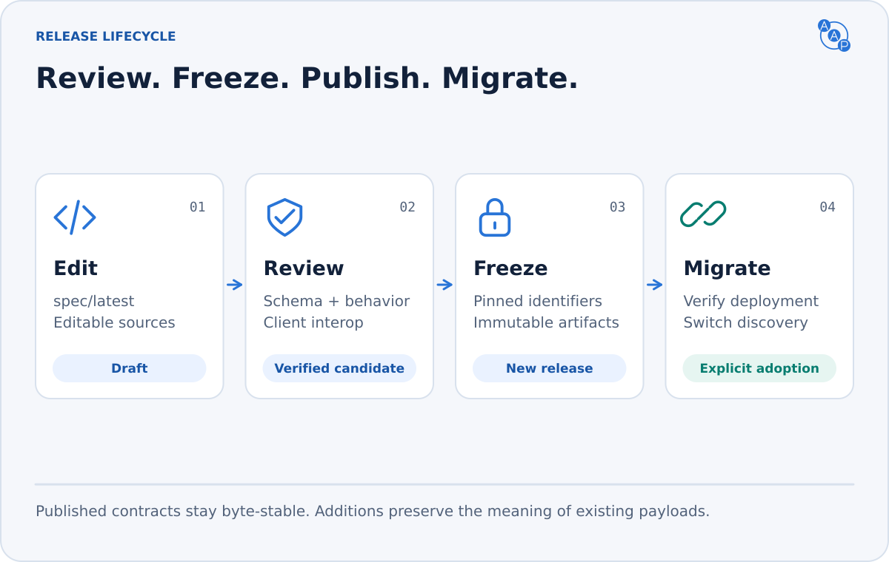

# Versions and migration

**AAP 3.0 is a new major contract.** It makes MCP native, adds dealer-domain discovery links and search capabilities, and tightens automotive results and lead outcomes. Do not advertise it on an unchanged 2.1 endpoint.



## Four independent version numbers

| Identifier | Meaning in AAP 3.0 |
|---|---|
| AAP `3.0.0` / contract `v3.0` | Automotive schemas, bindings and behavior |
| MCP `2026-07-28` + `2025-11-25` | Current wire protocol and explicit compatibility path |
| A2A `1.0` | Agent Card, Message and JSON-RPC protocol |
| PAP `0.2` | Upstream Poppy draft; discovery bridge remains `version: "1"` |

A server's software version is separate. A PAP 0.2 client is not automatically an AAP 3.0 client, and MCP version negotiation does not choose an automotive schema version.

## For implementers

Migrate the implementation and its clients before switching discovery. Keep each supported automotive contract at its own card and endpoint identity.

| Area | AAP 2.1 | AAP 3.0 action |
|---|---|---|
| MCP | Reference manifest/optional adapter | Implement native Streamable HTTP for both required revisions, actual tools/list and typed success/error results |
| Discovery | A2A + PAP pair | Add complete AAP params, exact MCP URL, search capabilities, release metadata and dealer `/llms.txt` |
| Search filters | Flat filters with incomplete behavior discovery | Advertise actual supported keys/sorts; reject unsupported constraints; implement explicit query token rules |
| Features | Free-text attributes | Add `features_all` (AND), `features_any` (OR), advertised feature vocabulary and source-backed `feature_evidence`; unknown is not absent |
| Geography | Location context without a radius contract | If advertised, implement `near`, haversine miles, radius filtering and `distance_mi` ordering |
| Coordinate names — breaking for deployed clients | Some deployment extensions accept `near.lat` / `near.lng`, including in validation-error hints; these were not AAP 2.1 schema fields | Use `near.latitude` / `near.longitude`. Update handlers, client/tool schemas, examples and error hints together; AAP 3.0 rejects the short keys |
| Pagination | Offset/limit | Required cursor continuation; `limit` 1–100; `total` exact or null; no silent result caps |
| Search response | Vehicles and page coordinates | Require `next_cursor`, `applied_filters`, effective `sort`; query terms and distance/evidence when applicable |
| Inventory listings | Some guarantees only in prose | Require eligible `status`, `updated_at` and a stable identifier in search/detail responses |
| Lead retries | Optional key | Require `idempotency_key`; atomic deduplication for at least 24 hours and correlated callers across bindings |
| Contact channels | Consent declaration | Require matching contact data and an authorized preferred channel; reject unusable grants before delivery |
| Appointment outcome | Some conditions only described | Enforce time on `confirmed`, alternatives on `proposed`, and no booking on a rejected lead |
| Errors | Existing automotive vocabulary | Add `UNSUPPORTED_FILTER`, `UNSUPPORTED_SORT`, `INVALID_CURSOR`; expose usable diagnostics and retry timing |

Pricing semantics, five canonical skill IDs, A2A 1.0 wire form, PAP 0.2 identity/DPoP and discovery bridge `1` remain. Do not weaken authentication to make a client with missing credentials appear compatible.

### Release order and version discovery

1. Publish the approved version-pinned specification, schemas and artifacts.
2. Upgrade clients and server handlers, then pass [runtime acceptance](./conformance.md#required-deployment-acceptance-cases).
3. Publish consistent Agent Card, Poppy and `llms.txt` links to the implemented endpoints.
4. Switch the default discovery only when that complete contract works.

One A2A card declares exactly one required AAP extension. Several required versions do not express an either/or choice. A2A forbids automatic fallback to an earlier extension version.

For coexistence, retain separate version-specific cards and endpoints. One origin has one default well-known card; distribute other card URLs through explicit configuration or a registry, or use separate origins. For a coordinated cutover, communicate which clients must migrate and when the old endpoint retires. A new URI alone does not make retirement backward compatible.

Do not retry an uncertain lead through an older contract with a new key. Preserve its identity and reconcile the earlier outcome.

### PAP 0.2 migration

Upgrading from AAP 2.0/PAP 0.1 also requires these security changes:

| Surface | PAP 0.2 requirement |
|---|---|
| Supported draft | Explicit major/minor `0.2`; reject an unsupported pre-1.0 minor |
| Organization | Final HTTPS discovery host, case-only comparison; `www` is distinct |
| Company identity | One issuer per independent Company; aliases share auth and are all authorized in `poppy_domains` |
| Assertions | Two distinct signed assertions, exact issuer-string audience, at most 300 seconds, replay checks |
| DPoP | ES256 support, separate per-User-ID keys, nonce handling and token-endpoint replay checks |
| Native MCP authorization | DPoP when advertised; otherwise Bearer restricted to the exact MCP resource URL |
| Redirects | Never forward secrets after endpoint redirects; validate peer-supplied destinations |

See the [PAP client guide](./pap-client-guide.md) and the [frozen 2.1 migration record](https://autoagentprotocol.org/docs/v2.1/versioning#pap-02-migration) for the complete transition. The historical 2.0→2.1 minor-version exception was approved for one exact specification hash. It does not relax the major-version policy for later releases.

### Breaking migration checklist

An upgrade from AAP 1.x must also apply the [frozen 2.0 migration](https://autoagentprotocol.org/docs/v2.1/versioning#breaking-migration-checklist): paired PAP discovery and native API, required response contexts, standard A2A error detail arrays, securityRequirements shape, exact extension activation and truthful media types. Direct upgrades must implement the final contract in full; they need not deploy every intermediate version.

## Editable work and stable releases

| Source or URL | Meaning |
|---|---|
| `spec/latest/`, `docs/` | Editable specification and documentation |
| `/docs/latest/` | Editable documentation with an unreleased banner |
| `spec/v3.0/`, `/v3.0/`, `/docs/v3.0/` | Frozen contract, artifacts and documentation after approval |
| `/latest/` | Artifact alias of the stable release named by `releases.json` |

Draft schema/extension URLs use `https://draft.autoagentprotocol.invalid`. Release preparation replaces them with immutable production identifiers. Agents pin the selected release rather than relying on a moving `/latest/` alias.

## SemVer and immutability

AAP follows Semantic Versioning. Optional additive behavior can be minor; removed fields, tighter validation, changed required meanings or new mandatory interfaces require a major release. The structural compatibility report is conservative and does not replace semantic review.

Contract paths contain major/minor only, so the release tool creates `MAJOR.MINOR.0` snapshots. Published snapshots are never edited, including their diagrams. Editorial corrections enter the editable source for a later release.

A release freezes schemas, examples, skills, docs/sidebar/images, generated TypeScript/OpenAPI/MCP artifacts, provenance, a compatibility report and SHA-256 integrity. CI and local checks reject changes under previously released paths. Historical artifacts are copied from their snapshots, never regenerated using newer tooling.

## Preparing a release

Commit reviewed edits to the working sources, then rehearse:

```bash
pnpm release:prepare 3.0.0 --dry-run
```

After reviewing the compatibility report, run without `--dry-run` from a clean tree. The command validates and freezes the new contract, generates artifacts, records the source commit/hashes and updates registry/package versions. It does not commit, tag, push, publish npm packages or deploy the site. See [RELEASING.md](https://github.com/auto-agent-protocol/auto-agent-protocol/blob/main/RELEASING.md).

## A2A version handling

Send `A2A-Version: 1.0` and the exact `A2A-Extensions` URI as headers on every A2A call. Under this AAP profile, a missing version returns -32009. A2A separately defines an explicitly empty version as `0.3`; reject it when unsupported. Do not confuse an upstream protocol version with the selected AAP extension. See [request headers](./bindings/json-rpc.md#request-headers).
