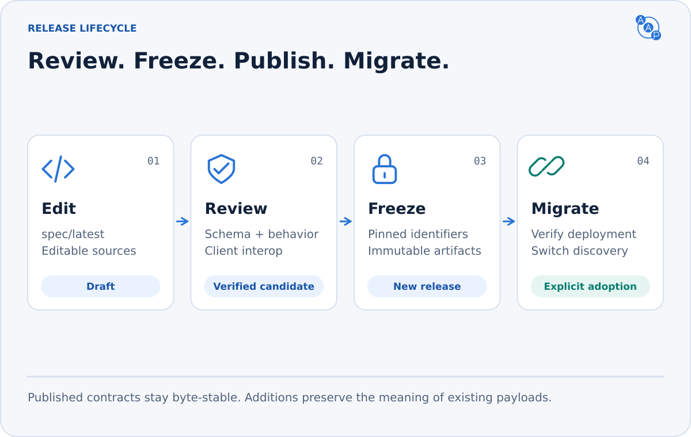

# Versions and migration

**AAP 3.2.0 adopts published PAP 0.3.** This approved minor transition requires an authentication migration from the earlier PAP 0.3 profile in frozen AAP 3.1. The next AAP major release is reserved for PAP 1.0. Automotive payloads retain their 3.1 meanings, including explicit currency and odometer units.



## Four independent version numbers

| Identifier | Meaning in AAP 3.2 |
|---|---|
| AAP `3.2.0` / contract `v3.2` | Target automotive schemas, bindings and behavior; draft authoring still uses `0.0.0-dev` |
| MCP `2026-07-28` + `2025-11-25` | Current wire protocol and explicit compatibility path |
| A2A `1.0` | Agent Card, Message and JSON-RPC protocol |
| PAP `0.3` | Published specification pinned to commit `6fb46d381ac1b94265795132af13848ec442b6f6`; discovery bridge remains `version: "1"` |

A server's software version is separate. PAP 0.2 and earlier draft 0.3 clients must migrate their authentication flows; a PAP 0.3 client is not automatically an AAP 3.2 client, and MCP version negotiation does not choose an automotive schema version.

## AAP 3.0 to 3.1

| Area | Existing 3.0 meaning | Additive 3.1 behavior |
|---|---|---|
| Vehicle amounts | Whole USD | Optional `currency` labels USD or CAD; omission still means USD. It covers `price`, `list_price`, `msrp` and vehicle fees |
| Vehicle odometer | Miles | Optional `mileage_unit` labels mi or km; omission still means mi. Returned numbers remain native |
| Rooftop fee defaults | Whole USD | Optional rooftop `currency`; omission still means USD. Never infer vehicle currency from it |
| Search and facets | USD prices, mi odometer comparisons | Optional top-level `currency` and `mileage_unit`; use declared capability defaults, falling back to USD/mi. One currency scopes every matching set; mileage comparisons convert exactly |
| Facets without search | USD/mi requests without search capabilities | Accept explicit USD/CAD and mi/km contexts; omitted contexts remain USD/mi. No search capability declaration is needed |
| Capabilities | No monetary or odometer context | Optional `currencies`, `default_currency`, `default_mileage_unit`; declarations must agree across bindings |
| Results and cursors | USD/mi implicit | Label effective nondefault contexts explicitly on search/facet data; bind both contexts into cursor identity. Per-vehicle labels never inherit query context |
| Geographic and electric range | Explicit `_mi` fields | Unchanged: miles for every country and odometer unit |
| Leads and trade-ins | USD/mi if numeric values are present | Preserve explicit currency and odometer labels with each partial vehicle description |

This requires schema, generated tool/OpenAPI metadata and runtime changes together. Documentation alone cannot establish the new fields or comparison behavior. Keep existing 3.0 and approved connector endpoints operating under their original contracts while publishing separate 3.1 discovery and endpoints. See [currency and odometer context](./skills/inventory-search.md#currency-and-odometer-context) for exact defaults and comparison rules.

## For implementers

For implementations coming from 2.1, the 3.0 major migration below is also required. It made MCP native, added dealer-domain discovery links and search capabilities, and tightened automotive results and lead outcomes. Migrate the implementation and its clients before switching discovery. Keep each supported automotive contract at its own card and endpoint identity.

| Area | AAP 2.1 | AAP 3.0 action |
|---|---|---|
| MCP | Reference manifest/optional adapter | Implement native Streamable HTTP for both required revisions, actual tools/list and typed success/error results |
| Request headers | A2A version and extension headers mandatory | Accept omitted A2A headers on contract-pinned endpoints and omitted MCP mirror headers when the body or this client's negotiated session supplies the value. Keep supplied-value conflict checks and all authentication requirements; see the binding pages for this AAP compatibility extension |
| PAP | Draft 0.2 authentication and discovery | AAP 3.0 adopted the earlier draft 0.3 profile. Upgrades to AAP 3.2 use the [published 0.3 migration below](#pap-03-migration); changing the version label is insufficient |
| Discovery | A2A + PAP pair | Add complete AAP params, exact MCP URL, search capabilities, release metadata and dealer `/llms.txt` |
| Search filters | Empty arrays, repeated values and empty queries can validate | Advertise supported keys/sorts; deduplicate arrays and omit empty optional filters. Reject `make: []`, `make: ["Honda", "Honda"]`, empty/whitespace-only `query`, unknown keys and unsupported constraints; implement explicit query token rules |
| Features | Free-text attributes | Add `features_all` (AND), `features_any` (OR), advertised feature vocabulary and source-backed `feature_evidence`; unknown is not absent |
| Geography | Location context without a radius contract | If advertised, implement `near`, haversine miles, radius filtering and `distance_mi` ordering |
| Coordinate names — breaking for deployed clients | Some deployment extensions accept `near.lat` / `near.lng`, including in validation-error hints; these were not AAP 2.1 schema fields | Use `near.latitude` / `near.longitude`. Update handlers, client/tool schemas, examples and error hints together; AAP 3.0 rejects the short keys |
| Pagination | Offset/limit; schema permits `pagination.limit` up to 1000 | Maximum falls to 100. Update clients requesting 101–1000 to use at most the advertised `max_limit` (never above 100) and follow `next_cursor`; `total` is exact or null; no silent result caps |
| Search response | `data.limit` is optional | Always return the effective `data.limit`, even when the client omitted it, plus `next_cursor`, `applied_filters` and effective `sort`; include query terms and distance/evidence when applicable |
| Aggregate seller | Opaque `dealer_id` without a lookup | Expose `dealer.information` with a `dealer_id` selector; echo the same ID and actual seller profile before consent. Parameterless dealer-scoped requests remain valid |
| Inventory listings | Some guarantees only in prose | Require eligible `status`, `updated_at` and a stable identifier in search/detail responses |
| Lead retries | Optional key; `duplicate` is a lead status | Require `idempotency_key`; retain atomic deduplication for at least 24 hours. Replay the complete original result with `data.replayed: true`, preserving `received`/`rejected`, appointment details and message. `status: "duplicate"` is removed |
| Contact channels | Consent declaration | Require matching contact data and an authorized preferred channel; reject unusable grants before delivery |
| Appointment outcome | Some conditions only described | Enforce time on `confirmed` and alternatives on `proposed`. Any appointment included on a rejected lead must also be `rejected` |
| Errors | Existing automotive vocabulary; retry timing optional and may use seconds | Add `DEALER_NOT_FOUND`, `UNSUPPORTED_FILTER`, `UNSUPPORTED_SORT`, `INVALID_CURSOR`. `RATE_LIMITED` requires `details.retry_after_ms`; multiply seconds by 1,000. `retry_after_seconds` alone is insufficient. HTTP 429 also requires `Retry-After` |
| Error details | `aap.error.details` accepts unrestricted JSON, including strings, arrays and null | When present, `details` must be an object. Convert custom diagnostics to `details.errors[]`, where each item requires a JSON Pointer `instanceLocation`, a nonempty `keyword` and a nonempty `error`; additional detail fields remain allowed |

The public `DayHours` and `WeeklyHours` TypeScript exports are retained. `DayHours` remains `{open, close} | null`; consumers keep their existing imports.

Pricing semantics, five canonical skill IDs, A2A 1.0 wire form and discovery bridge `1` remain. PAP upgrades to 0.3, including its breaking Session, metadata and optional-flow changes. Do not weaken authentication to make a client with missing credentials appear compatible.

### Release order and version discovery

1. Publish the approved version-pinned specification, schemas and artifacts.
2. Upgrade clients and server handlers, then pass [runtime acceptance](./conformance.md#required-deployment-acceptance-cases).
3. Publish consistent Agent Card, Poppy and `llms.txt` links to the implemented endpoints.
4. Switch the default discovery only when that complete contract works.

One A2A card declares exactly one required AAP extension. Several required versions do not express an either/or choice. A2A forbids automatic fallback to an earlier extension version.

For coexistence, retain separate version-specific cards and endpoints. One origin has one default well-known card; distribute other card URLs through explicit configuration or a registry, or use separate origins. For a coordinated cutover, communicate which clients must migrate and when the old endpoint retires. A new URI alone does not make retirement backward compatible.

Do not retry an uncertain lead through an older contract with a new key. Preserve its identity and reconcile the earlier outcome.

### PAP 0.3 migration

AAP 3.2 targets [published 0.3 at commit `6fb46d381ac1b94265795132af13848ec442b6f6`](https://github.com/personal-agent-protocol/personal-agent-protocol/blob/6fb46d381ac1b94265795132af13848ec442b6f6/content/versions/0.3/spec.mdx). Frozen AAP 3.1 pins October 26 commit `86f0c8d8db3c95cf06d7e05370ec4bddf7d25bc7`, which used the same upstream `0.3` label but a different authentication model. The maintainer approved **AAP 3.2.0** for this migration and reserved the next major for PAP 1.0. Required authentication fields and meanings change, so older clients still require migration. The release tool permits this minor exception only for the reviewed specification hash and the 3.1.0 → 3.2.0 pair. The approved release snapshot and package versions identify this transition; frozen earlier releases remain unchanged.

| Surface | Frozen AAP 3.1 profile | AAP 3.2 published PAP 0.3 binding |
|---|---|---|
| Signed-out access | OAuth guest JWT grant, two assertions, Session Token and DPoP | Fresh delegated `Poppy-Session` JWT on each request; no guest token grant |
| Company identity | Required `auth.issuer` | Discover domain protected-resource metadata; optional issuer; domain fallback only after explicit absence, never errors |
| Existing Company issuer | Mandatory guest issuer | Retain its exact identity; `auth.disabled: true` disables new sign-in without resetting User IDs or Sessions |
| Session identity | DPoP key thumbprint | `client_id + sid`; same User/Agent IDs, delegated keys may rotate |
| Delegation | Not defined | Identity-key-signed ES256/PS384 delegation, public ES256 delegated key, at most 24-hour lifetime, no user/company identifiers |
| Request binding | Token plus DPoP | Session JWT method/URL/time; optional token hash and same-client binding; OAuth DPoP remains separate when used |
| Failure recovery | Guest token/proof OAuth errors | HTTP 400 `invalid_session` or `session_ended`; safe optional description; new-SID retry once for ended Session |
| Issuer grants | JWT bearer and refresh required | Ordinary OAuth refresh required; account sign-in optional |
| Discovery fields | `apis[].resource`, `auth.mediated` | Resource metadata via RFC 9728; mediated sign-in is an extension; optional `auth.disabled`, conversation `access` and `skill_index` |
| Account token | Session-bound guest/sign-in token flow | Ordinary Bearer or DPoP access token plus refresh; reduced scopes permitted, scope expansion forbidden |
| Native PAP MCP | Mandatory guest-token exchange for non-DPoP | Session header and ordinary OAuth where needed; no mandatory legacy exchange |
| Browser join | DPoP nonce containing code in browser form | Agent authorizes code by JSON POST to `/authorize` with Session header, then browser redeems code with cookie |
| Generated artifacts | Guest/exchange schemas and OpenAPI DPoP scheme | Delegation/Session/error/ordinary OAuth schemas and `Poppy-Session` header security |

Keep the existing endpoint/profile while testing a separately configured replacement. Do not change the meaning of a frozen endpoint or replace default discovery before release and deployment approval. Optional account sign-in, browser, conversation and native MCP surfaces require their complete independent acceptance before advertisement.

Update client constructors and generated schemas together. Preserve automotive payload meaning and the bridge extension version; the AAP contract version is a separate decision. Lead idempotency remains bound to stable verified caller/User identity, never to a rotating delegation key or a newly created Session. Reconcile uncertain writes before migration.

### PAP 0.2 migration

This heading remains as a historical link. AAP 2.1 used PAP 0.2; its [frozen migration record](https://autoagentprotocol.org/docs/v2.1/versioning#pap-02-migration) documents the earlier 0.1 → 0.2 transition. AAP 3.2 targets **published 0.3 directly**; frozen AAP 3.1 retains its earlier pinned profile. They do not need an intermediate 0.2 deployment. Both the historical 2.0 → 2.1 and the approved 3.1 → 3.2 minor-release exceptions are pinned to their reviewed specification hashes and do not permit unrelated breaking changes.

### Breaking migration checklist

An upgrade from AAP 1.x must also apply the [frozen 2.0 migration](https://autoagentprotocol.org/docs/v2.1/versioning#breaking-migration-checklist): paired PAP discovery and native API, required response contexts, standard A2A error detail arrays, securityRequirements shape, exact extension activation and truthful media types. Direct upgrades must implement the final contract in full; they need not deploy every intermediate version.

## Editable work and stable releases

| Source or URL | Meaning |
|---|---|
| `spec/latest/`, `docs/` | Editable specification and documentation |
| `/docs/latest/` | Editable documentation with an unreleased banner |
| `spec/v3.2/`, `/v3.2/`, `/docs/v3.2/` | Frozen AAP 3.2 contract, artifacts and documentation |
| `/latest/` | Artifact alias of the stable release named by `releases.json` |

Draft schema/extension URLs use `https://draft.autoagentprotocol.invalid`. Release preparation replaces them with immutable production identifiers. Agents pin the selected release rather than relying on a moving `/latest/` alias.

## SemVer and immutability

AAP normally follows Semantic Versioning. Optional additive behavior can be minor; removed fields, tighter validation, changed required meanings or new mandatory interfaces normally require a major release. The explicitly approved PAP transitions to AAP 2.1 and 3.2 are exceptions, with required client migrations documented above. The next AAP major is reserved for PAP 1.0. These decisions do not waive compatibility checks for other changes; the structural report remains conservative and does not replace semantic review.

Contract paths contain major/minor only, so the release tool creates `MAJOR.MINOR.0` snapshots. Published snapshots are never edited, including their diagrams. Editorial corrections enter the editable source for a later release.

A release freezes schemas, examples, skills, docs/sidebar/images, generated TypeScript/OpenAPI/MCP artifacts, provenance, a compatibility report and SHA-256 integrity. CI and local checks reject changes under previously released paths. Historical artifacts are copied from their snapshots, never regenerated using newer tooling.

## Preparing a release

Commit reviewed edits to the working sources, then rehearse:

```bash
pnpm release:prepare 3.2.0 --dry-run
```

After reviewing the compatibility report, run without `--dry-run` from a clean tree. The command validates and freezes the new contract, generates artifacts, records the source commit/hashes and updates registry/package versions. It does not commit, tag, push, publish npm packages or deploy the site. See [RELEASING.md](https://github.com/auto-agent-protocol/auto-agent-protocol/blob/main/RELEASING.md).

## A2A version handling

Portable A2A clients send `A2A-Version: 1.0` and the exact `A2A-Extensions` URI. AAP 3.0 additionally accepts their omission on a contract-pinned endpoint, using its configured A2A 1.0 interface and AAP contract. Supplied values still take effect: unsupported versions return -32009, and an explicitly empty version means `0.3`, not a request for a default. This compatibility extension does not change strict upstream client requirements or permit automatic contract fallback. See [request headers](./bindings/json-rpc.md#request-headers).
