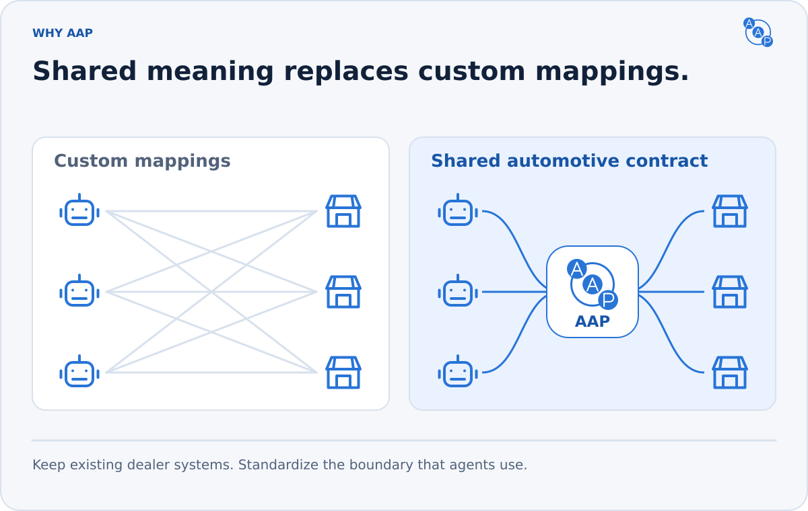
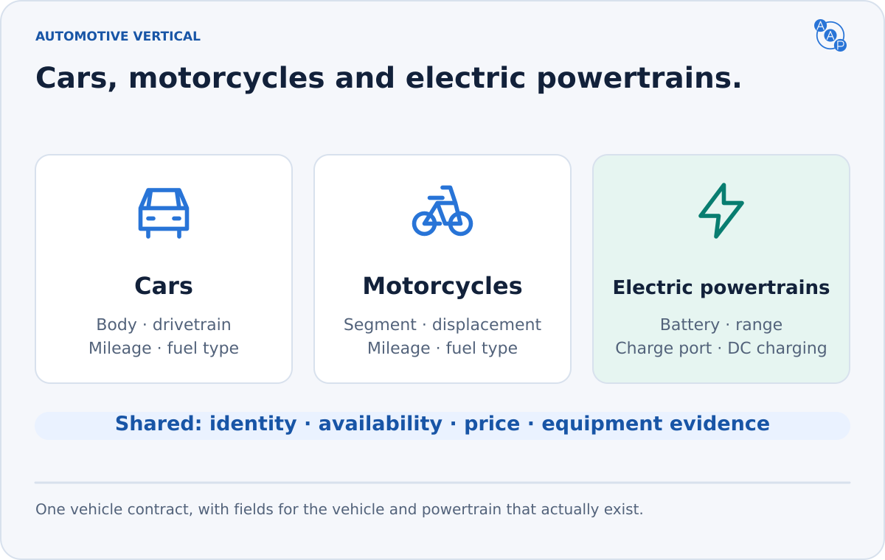

# Why automotive needs AAP

**A connected tool still needs to explain what its data means.** Does a price include required fees? Does a feature exist on this vehicle? Is a test drive booked, or merely requested?

AAP makes those answers consistent across dealerships and protocols.

| Automotive question | AAP contract |
|---|---|
| Is this listing still eligible? | Controlled availability and a source update timestamp |
| Does it meet the buyer's constraints? | Declared filters, evidence, radius/distance and complete pagination |
| Which price can I compare? | Authoritative advertised price with mandatory dealer charges included |
| May I contact this dealer for the buyer? | An explicit consent grant for this payload and these channels |
| What happened after submission? | A lead ID, deduplicated retries and an explicit appointment outcome |

## Built on the protocols agents use

| Standard | Its role in AAP 3.1 |
|---|---|
| [MCP](https://modelcontextprotocol.io/) | Native, self-describing tools with complete schemas and structured results |
| [A2A](https://a2a-protocol.org/) | Agent Card discovery and typed automotive messages |
| [Personal Agent Protocol](https://personalagentprotocol.org/docs/0.3/spec) | Company identity, guest Sessions, DPoP and native APIs |
| [ADF/XML](./compatibility/adf-mapping.md) | A practical delivery bridge to existing dealer lead systems |

AAP supplies automotive semantics and uses each protocol's own transport and authentication rules. An operator can route all three interfaces to the same inventory, pricing and lead services.

## A vertical contract with a clear boundary

Cars, electric vehicles, motorcycles, RVs and trailers share the same five skills. Vehicle-specific fields carry range, charging, engine displacement and other known attributes without changing the call flow.

The release covers research and consented dealer contact. It does not define checkout, payments, credit decisions or binding valuations. An accepted lead is a conversation starter; a confirmed appointment is an explicit, separate outcome.

Use [conformance](./conformance.md) to distinguish a validated contract from a verified deployment. Publishing discovery alone does not implement the service, prove a client's support, or establish universal agent adoption.
