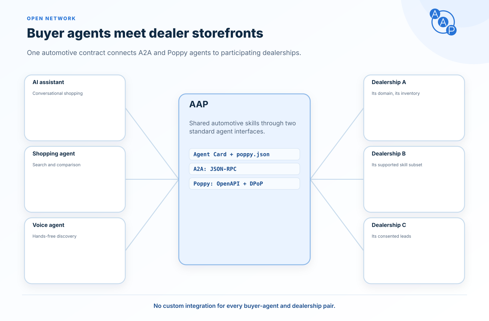
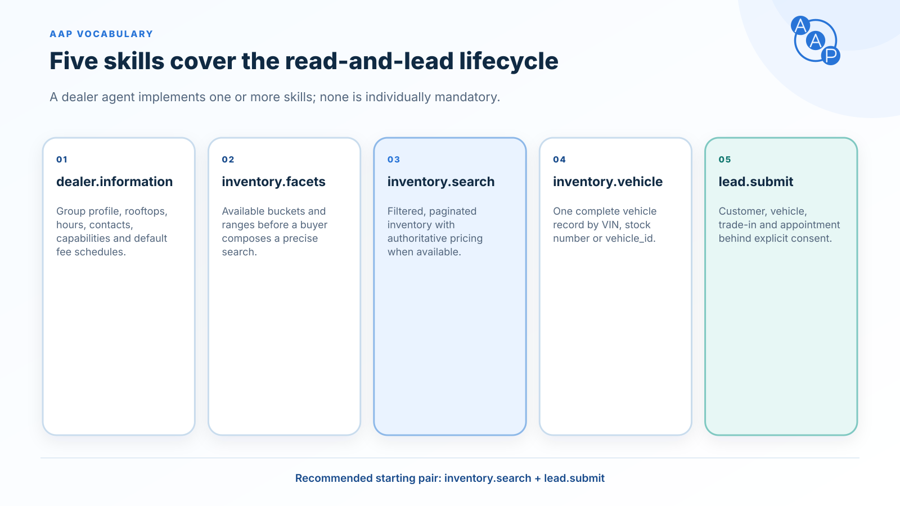
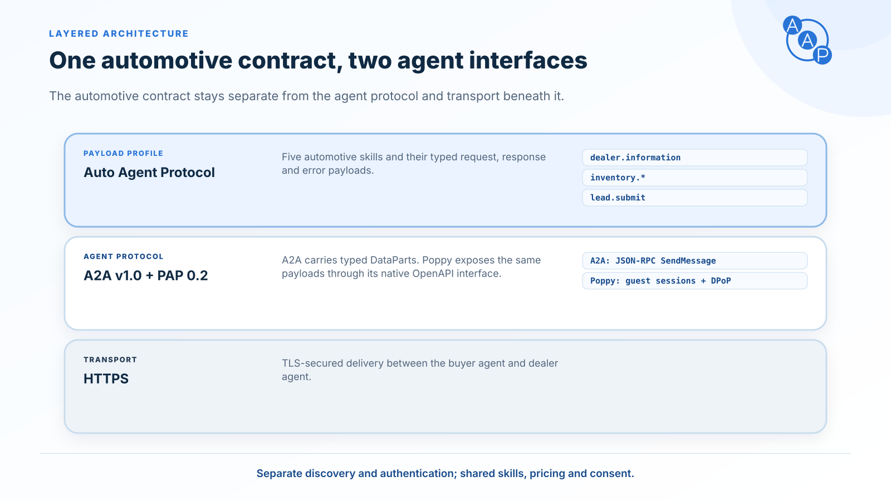
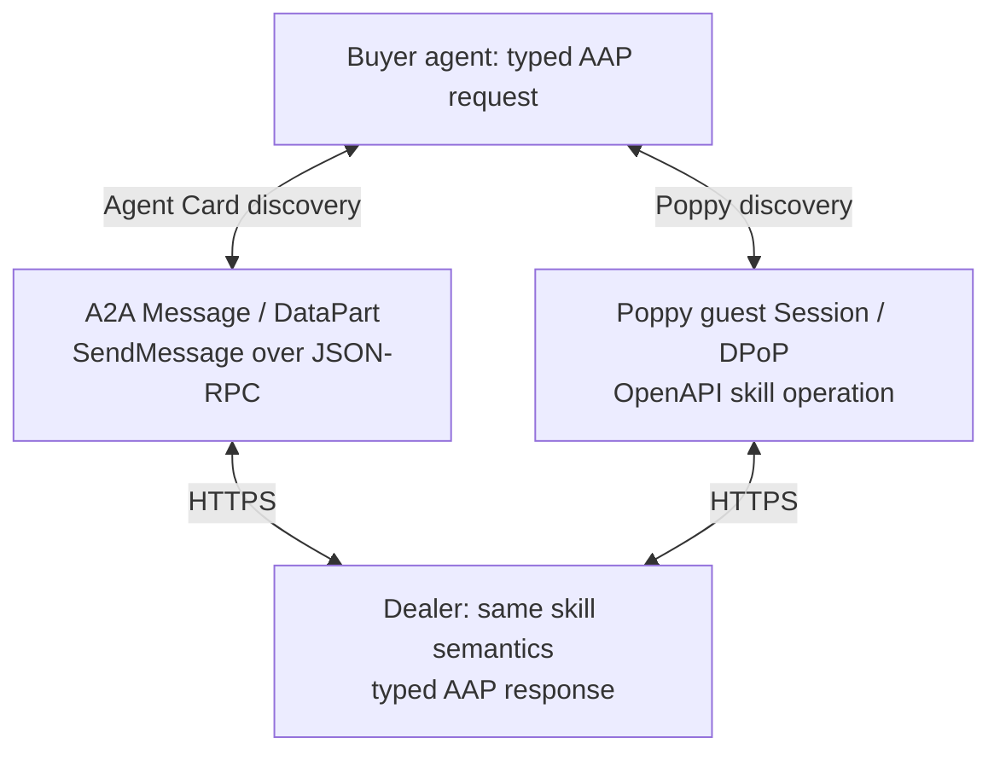
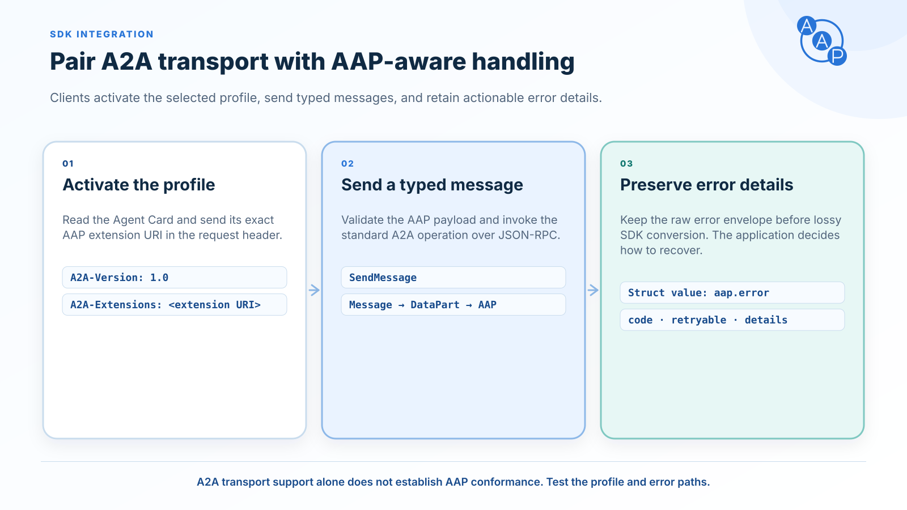

# Introduction




**The Auto Agent Protocol (AAP) lets AI assistants shop at car and motorcycle dealerships.** People increasingly ask an AI assistant to find their next car or motorcycle. AAP is the free, open standard that lets any of those assistants find a dealership, browse its real inventory, and — with the customer's clear permission — send the dealership a sales lead. Inventory listings carry an optional `vehicle_type` (`car`, `motorcycle`, `trailer`, `rv`, `other`; absent = `car`) so a single vocabulary covers both automotive and powersports retail, including electric models via a generic electric-powertrain field group. For a dealership, joining in means publishing **two discovery files on your own website** and answering a few well-defined questions; no app store, no middleman, no per-partner integration work.


In technical terms, AAP defines shared automotive payloads for an [A2A v1.0](https://a2a-protocol.org) (Agent2Agent) profile and a [Personal Agent Protocol](./personal-agent-protocol.md) guest API. On the A2A interface, requests and responses travel in `Message.parts[].data` as typed `DataParts`, using JSON-RPC 2.0. On the Poppy OpenAPI interface, the same payloads are JSON request and response bodies authenticated with Poppy Sessions and DPoP. Both interfaces are REQUIRED for AAP 2.1. The removed A2A HTTP+JSON binding and gRPC are outside this profile.

The extension is identified by a single URI:

```
https://autoagentprotocol.org/extensions/aap/v2.1
```

A dealer lists this URI in `capabilities.extensions[]` of its A2A Agent Card and implements **one or more** of the five standard AAP automotive skills on both interfaces. Its Poppy discovery links that card and the native API. Publishing the documents is a declaration; compliance also requires the [behavior and security rules](./conformance.md). Agents pick the subset they support; AAP RECOMMENDS at least `inventory.search` + `lead.submit` for an end-to-end shopping flow, but neither is mandatory.

## What AAP standardizes



The AAP profile defines a **vocabulary** of five standard skill IDs that cover the read-and-lead lifecycle of automotive retail. A dealer agent picks whichever subset matches its capabilities — none of the five is individually mandatory.

| Skill | Purpose |
|---|---|
| `dealer.information` | Dealership profile, rooftops, hours, contact channels, capabilities |
| `inventory.facets` | Aggregated counts and ranges over the dealer's inventory |
| `inventory.search` | Filtered, paginated inventory queries (cars and motorcycles) |
| `inventory.vehicle` | Detail view of one specific vehicle or motorcycle (by VIN, stock, or vehicle_id) |
| `lead.submit` | Unified consented lead carrying customer info plus optional vehicle of interest, trade-in, and appointment |

AAP 2.1 also defines [Personal Agent Protocol support](./personal-agent-protocol.md): paired discovery, signed-out sessions and an OpenAPI interface for the same skills. A2A authentication follows the Agent Card; native Poppy API authentication follows Poppy Sessions and DPoP. It does NOT define payments, financing approval, RFQ/quote workflows, trade-in valuations, or reservations. Future versions MAY extend this surface; the profile is intentionally minimal.

## Layered architecture



AAP defines shared automotive payloads. The A2A interface carries them in typed `DataParts`; the native Poppy OpenAPI interface carries the same payloads directly over HTTPS with Poppy authentication.



AAP uses exactly **one** A2A operation: `SendMessage` — a request `Message` goes in, a response `Message` comes out. The optional A2A surface (`SendStreamingMessage`, the `tasks` operations Get/List/Cancel/Subscribe, push notification configs, `GetExtendedAgentCard`) is out of scope for this profile: dealer agents do not need to implement it, and buyer agents MUST NOT require it. The Poppy API invokes the same skills directly without A2A envelopes.

## A2A quick start

A buyer agent uses the A2A interface in three steps below. For a Poppy client, follow [discovery, guest session creation and the native API call](./personal-agent-protocol.md#2-paired-discovery); a native API call requires a valid Session Token and DPoP proof.

### 1. Discover the agent

Fetch the A2A agent card at the dealer's well-known URL:

```bash
curl https://demo-toyota.example.com/.well-known/agent-card.json
```

Confirm the card lists the AAP extension URI under `capabilities.extensions[].uri` and includes a `supportedInterfaces[]` entry whose `protocolBinding` is `JSONRPC` (REQUIRED on every AAP agent card; it is the A2A binding this profile specifies).

### 2. The binding

Every AAP agent exposes the JSON-RPC 2.0 binding — AAP's A2A transport. gRPC is out of scope, and the HTTP+JSON (REST) binding was removed in v1.1.0.

| Binding | Status | A2A spec | AAP page |
|---|---|---|---|
| JSON-RPC 2.0 | REQUIRED for the A2A interface | A2A Section 9 | [JSON-RPC binding](./bindings/json-rpc.md) |

### 3. Send a typed AAP message

Wrap an AAP request inside an A2A `Message` and send it with `SendMessage` — the single A2A operation AAP uses. Below is the simplest call — `dealer.information` over the JSON-RPC binding, using the A2A v1.0 ProtoJSON wire format (`ROLE_USER`/`ROLE_AGENT` enum names, no `kind` discriminators) that A2A v1.0 clients send and parse:

```bash
curl -X POST https://demo-toyota.example.com/a2a \
  -H "Content-Type: application/json" \
  -H "A2A-Version: 1.0" \
  -H "A2A-Extensions: https://autoagentprotocol.org/extensions/aap/v2.1" \
  -d '{
    "jsonrpc": "2.0",
    "id": 1,
    "method": "SendMessage",
    "params": {
      "message": {
        "messageId": "01HZ9G5N8D1Y4M6SP9C4XKVW3Q",
        "role": "ROLE_USER",
        "parts": [
          {
            "data": { "type": "dealer.information.request" },
            "mediaType": "application/vnd.autoagent.dealer-information-request+json"
          }
        ]
      },
      "configuration": {
        "acceptedOutputModes": ["application/vnd.autoagent.dealer-information-response+json"]
      }
    }
  }'
```

`A2A-Version` is required by A2A on every request, and `A2A-Extensions` activates the AAP profile — AAP cards declare the extension `required: true`, so a call that omits it is rejected with `ExtensionSupportRequiredError`. See [request headers](./bindings/json-rpc.md#request-headers).

The dealer agent MUST include a nonempty `contextId` in every response Message, preserving the context of the interaction or generating one for a new interaction. The dealer agent replies with a `SendMessageResponse` in the JSON-RPC `result` — `{ "message": <Message> }` — where the `message` is an A2A `Message` whose first `DataPart.data` is an AAP response:

```json
{
  "jsonrpc": "2.0",
  "id": 1,
  "result": {
    "message": {
      "messageId": "01HZ9G5P2KA8RT9WMS3B4C5D6E",
      "contextId": "ctx_example_001",
      "role": "ROLE_AGENT",
      "parts": [
        {
          "data": {
            "type": "dealer.information.response",
            "data": {
              "name": "Demo Auto Group",
              "welcome_message": "Welcome to Demo Auto Group.",
              "rooftops": [
                {
                  "name": "Demo Toyota San Francisco",
                  "legal_name": "Demo Toyota of San Francisco, LLC",
                  "website": "https://demo-toyota.example.com",
                  "phones": [
                    {
                      "name": "Sales",
                      "value": "+14155550100"
                    }
                  ],
                  "address": {
                    "country": "US",
                    "state": "CA",
                    "city": "San Francisco",
                    "address_line_1": "100 Market St",
                    "zip": "94105"
                  },
                  "timezone": "America/Los_Angeles",
                  "capabilities": [
                    "sales",
                    "service",
                    "financing"
                  ]
                }
              ]
            }
          },
          "mediaType": "application/vnd.autoagent.dealer-information-response+json"
        }
      ]
    }
  }
}
```

## SDK integration



AAP uses the standard A2A `SendMessage` operation. An SDK integration must also activate the selected AAP extension, validate its payloads, and preserve the error details needed for validation feedback and retry decisions. SDK versions differ in which error details their typed exceptions preserve; see the [SDK error-handling notes](./errors.md#sdk-error-handling) before implementing an adapter. Transport support alone does not establish AAP conformance.

## Where to read next

- [Why automotive needs AAP](./why.md) — the gap AAP fills against A2A, ACP, MCP, and ADF.
- [A2A profile](./a2a-profile.md) — how AAP slots into A2A's three-layer architecture.
- [Discovery](./discovery.md) — paired well-known files and full agent card example.
- [Personal Agent Protocol](./personal-agent-protocol.md) — full Poppy guest API specification.
- [Conformance](./conformance.md) — compatibility evidence and implementation checks.
- [Pricing and fee disclosure](./pricing-and-ftc.md) — authoritative price semantics, optional vehicle fee itemization, provider mapping, and current FTC context.
- [Skills reference](./skills/dealer-information.md) — one page per skill with full request/response examples.
