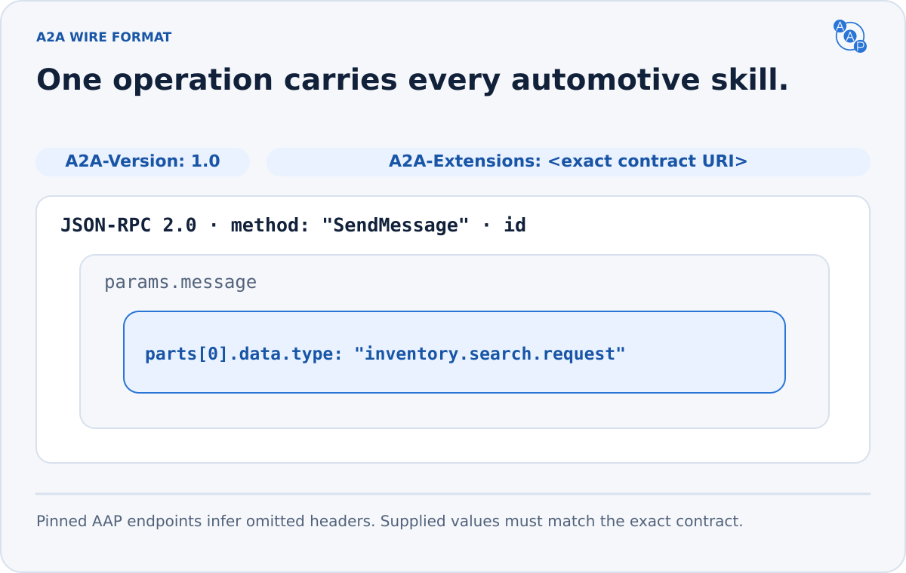

# A2A JSON-RPC binding


**One A2A operation carries every AAP skill: `SendMessage`.** The automotive request lives in `params.message.parts[0].data`; the response returns in `result.message.parts[0].data`.



This is AAP's required **A2A** transport. [MCP](./mcp.md) and [PAP OpenAPI](../personal-agent-protocol.md) are separate native interfaces to the same payloads. The older A2A HTTP+JSON binding remains [removed](./rest.md).

## Endpoint and method

Use the Agent Card's `supportedInterfaces[]` entry with `protocolBinding: "JSONRPC"` and `protocolVersion: "1.0"`. Send HTTPS POST with JSON-RPC `jsonrpc: "2.0"`, a request `id`, method `SendMessage`, and an A2A `Message` in `params.message`. If the selected interface declares `tenant`, echo it in `params.tenant`.

Clients MUST include `configuration.acceptedOutputModes` with the expected AAP response media type. Modes are alternatives: an unsupported choice does not invalidate a supported one.

| Wire field | Required form |
|---|---|
| Request/response role | `ROLE_USER` / `ROLE_AGENT` |
| Message and Part kind | ProtoJSON member discriminator; no `kind` field |
| `messageId` | Nonempty, unique for each message; response differs from request |
| Server `contextId` | Nonempty; preserve a valid interaction context or create one |
| First part | Matching typed AAP `data` and vendor `mediaType` |
| JSON-RPC `result` | `SendMessageResponse`: `{ "message": <Message> }` |

An initial client request may omit `contextId`. A server response may not. AAP uses direct response Messages; it does not create a Task or require an Artifact.

Only advertise A2A capabilities that work. When an unsupported operation is called, use its standard A2A error:

| Operation | Error | JSON-RPC |
|---|---|---|
| Streaming or task subscription without streaming support | `UnsupportedOperationError` | -32004 |
| Push notification configuration without support | `PushNotificationNotSupportedError` | -32003 |
| Extended Agent Card without support | `UnsupportedOperationError` | -32004 |
| A task operation this server does not implement | `UnsupportedOperationError` | -32004 |

A server implementing additional A2A operations follows their upstream semantics, including task-not-found behavior. AAP clients MUST NOT depend on that optional surface.

## Request headers

[A2A service parameters](https://a2a-protocol.org/v1.0.0/specification/#92-service-parameter-transmission) travel as HTTP headers on JSON-RPC requests:

```http
POST /a2a HTTP/1.1
Host: demo-toyota.example.com
Content-Type: application/json
A2A-Version: 1.0
A2A-Extensions: https://autoagentprotocol.org/extensions/aap/v3.0
```

The selected Agent Card's authorization requirements also apply.

- `A2A-Version` is mandatory under this AAP profile. Missing or unsupported versions return `VersionNotSupportedError` (-32009) before skill execution. Under A2A, an explicitly empty value means `0.3`; reject it when unsupported. Do not infer `1.0`.
- `A2A-Extensions` MUST contain the card's exact AAP URI as a comma-separated list member. Missing activation returns `ExtensionSupportRequiredError` (-32008). Unknown unrelated extensions are ignored; a different AAP version is not a match.
- A query parameter does not replace either header. A2A version and extension validation have no mandated precedence when both fail.

Servers SHOULD echo activated extensions in the response `A2A-Extensions` header. An activation failure MUST name the exact URI and header in its message and standard ErrorInfo metadata; see [recovery instructions](../errors.md#activation-recovery).

## A complete exchange

The request below uses only advertised search capabilities. The `type` and `mediaType` identify the same skill.

```json
{
  "jsonrpc": "2.0",
  "id": "req_001",
  "method": "SendMessage",
  "params": {
    "message": {
      "messageId": "01HZ9F4M7C0X3K5RN8B3WJTW2P",
      "role": "ROLE_USER",
      "parts": [
        {
          "data": {
            "type": "inventory.search.request",
            "filters": {
              "make": [
                "Honda"
              ],
              "status": [
                "available"
              ],
              "price_max": 35000
            },
            "pagination": {
              "limit": 20
            },
            "sort": {
              "field": "price",
              "order": "asc"
            }
          },
          "mediaType": "application/vnd.autoagent.inventory-search-request+json"
        }
      ]
    },
    "configuration": {
      "acceptedOutputModes": [
        "application/vnd.autoagent.inventory-search-response+json"
      ]
    }
  }
}
```

<details>
<summary>Complete response: one matching vehicle</summary>

```json
{
  "jsonrpc": "2.0",
  "id": "req_001",
  "result": {
    "message": {
      "messageId": "response_001",
      "contextId": "context_001",
      "role": "ROLE_AGENT",
      "parts": [
        {
          "data": {
            "type": "inventory.search.response",
            "data": {
              "total": 1,
              "limit": 20,
              "next_cursor": null,
              "applied_filters": {
                "make": [
                  "Honda"
                ],
                "status": [
                  "available"
                ],
                "price_max": 35000
              },
              "sort": {
                "field": "price",
                "order": "asc"
              },
              "vehicles": [
                {
                  "vehicle_id": "vehicle_001",
                  "make": "Honda",
                  "model": "CR-V",
                  "year": 2024,
                  "condition": "used",
                  "status": "available",
                  "price": 32995,
                  "updated_at": "2026-10-24T14:00:00Z"
                }
              ]
            }
          },
          "mediaType": "application/vnd.autoagent.inventory-search-response+json"
        }
      ]
    }
  }
}
```

</details>

All five skills use this envelope. The complete [request](https://autoagentprotocol.org/v3.0/examples/inventory-search-request.jsonrpc.example.json) and [response](https://autoagentprotocol.org/v3.0/examples/inventory-search-response.jsonrpc.example.json) fixtures, [skill schemas](../intro.md#five-skills-one-shopping-journey) and generated OpenAPI provide copyable machine-readable forms.

## Error mapping (A2A Section 9.5)

A failed skill returns a JSON-RPC error. `error.data` is an array of standard ProtoJSON Any detail objects, led by `google.rpc.ErrorInfo`. The typed AAP error appears in a `google.protobuf.Struct` object's `value`. Never place a bare AAP object directly in `error.data`.

<details>
<summary>Complete validation error with all detected field problems</summary>

```json
{
  "jsonrpc": "2.0",
  "id": "req-3",
  "error": {
    "code": -32602,
    "message": "Invalid params: filters.year_min must be an integer",
    "data": [
      {
        "@type": "type.googleapis.com/google.rpc.ErrorInfo",
        "reason": "SCHEMA_VALIDATION_FAILED",
        "domain": "autoagentprotocol.org",
        "metadata": {
          "code": "SCHEMA_VALIDATION_FAILED",
          "error_id": "err_01HZ9EXAMPLE",
          "retryable": "false",
          "created_at": "2026-04-30T10:15:30Z"
        }
      },
      {
        "@type": "type.googleapis.com/google.rpc.BadRequest",
        "fieldViolations": [
          {
            "field": "/filters/year_min",
            "description": "type: must be an integer"
          },
          {
            "field": "/filters/made_up",
            "description": "additionalProperties: unknown filter key"
          }
        ]
      },
      {
        "@type": "type.googleapis.com/google.protobuf.Struct",
        "value": {
          "type": "aap.error",
          "error_id": "err_01HZ9EXAMPLE",
          "code": "SCHEMA_VALIDATION_FAILED",
          "message": "request failed validation with 2 errors",
          "retryable": false,
          "details": {
            "errors": [
              {
                "instanceLocation": "/filters/year_min",
                "keyword": "type",
                "error": "must be an integer"
              },
              {
                "instanceLocation": "/filters/made_up",
                "keyword": "additionalProperties",
                "error": "unknown filter key"
              }
            ]
          },
          "created_at": "2026-04-30T10:15:30Z"
        }
      }
    ]
  }
}
```

</details>

| AAP `code` | JSON-RPC `code` | Notes |
|---|---|---|
| `SCHEMA_VALIDATION_FAILED` | -32602 | JSON-RPC "Invalid params". |
| `MISSING_REQUIRED_FIELD` | -32602 | "Invalid params". |
| `INVALID_CONDITION` | -32602 | "Invalid params" — a `condition` value is in the wrong vocabulary. |
| `UNSUPPORTED_SKILL` | -32602 | Invalid AAP request parameter: the dealer does not implement the skill identified by the typed payload. The JSON-RPC method is still `SendMessage`. Reserve -32004 for A2A `UnsupportedOperationError` with A2A's required ErrorInfo reason and domain. |
| `UNSUPPORTED_FILTER` | -32602 (Invalid params) | Filter or feature code is not supported here. |
| `UNSUPPORTED_SORT` | -32602 (Invalid params) | Sort field is not advertised. |
| `INVALID_CURSOR` | -32602 (Invalid params) | Cursor is invalid, expired or bound to another request. |
| `VEHICLE_NOT_FOUND` | -32000 | Application error. |
| `VEHICLE_UNAVAILABLE` | -32000 | Application error. |
| `CONTACT_CONSENT_REQUIRED` | -32000 | Application error. |
| `INVALID_CONSENT` | -32000 | Application error. |
| `APPOINTMENT_TIME_UNAVAILABLE` | -32000 | Application error. |
| `IDEMPOTENCY_CONFLICT` | -32000 | Application error — an `idempotency_key` was reused with a different payload. |
| `RATE_LIMITED` | -32000 | Generic JSON-RPC server error. NOT -32002: A2A §5.4 assigns that code to `TaskNotCancelableError`, which both reference SDKs decode as a terminal task-lifecycle failure rather than a retryable throttle. |
| `INTERNAL_ERROR` | -32603 | JSON-RPC "Internal error". |

Validation responses MUST include every detectable field problem in `details.errors[]`, with `instanceLocation`, `keyword` and a safe `error` message. A2A protocol/authentication failures remain distinct from automotive skill failures. See [errors and retries](../errors.md) for extraction, recovery and throttling.
