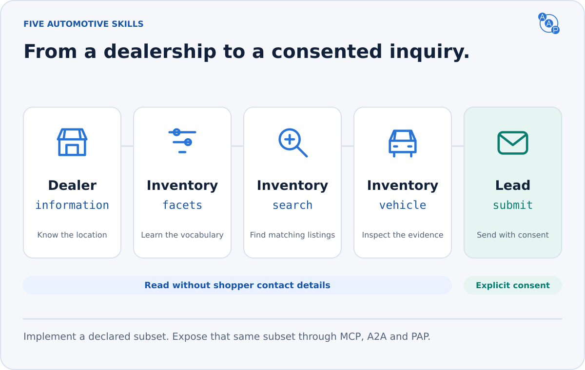
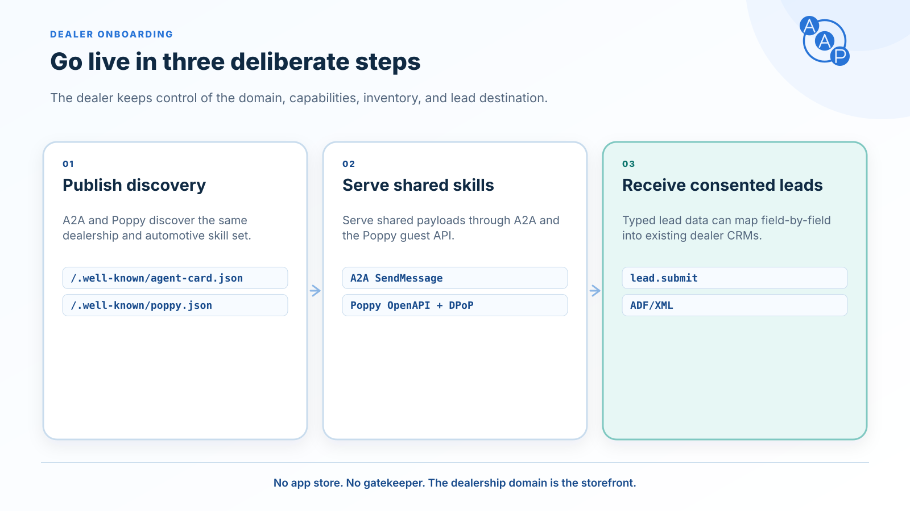

# Automotive, ready for agents


**Auto Agent Protocol gives AI agents a shared language for automotive retail.** Discover a dealer, search actual inventory, inspect evidence and pricing, then send a lead with the buyer's permission.


AAP 3.0 defines three native interfaces. Each carries the same typed request and response; none requires an extra hop through another protocol.

| Interface | How the agent calls | Baseline |
|---|---|---|
| [MCP](./bindings/mcp.md) | Discover and call automotive tools | Streamable HTTP, 2026-07-28 + 2025-11-25 compatibility |
| [A2A](./bindings/json-rpc.md) | `SendMessage` with an automotive DataPart | A2A 1.0, JSON-RPC 2.0 |
| [PAP](./personal-agent-protocol.md) | Native OpenAPI operation with Session + DPoP | Personal Agent Protocol draft 0.2 |

A full AAP 3.0 dealer deployment implements all three with the same skill subset and business behavior. A client needs only its chosen interface. A partial implementation can describe the binding it supports, but cannot claim the full deployment profile. [Conformance](./conformance.md) defines the exact boundary.

## Five skills. One shopping journey.



| Skill | Answer |
|---|---|
| [`dealer.information`](./skills/dealer-information.md) | Who is this dealer, and where are its locations? |
| [`inventory.facets`](./skills/inventory-facets.md) | Which filters and feature codes are useful here? |
| [`inventory.search`](./skills/inventory-search.md) | Which vehicles meet every supported constraint? |
| [`inventory.vehicle`](./skills/inventory-vehicle.md) | What is known about this specific listing? |
| [`lead.submit`](./skills/lead-submit.md) | Can the dealer receive this explicitly authorized inquiry? |

Declare one or more implemented skills. Search with feature filters also requires facets for its feature vocabulary. For a complete shopping experience, implement all five. The same vehicle model covers cars, EVs, motorcycles, RVs and trailers; an omitted `vehicle_type` means `car`.

## Automotive meaning, shared everywhere


- **Search:** explicit capabilities, verified features, radius/distance semantics and complete cursor pagination.
- **Truthful listings:** availability, freshness, identifiers and evidence; missing data remains unknown.
- **Clear pricing:** one authoritative advertised `price`; mandatory dealer charges are included, only government-required consumer charges are separate.
- **Controlled contact:** explicit channel consent, mandatory retry keys and truthful appointment outcomes.

AAP covers discovery, research and dealer contact. Payments, financing approval, transaction quotes, reservations and trade-in valuations are outside this release.

## Start on the dealer's domain



Publish `/.well-known/agent-card.json`, `/.well-known/poppy.json` and `/llms.txt` on the dealer's HTTPS website. They link the actual MCP endpoint, A2A interface and deployment-specific PAP OpenAPI. Services can run on a provider's tenant infrastructure.

An agent follows an explicit endpoint and its access requirements. It does not have to guess a URL or scrape a search form. Discovery improves access; it does not guarantee every assistant will automatically use a protocol.

The selected automotive contract is identified by:

```text
https://autoagentprotocol.org/extensions/aap/v3.0
```

For a quick implementation path, read [discovery](./discovery.md), choose the [MCP](./bindings/mcp.md), [A2A](./bindings/json-rpc.md) or [PAP client](./pap-client-guide.md) guide, and validate against the [schemas](https://autoagentprotocol.org/v3.0/schemas/agent-card.schema.json). Existing operators should start with the [v3 migration checklist](./versioning.md#for-implementers).
