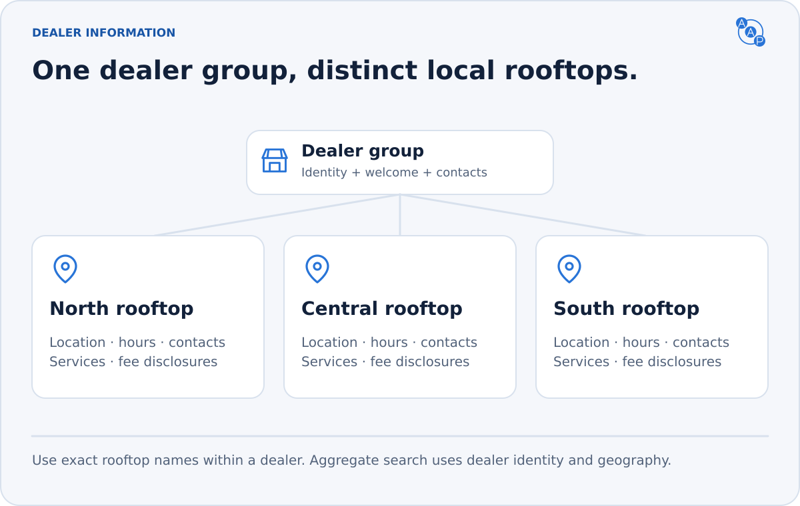

# `dealer.information`

**Learn who the dealer is and where to go.** One dealer group can have several physical locations, called rooftops.



| MCP tool | Shared request → response |
|---|---|
| `aap_dealer_information` | `dealer.information.request` → `dealer.information.response` |

Use the typed request as MCP arguments, an A2A DataPart or a PAP OpenAPI body. No customer information or contact consent is needed; transport authentication still applies.

## Request

```json
{ "type": "dealer.information.request" }
```

Omit `dealer_id` for the endpoint's default profile. Unknown request properties are invalid.

### Resolve a seller from aggregate inventory

An endpoint advertising `scope: "aggregate"` MUST expose this skill through every binding. Before requesting permission to contact a seller, resolve the listing's opaque `dealer_id` on that same endpoint:

```json
{ "type": "dealer.information.request", "dealer_id": "d-7" }
```

```json
{
  "type": "dealer.information.response",
  "data": {
    "dealer_id": "d-7",
    "name": "Demo Toyota",
    "rooftops": [{
      "name": "Demo Toyota San Francisco",
      "website": "https://demo-toyota.example.com"
    }]
  }
}
```

For a selected profile, `data.dealer_id` MUST equal the requested identifier. `data.name` and `rooftops` MUST identify only the actual receiving dealership. An unknown or inaccessible identifier returns `DEALER_NOT_FOUND`; never substitute the marketplace's profile. Clients MUST stop on a mismatched or unresolved identity and MUST NOT infer the recipient from a rooftop name. The seller ID remains stable within this endpoint and MUST NOT be reassigned to another business.

An ordinary dealer-scoped endpoint needs no additional lookup before consent: its discovery already identifies the dealer. The existing parameterless request remains valid. If it accepts a selector, it follows the same exact-match rule.

## Response

```json
{
  "type": "dealer.information.response",
  "data": {
    "name": "Demo Auto Group",
    "rooftops": [{
      "name": "Demo Toyota San Francisco",
      "website": "https://demo-toyota.example.com",
      "geo": { "latitude": 37.789, "longitude": -122.394 },
      "timezone": "America/Los_Angeles",
      "phones": [{ "name": "Sales", "value": "+14155550100" }],
      "capabilities": ["sales", "service", "trade_in"]
    }]
  }
}
```

`data.name` and at least one rooftop are required. Every rooftop needs `name`; the other details are optional. Omission means unknown, not closed or unavailable.

| Rooftop fields | Meaning |
|---|---|
| `name`, `legal_name`, `website` | Public identity, optional legal name and website |
| `address`, `geo` | Physical location; latitude/longitude use WGS84 coordinates |
| `emails`, `phones` | Labeled contact values such as Sales or Service |
| `schedules`, `timezone` | Named weekly hours such as sales, service or parts in rooftop local time; a day is `{open, close}` or `null` when closed |
| `capabilities` | Service tags such as sales, service, trade_in, delivery or motorcycle_sales |
| `fees` | Optional default fee schedule for the publisher; never an extra charge for the buyer to add |

Rooftop names MUST be unique within a dealer-scoped endpoint and match the exact values used by `Vehicle.rooftop` and `filters.rooftops`. Aggregate search does not accept ambiguous rooftop-name filters. An aggregate operator must retain owning dealer identity on listings.

A displayed `09:00` is interpreted in the rooftop's `timezone`, not the buyer's timezone. If the timezone or hours are absent, do not infer them. Keep cached profile data consistent with current operations.

## Department schedules

A rooftop can publish separate schedules for sales, service and parts. Use `name: "parts"` for parts department hours, with the same weekly `value` structure used by `sales` and `service`. Each department can have different opening and closing times, interpreted in the rooftop's `timezone`.

Schedule names are free-text labels, so other department names are allowed. Schedules remain optional. Advertising the `parts` capability does not require a parts schedule or establish its hours. The full response example below includes a separate parts schedule.

## Fees belong to the listing price

Rooftop fees are publisher defaults and discovery metadata. A publisher may use them to construct a complete effective vehicle fee snapshot. Buyers MUST NOT join them onto a vehicle, add them to `price`, or treat a missing schedule as zero fees.

A vehicle's optional `fees` is a complete replacement breakdown, already included in authoritative `price`. See [pricing](../pricing-and-ftc.md).

The [full example](https://autoagentprotocol.org/v3.0/examples/dealer-information-response.example.json) includes two rooftops and complete schedules. The [schema](https://autoagentprotocol.org/v3.0/schemas/dealer-information.schema.json) defines every field.
