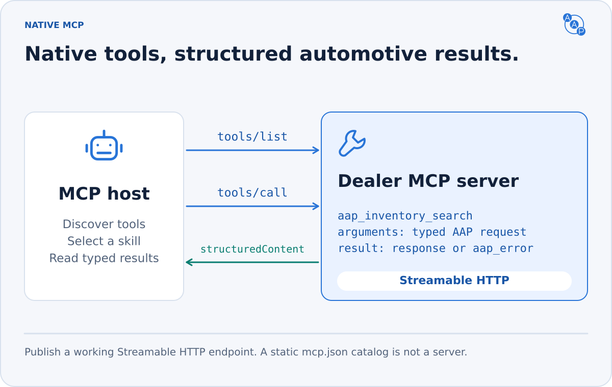

# MCP binding




**MCP is a first-class AAP interface.** A server can call its inventory and lead services directly. An A2A hop is optional. All bindings share the same automotive payloads, supported skill subset, inventory scope, consent checks and idempotency store. Verified caller scope remains part of duplicate detection.

## Protocol baseline

An AAP 4.0 MCP endpoint MUST implement Streamable HTTP for **MCP 2026-07-28** and **2025-11-25**. Advertise both actual revisions in discovery; additional revisions are optional. AAP's `4.0.0` release number is separate from these MCP protocol dates and from a server's software version.

| | MCP 2026-07-28 | MCP 2025-11-25 compatibility |
|---|---|---|
| Start | Optional client call to mandatory `server/discover` | `initialize`, then `notifications/initialized` |
| Request metadata | Protocol version and client capabilities required; client info recommended, optional | Version, capabilities and client info supplied during initialization |
| HTTP metadata | Standard clients send `MCP-Protocol-Version`, `Mcp-Method`, and `Mcp-Name` for tool calls; AAP accepts their omission when the body supplies the values | Negotiated `MCP-Protocol-Version`; may be omitted when this client's validated session supplies it |
| Completed results | `resultType: "complete"` | No `resultType` field required |
| Protocol sessions | None | Optional `Mcp-Session-Id` |

The current binding follows the [2026-07-28 specification](https://modelcontextprotocol.io/specification/2026-07-28), pinned for review to [upstream commit `dae694f`](https://github.com/modelcontextprotocol/modelcontextprotocol/tree/dae694f61a31f7a3ec2af3aff709e11f70f61e48). The compatibility path follows the [2025-11-25 lifecycle](https://modelcontextprotocol.io/specification/2025-11-25/basic/lifecycle) and [transport](https://modelcontextprotocol.io/specification/2025-11-25/basic/transports). Optional upstream features are required only when advertised.

Under the current [per-request metadata rules](https://modelcontextprotocol.io/specification/2026-07-28/basic/index#_meta), clients MUST send `io.modelcontextprotocol/protocolVersion` and `io.modelcontextprotocol/clientCapabilities` (an empty object is sufficient when no optional capabilities apply). `io.modelcontextprotocol/clientInfo` is recommended but MAY be omitted. Servers MUST NOT reject an otherwise valid request solely because this software-identification field is absent, or use it as authenticated identity. This optionality does not change the legacy initialization fields.

## Publish a reachable endpoint

Publish a public HTTPS MCP URL on the dealership's own discovery surfaces. It may point to a platform-hosted tenant endpoint, for example `https://api.provider.example/aap/4.0.0/demo-toyota/mcp`.

- Agent Card: `capabilities.extensions[]` → the AAP entry's `params.mcp`.
- Poppy: `mcp` in the version-`"1"` entry of the `extensions["autoagentprotocol.org/aap"]` list for a public link; a native `apis` entry only when PAP 1.0 Session support is implemented.
- `/llms.txt`: a Markdown link to the exact endpoint, its access requirements and the AAP contract version.

Do not guess `/mcp` or invent a universal well-known MCP path. Discovery files MUST identify the same dealership, AAP contract and implemented skill subset. See [discovery](../discovery.md).

The endpoint MUST accept POST with `Content-Type: application/json`. Standard MCP clients send `Accept: application/json, text/event-stream` and handle either JSON or request-scoped SSE responses. AAP endpoints MUST also serve synchronous operations as JSON when `Accept` is absent, is `*/*`, or accepts JSON without SSE. Do not reject such a request solely for omitting SSE from `Accept`; honor explicit media exclusions and return 406 if no supported response type is acceptable. Validate a supplied `Origin` against the deployment's allowed origins; reject invalid origins with HTTP 403. A missing browser Origin header is not, by itself, evidence of an unauthorized server-side client.

## Discover and list tools

For the current revision:

```http
POST /aap/4.0.0/demo-toyota/mcp HTTP/1.1
Host: api.provider.example
Content-Type: application/json
Accept: application/json, text/event-stream
MCP-Protocol-Version: 2026-07-28
Mcp-Method: server/discover
```

```json
{
  "jsonrpc": "2.0",
  "id": "discover-1",
  "method": "server/discover",
  "params": {
    "_meta": {
      "io.modelcontextprotocol/protocolVersion": "2026-07-28",
      "io.modelcontextprotocol/clientCapabilities": {}
    }
  }
}
```

The result declares `supportedVersions`, `capabilities.tools`, and server identity under `_meta["io.modelcontextprotocol/serverInfo"]`. Both `server/discover` and `tools/list` results MUST include `ttlMs` (a nonnegative integer) and `cacheScope` (`public` or `private`). Use `private` when visibility depends on authorization, and never share those cached results between authorization contexts. Use `ttlMs: 0` when the result should be immediately stale. The server MUST implement this method; clients may proceed directly to another method with the same required request metadata.

This minimal discovery request omits optional client software identification. Then call `tools/list`, keeping the version/capability metadata and changing `Mcp-Method` to `tools/list`. Follow MCP `nextCursor` until the entire tool list is retrieved. This cursor is distinct from an inventory result's `next_cursor`.

| AAP skill | MCP tool | Side effect |
|---|---|---|
| `dealer_information` | `aap_dealer_information` | Read |
| `inventory_facets` | `aap_inventory_facets` | Read |
| `inventory_search` | `aap_inventory_search` | Read |
| `inventory_vehicle` | `aap_inventory_vehicle` | Read |
| `lead_submit` | `aap_lead_submit` | Write: consented dealer contact |
| `trade_in_submit` (optional) | `aap_trade_in_submit` | Write: consented trade-in submission; the reply may carry a valuation |
| `credit_application_submit` (optional) | `aap_credit_application_submit` | Write: sends a credit application under each applicant's credit consent |

The release's `mcp.json` is a **reference tool catalog**, not a live server or a JSON-RPC response. A deployment MUST expose only implemented tools, in a deterministic order. Its inventory search tool MUST add actual `capabilities` under `_meta["autoagentprotocol.org/aap"]`, following `inventory-capabilities.schema.json`. That object MUST match the linked Agent Card.

The two optional tools appear only when implemented. Each MUST carry its actual `capabilities` under `_meta["autoagentprotocol.org/aap"]` ([trade-in](https://autoagentprotocol.org/v4.0/schemas/trade-in-capabilities.schema.json), [credit application](https://autoagentprotocol.org/v4.0/schemas/credit-application-capabilities.schema.json)), identical to the Agent Card's `params.skills[...].capabilities`. The reference catalog lists the `capabilities_schema`; a deployment adds the object:

```json
{
  "autoagentprotocol.org/aap": {
    "version": "4.0.0",
    "skill": "trade_in_submit",
    "request_type": "trade_in_submit_request",
    "response_type": "trade_in_submit_response",
    "request_schema": "https://autoagentprotocol.org/v4.0/schemas/trade-in-submit-request.schema.json",
    "response_schema": "https://autoagentprotocol.org/v4.0/schemas/trade-in-submit-response.schema.json",
    "error_schema": "https://autoagentprotocol.org/v4.0/schemas/error.schema.json",
    "capabilities_schema": "https://autoagentprotocol.org/v4.0/schemas/trade-in-capabilities.schema.json",
    "capabilities": { "instant_valuation": true, "currencies": ["USD"] }
  }
}
```

If only `inventory_facets` is implemented, omit the search tool and search capabilities. The facets tool follows the [USD/CAD and mi/km fallback](../skills/inventory-facets.md#currency-and-odometer-context), with USD/mi defaults, identically to A2A and PAP.

### Complete schemas, standard hints

Every tool MUST expose:

- An object `inputSchema` that validates the complete typed AAP request, including `type`.
- An object `outputSchema` accepting either the matching typed response or `aap_error`. The three write tools also accept the two PAP Operations results, so a dealer that advertises [Operations](../personal-agent-protocol.md#operations-approvals) stays within its own schema.
- Self-contained JSON Schema 2020-12: referenced definitions are included under `$defs`; no remote fetch is needed to validate a call.
- Standard `annotations` for read-only, destructive, idempotent and open-world behavior. AAP metadata belongs in namespaced `_meta`, not custom annotation keys.
- A meaningful description and AAP metadata containing the release version, skill ID, request/response types and canonical schema URLs.

Read tools use `readOnlyHint: true`. The three write tools, `aap_lead_submit`, `aap_trade_in_submit` and `aap_credit_application_submit`, use `readOnlyHint: false`, `destructiveHint: false`, and conservatively `idempotentHint: false`: their required key protects retries for at least 24 hours, not indefinitely. Include the actual retention window in the tool description. Every tool uses `openWorldHint: true`. These are descriptive hints; authorization and consent remain enforced by the server.

## Call the shared contract

Set `Mcp-Method: tools/call` and `Mcp-Name: aap_inventory_search`, alongside the headers above:

```json
{
  "jsonrpc": "2.0",
  "id": "search-1",
  "method": "tools/call",
  "params": {
    "_meta": {
      "io.modelcontextprotocol/protocolVersion": "2026-07-28",
      "io.modelcontextprotocol/clientInfo": { "name": "example-buyer", "version": "1.0.0" },
      "io.modelcontextprotocol/clientCapabilities": {}
    },
    "name": "aap_inventory_search",
    "arguments": {
      "type": "inventory_search_request",
      "filters": { "price_max": 35000, "status": ["available"] },
      "pagination": { "limit": 20 },
      "sort": { "field": "price", "order": "asc" },
      "privacy": { "anonymous": true }
    }
  }
}
```

The server MUST validate arguments, authorize the operation, execute the shared skill, and validate the response before returning it. The tool name and payload `type` MUST agree.

A successful current result contains `resultType: "complete"`, `isError: false`, the typed AAP response in `structuredContent`, and its serialized JSON in a text `content` block. The two representations MUST agree. Clients may use either without losing vehicle fields, evidence, pagination or fee semantics. The compatibility result carries the same content without requiring `resultType`.

## Errors that an agent can act on

| Failure | Response |
|---|---|
| Unknown tool or malformed JSON-RPC | MCP protocol error; do not pretend a skill succeeded. |
| Invalid arguments to a known tool, unsupported filters, expired cursor, unavailable vehicle, missing consent | Completed tool result with `isError: true`; typed `aap_error` in `structuredContent` and matching serialized text. |
| Invalid or missing authorization | HTTP 401 with MCP authorization discovery challenge; no skill execution. |
| Insufficient scope | HTTP 403 with the applicable OAuth challenge; no skill execution. |
| HTTP-level throttling | HTTP 429 and `Retry-After`. |
| Skill-level quota | `aap_error` / `RATE_LIMITED`, `isError: true`, and `details.retry_after_ms`. |

The output schema's success/error union keeps structured failures valid. `isError` MUST agree with the payload: true for `aap_error`, false for a successful skill response. Include request paths and a concrete correction in `details`; never include credentials, customer values or internal stack traces.

Supplied metadata headers that conflict with the body return HTTP 400 with `HeaderMismatch` (`-32020`). The [AAP ingress rules](#keep-the-client-requirements-small) below allow omission of redundant headers. An unsupported or unresolvable protocol date returns HTTP 400 with `UnsupportedProtocolVersionError` (`-32022`) and supported versions. Required current body metadata still applies. Correct the request instead of interpreting these errors as a signal to drop into an older protocol.

## Host schema compatibility

MCP permits JSON Schema 2020-12 composition and conditionals. Some Claude Code builds have been reported to drop tools with these keywords at the **input schema root**, or to receive an Anthropic API error: [current report](https://github.com/anthropics/claude-code/issues/95504), [earlier API error](https://github.com/anthropics/claude-code/issues/27337). This is a host limitation, not an invalid MCP contract, and does not establish failure in every Claude product or Instinct.

The generated catalog places root input constraints under `dependentSchemas.type`. Every AAP request already requires its `type` discriminator, so those constraints still validate the **whole request object** whenever it can be valid. The arguments, property descriptions, examples and accepted/rejected payloads stay the same; no wrapper, alternate skill name or second automotive schema is introduced. The generator refuses this transformation if the required discriminator is absent. Servers MUST retain complete canonical request validation, including consent, identifiers and geography.

Repository checks compare the generated and canonical validators on valid and malformed requests and exercise both pinned official MCP clients. These are not a Claude-host certification. Before advertising a supported host, verify that all implemented tools appear and that search, vehicle detail and consented lead calls reach the server. If a host still rejects `dependentSchemas`, `$defs` or other standard keywords, use a client supporting the complete schema (the pinned official clients are covered), or a separately tested host adapter that preserves the arguments and canonical server validation. Report the unsupported host/build explicitly; never silently remove tools or weaken the automotive contract.

## Existing clients

For 2025-11-25, accept `initialize` with `protocolVersion`, `clientInfo` and `capabilities`; return that supported version, `serverInfo` and `capabilities.tools`. Accept `notifications/initialized` with HTTP 202 and no body. Subsequent requests send the negotiated protocol header, or may omit it when the server can recover the version from this client's validated session. A stateless request with no version information must supply the header. Keep tool arguments, schemas and AAP results identical to the current binding.

A legacy server may issue an MCP session ID. It is transport state, never a replacement for authorization or a verified PAP Session JWT. If issued, enforce its lifecycle under the legacy specification. The current 2026-07-28 path does not create protocol sessions. Do not require legacy initialization or a session ID on a current request.

Use the upstream [HTTP compatibility rules](https://modelcontextprotocol.io/specification/2026-07-28/basic/transports/streamable-http#backward-compatibility) when supporting both client generations. Do not retry a consented write on a different binding with a new idempotency key after an uncertain result.

## Keep the client requirements small

Public MCP reads need no A2A activation headers, PAP Session, DPoP proof or customer sign-in. Require authorization only when the endpoint advertises it. Validate `Origin` when supplied; non-browser clients need not invent it. For legacy clients, prefer stateless operation without issuing `Mcp-Session-Id` unless a deployment actually needs transport sessions. Modern MCP has no protocol session ID.

The [modern HTTP rules](https://modelcontextprotocol.io/specification/2026-07-28/basic/transports/streamable-http#standard-request-headers) require mirror headers from conforming MCP clients. AAP adds explicit compatibility ingress so those redundant copies do not block a request whose body already supplies the same information:

| Header | AAP behavior when absent | Behavior when supplied |
|---|---|---|
| `MCP-Protocol-Version` | Use the current request's `params._meta["io.modelcontextprotocol/protocolVersion"]`, or this client's negotiated legacy session version | Must agree with the body or negotiated context and select a supported revision |
| `Mcp-Method` | Derive from JSON-RPC `method` | Must match `method` |
| `Mcp-Name` on `tools/call` | Derive from `params.name` | Decode standard Base64 sentinel encoding when used, then require an exact match |
| `Accept` | Return JSON for synchronous AAP operations | JSON-only is accepted; respect explicit media exclusions |

AAP servers MUST accept these omissions whenever the listed source unambiguously supplies the value. Normalize metadata before routing or policies that use it, then run the same envelope, schema, authorization and tenant checks. Never overwrite a supplied conflict, infer a version from another client's session, or treat absent credentials as a public grant. Keep current body version/capability metadata required; do not guess a protocol version when neither the body, header nor the client's negotiated context provides one.

These omission rules are an AAP compatibility extension, not the strict upstream MCP wire requirements. Portable MCP clients should continue sending the standard headers, as the examples do. An adapter to a strict MCP implementation fills the omitted copies before forwarding. AAP adds no custom header or `x-mcp-header` parameter mirroring requirement. Modern mirror requirements never apply to a valid legacy request. The [reference normalization helpers](https://github.com/auto-agent-protocol/auto-agent-protocol/blob/main/tools/lib/request-headers.ts) and HTTP contract tests cover both accepted omissions and rejected conflicts; deployed endpoints must implement and verify this behavior too.

## Public reads and PAP sessions

Public inventory reads SHOULD work without customer sign-in or personal information. An operator may require MCP OAuth credentials; it MUST disclose that requirement and publish protected resource metadata rather than an undocumented API-key prerequisite.

A public MCP link in the AAP Poppy bridge entry alone does **not** claim native PAP support, and PAP clients send it no Session header unless the same URL is also listed as a native `mcp` API. Listing `apis: [{"type":"mcp", ...}]` in `poppy.json` additionally requires the [PAP 1.0 MCP rules](../personal-agent-protocol.md#native-pap-mcp):

| Rule | Requirement |
|---|---|
| MCP revision | PAP 1.0 accepts MCP 2025-06-18 or later. AAP still requires 2026-07-28 and 2025-11-25 |
| Session | Every call carries a fresh delegated `Poppy-Session` JWT and `Poppy-Version: 1.0`; the server verifies both. The Session `sid` is not an `Mcp-Session-Id` |
| Signed out | Session header only; no OAuth token |
| Signed in | The token is requested with `resource` = the MCP `url` from `poppy.json`. The server's protected-resource metadata has exactly that `resource` and lists the Company issuer in `authorization_servers`. The token works only at this server; DPoP is validated when the token is bound |
| `extension_required` | Only to refuse the agent entirely; a tool that needs an extension returns an ordinary tool error |

With the optional [Operations extension](../personal-agent-protocol.md#operations-approvals) declared, a write tool can answer with an error result that carries the operation to approve:

```json
{
  "isError": true,
  "content": [{ "type": "text", "text": "Not sent yet. This credit application needs approval: one individual application to Demo Toyota with a soft inquiry." }],
  "structuredContent": {
    "operation": {
      "operation_id": "crd_7Hk2Qm",
      "revision": "1792742400-k3Jd9Qx2mW8v",
      "summary": "Send one individual credit application to Demo Toyota and authorize a **soft** credit inquiry. Demo Toyota may contact the applicant by email.",
      "terms": { "skill": "credit_application_submit", "dealer": "Demo Toyota", "application_type": "individual", "authorized_inquiry": "soft", "allowed_channels": ["email"], "idempotency_key": "4f1c2e8a-9b7d-4c3e-a5f6-0d8b1e2c3a4f" },
      "expires_at": "2026-10-23T08:20:00Z"
    }
  }
}
```

This is a PAP Operations result, not an AAP response. It validates against the write tool's `outputSchema` through [`poppy-operation-result.schema.json`](https://autoagentprotocol.org/v4.0/schemas/poppy-operation-result.schema.json); a declined approval uses [`poppy-approval-declined.schema.json`](https://autoagentprotocol.org/v4.0/schemas/poppy-approval-declined.schema.json). Read tools never return either. After approval, call the same tool with the same arguments, unchanged consent and `idempotency_key`, and the approval in `_meta["personalagentprotocol.org/approval"]`:

```json
{
  "personalagentprotocol.org/approval": {
    "operation_id": "crd_7Hk2Qm",
    "revision": "1792742400-k3Jd9Qx2mW8v",
    "approver": "user",
    "approved_at": 1792742460,
    "input_type": "tap"
  }
}
```

Generic MCP clients use standard MCP authorization. Never forward a Session JWT or access token to another resource, A2A endpoint or tenant. An adapter authenticates to downstream services under its own policy. Frozen AAP 3.2 keeps its published PAP 0.3 rules.

`lead_submit` always requires explicit contact consent and a stable idempotency key; `trade_in_submit` requires consent whenever contact data is sent; `credit_application_submit` requires each applicant's credit consent. MCP tool selection, OAuth consent, a PAP Session, an Operations approval or an agent's `source_agent` label never substitutes for them.

## Implement once; verify each binding

Route every binding to the same schema validators and automotive operations. A direct MCP implementation is sufficient; an A2A adapter must additionally set the downstream `A2A-Version: 1.0` and exact `A2A-Extensions` URI. Never send those activation headers as a substitute for MCP metadata.

Record correlation ID, actual binding, MCP revision, AAP version, skill, outcome code and latency. Exclude raw arguments, customer data, tokens and proofs. Verify modern and legacy tool discovery, every implemented skill, schema errors, consent rejection, duplicate suppression, tenant isolation and throttling before publication. See [conformance](../conformance.md).
