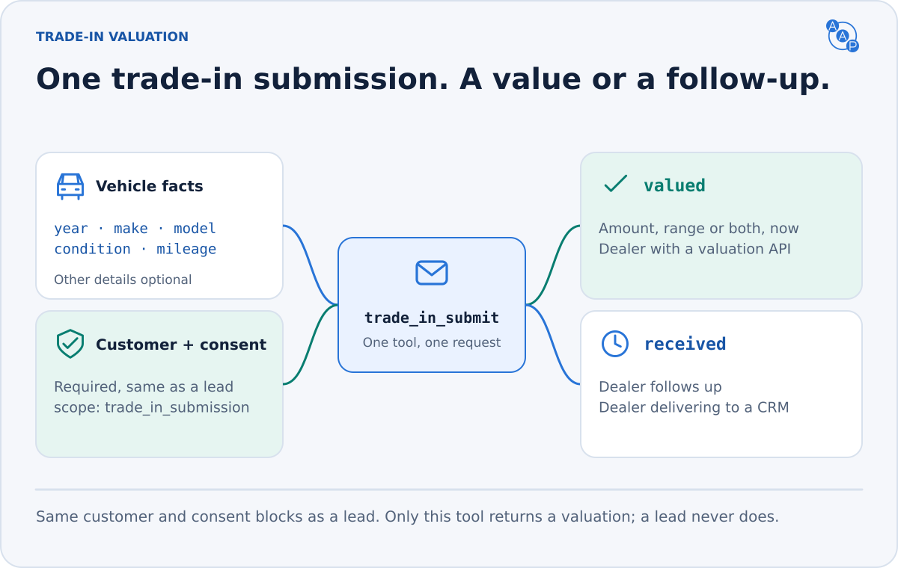
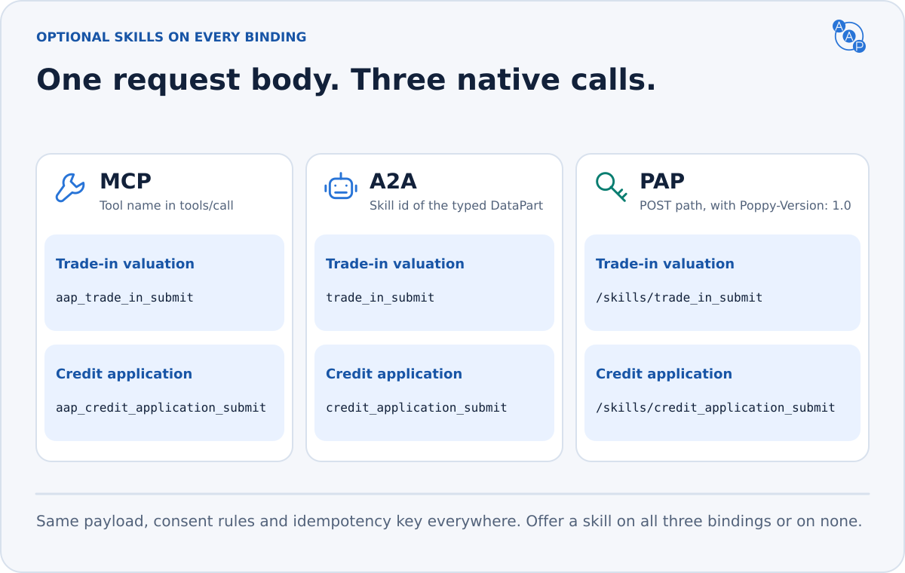
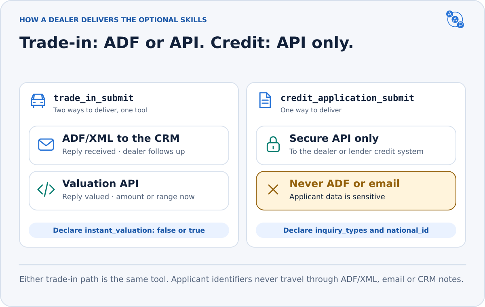
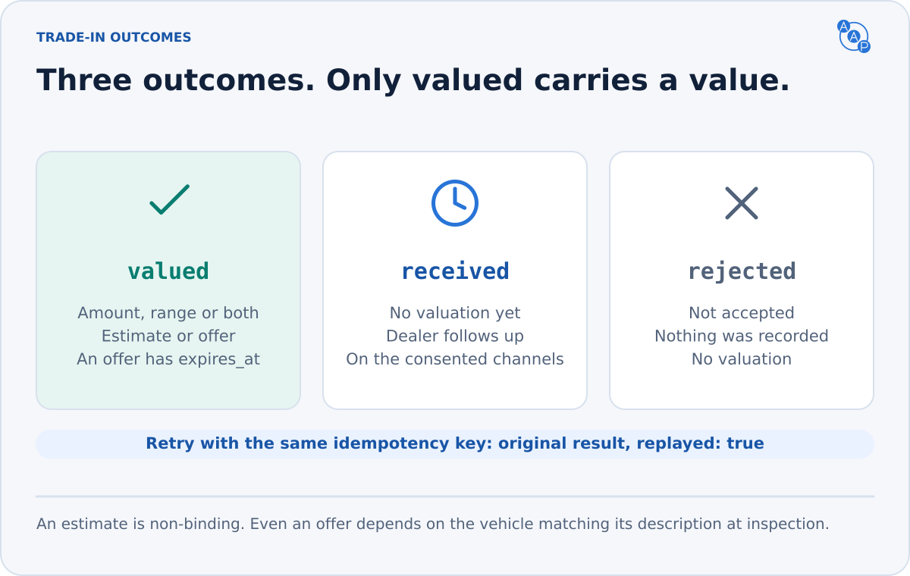

# `trade_in_submit`


**Describe the vehicle the buyer wants to trade in and read back the dealer's valuation, or its promise to follow up.** This is an optional skill: call it only on a dealer that declares it.





| Interface | Invocation |
|---|---|
| MCP | `aap_trade_in_submit` with the typed request as `arguments` |
| A2A | `SendMessage` with the typed request in `DataPart.data`; media types `application/vnd.autoagent.trade-in-submit-request+json` → `application/vnd.autoagent.trade-in-submit-response+json` |
| PAP | `POST /skills/trade_in_submit` (operationId `trade_in_submit`) with the typed request body, the delegated Session JWT and `Poppy-Version: 1.0` |

All three use the same [request schema](https://autoagentprotocol.org/v4.0/schemas/trade-in-submit-request.schema.json), [response schema](https://autoagentprotocol.org/v4.0/schemas/trade-in-submit-response.schema.json), [capabilities](https://autoagentprotocol.org/v4.0/schemas/trade-in-capabilities.schema.json) and deduplication store. The MCP tool is a write tool: `readOnlyHint: false`, `destructiveHint: false`, `idempotentHint: false`, `openWorldHint: true`.

## When to use it

| Buyer intent | Use |
|---|---|
| "What is my car worth?" with a value in the answer | `trade_in_submit` |
| "Have someone appraise my car and contact me" on a dealer with this skill | `trade_in_submit` |
| A purchase inquiry that mentions a trade-in | [`lead_submit`](./lead-submit.md) with its `trade_in` block; it never returns a valuation |
| The dealer does not declare `trade_in_submit` | `lead_submit` with a `trade_in` block, or the dealer's own channels |

`lead_submit` keeps its behavior in AAP 4.0 and still accepts a trade-in inside an inquiry. `trade_in_submit` is the only trade-in tool: it adds the reply. The consent scope of `lead_submit` stays `["lead_submission"]` and does not cover a trade-in submission; this skill's scope is `["trade_in_submission"]`.

## How a dealer implements it

There is one trade-in tool. A dealer chooses how to deliver it, and declares the result in its capabilities.



| Delivery | Capability | Reply |
|---|---|---|
| **ADF/XML to the CRM**, as a lead with a trade-in vehicle block; see the [ADF mapping](../compatibility/adf-mapping.md#trade_in_submit-over-adf) | `instant_valuation: false` | `received`; the dealer follows up |
| **Valuation API** | `instant_valuation: true` | `valued`, or `received` when no value is available |

The request, customer data, consent rules and idempotency key are the same on both paths, so an agent never needs to know which one a dealer uses. Either way the dealership receives the customer like a regular lead.

## Read the capabilities first

Read `params.skills["trade_in_submit"].capabilities` on the AAP Agent Card extension, or `tools/list` → `aap_trade_in_submit` → `_meta["autoagentprotocol.org/aap"].capabilities`. Both follow `trade-in-capabilities.schema.json` and MUST agree. A dealer declares the skill identically on all three bindings or not at all.

| Capability | Values | What the agent does |
|---|---|---|
| `instant_valuation` | required boolean | `true`: an accepted request can return `valued` in the same call. `false`: every accepted submission returns `received`; tell the buyer to expect follow-up. |
| `currencies` | optional, default `["USD"]` | Currencies the skill accepts and returns. |

Every submission carries customer data and consent, so a dealer that cannot answer immediately can always follow up.

```json
{ "instant_valuation": true, "currencies": ["USD"] }
```

## Request

| Field | Required | Meaning |
|---|---|---|
| `type` | yes | `trade_in_submit_request` |
| `vehicle.year`, `vehicle.make`, `vehicle.model` | yes | The vehicle's identity as the owner states it. |
| `vehicle.condition` | yes | Wear condition: `excellent`, `good`, `fair` or `poor`. Sale conditions (`new`, `used`, `cpo`) are invalid here. |
| `vehicle.mileage` | yes | Odometer reading in `vehicle.mileage_unit` (`mi` or `km`; omitted = `mi`). |
| `vehicle.vin`, `trim`, `exterior_color`, `driveline`, `transmission`, `displacement_cc`, `fuel`, `horsepower` | no | Details that improve a valuation. `horsepower` is peak total output in hp. A trade-in never carries `rebates`. |
| `customer`, `consent` | yes | The same customer block and consent grant as `lead_submit`, so a first-time trade-in reaches the dealership like a regular lead. |
| `vehicle_of_interest` | no | The vehicle the buyer intends to buy; sale condition `new`, `used` or `cpo`. |
| `message` | no | Free-text note, up to 4,000 characters, such as accident history or recent service. |
| `submitted_at` | no | When the agent finalized the submission; preserve it on a retry. |
| `source_agent` | yes | Attribution, not authorization. |
| `idempotency_key` | yes | Client-generated key, 1–128 characters (UUID recommended). |

Send only what the owner told you. Never invent a VIN, trim, equipment or condition.

## Customer and consent

Both are required, exactly as in `lead_submit`. If the trade-in is the customer's first contact, the dealership receives the same customer data it would get from a lead, and may follow up on the permitted channels only.

| | `lead_submit` | `trade_in_submit` |
|---|---|---|
| `customer`, `consent`, `source_agent`, `idempotency_key` | Required | Required |
| Consent `scope` | `["lead_submission"]` | `["trade_in_submission"]` |
| Trade-in vehicle | Optional `trade_in` block, any known fields | Required `vehicle` with year, make, model, condition and mileage |
| Reply | Lead status, never a valuation | Status and an optional valuation |

The grant uses the shared [consent grant](https://autoagentprotocol.org/v4.0/schemas/consent-grant.schema.json) with `scope` exactly `["trade_in_submission"]`. Each permitted channel needs its contact value: `email` requires `customer.email`; `phone` and `sms` require `customer.phone`. A specific `preferred_contact` must be permitted. Record the disclosure the owner actually saw in `consent_text` and the moment of approval in `granted_at`. A Session, sign-in, a PAP Operations approval or a `lead_submission` grant is not trade-in consent.

```json
{
  "type": "trade_in_submit_request",
  "vehicle": {
    "year": 2020,
    "make": "Volkswagen",
    "model": "Passat",
    "trim": "SE",
    "condition": "good",
    "mileage": 62000,
    "vin": "1VWSA7A39LC012345",
    "exterior_color": "Pure White",
    "driveline": "fwd",
    "transmission": "automatic",
    "displacement_cc": 1984,
    "fuel": "gas",
    "horsepower": 174
  },
  "customer": {
    "first_name": "Piotr",
    "last_name": "Nowak",
    "email": "piotr.nowak@example.com",
    "preferred_contact": "email"
  },
  "consent": {
    "granted_at": "2026-11-19T10:14:30Z",
    "allowed_channels": ["email"],
    "consent_text": "I authorize Demo Toyota to email me about the trade-in value of my 2020 Volkswagen Passat.",
    "scope": ["trade_in_submission"]
  },
  "vehicle_of_interest": {
    "vin": "JTMRWRFV5SD012345",
    "year": 2026,
    "make": "Toyota",
    "model": "RAV4",
    "condition": "new"
  },
  "message": "One owner, no accidents, new tires in September.",
  "source_agent": { "name": "example-buyer", "url": "https://buyer.example" },
  "submitted_at": "2026-11-19T10:15:00Z",
  "idempotency_key": "01JD9TRADEIN0VWPASSAT00043"
}
```

See also the [minimal](https://autoagentprotocol.org/v4.0/examples/trade-in-submit-request.minimal.example.json) and [Canadian km/CAD](https://autoagentprotocol.org/v4.0/examples/trade-in-submit-request.canadian.example.json) examples.

## Response



```json
{
  "type": "trade_in_submit_response",
  "data": {
    "trade_in_id": "trd_dt_90412",
    "status": "valued",
    "valuation": {
      "amount": 16800,
      "amount_min": 15900,
      "amount_max": 17600,
      "currency": "USD",
      "kind": "estimate",
      "expires_at": "2026-11-26T10:15:00Z",
      "source": "Dealer appraisal desk with regional auction data",
      "disclaimer": "Estimate based on the description provided. The final value depends on an in-person inspection and a clear title."
    },
    "dealer": { "name": "Demo Toyota", "phone": "+14155550100" }
  },
  "message": "Bring the vehicle in for a 20-minute inspection to turn this estimate into a firm offer."
}
```

| `status` | Meaning | `valuation` |
|---|---|---|
| `valued` | A valuation is included. | Required |
| `received` | Accepted for dealer follow-up without an immediate value. Only a request with consented contact data can be received. | Absent |
| `rejected` | Not accepted; nothing was recorded. | Absent |

| Valuation field | Meaning |
|---|---|
| `amount` | Single headline value, integer in whole units of `currency`. |
| `amount_min` + `amount_max` | A range; always both ends together. |
| `kind` | `estimate` (non-binding indication) or `offer` (the dealer commits until `expires_at` if the vehicle matches its description at inspection). Omitted means `estimate`. |
| `expires_at` | Last moment the valuation stands. Required for `offer`, optional for an estimate. |
| `currency` | Currency of every amount; omitted means `USD`. |
| `source` | Valuation provider or method, up to 200 characters. |
| `disclaimer` | Conditions the buyer must see with the value, up to 2,000 characters. |

A valuation carries `amount`, the `amount_min`/`amount_max` range, or both; every other valuation field is optional. `dealer` is a convenience contact summary; `message` is a dealer note up to 2,000 characters. See the [offer](https://autoagentprotocol.org/v4.0/examples/trade-in-submit-response.offer.example.json) and [range-only](https://autoagentprotocol.org/v4.0/examples/trade-in-submit-response.range.example.json) examples.

A dealer without an instant value answers a consented request with `received`:

```json
{
  "type": "trade_in_submit_response",
  "data": {
    "trade_in_id": "trd_dt_90415",
    "status": "received",
    "dealer": { "name": "Demo Toyota", "phone": "+14155550100" }
  },
  "message": "An appraiser will email a value within one business day."
}
```

## What the agent may tell the buyer

| May say | Must not say |
|---|---|
| "Demo Toyota estimates $16,800 (range $15,900–$17,600) until Nov 26." | That an estimate is an offer, a price the dealer must pay, or a guaranteed credit toward a purchase. |
| "This is an offer of $16,500 until Nov 22, if the car matches its description at inspection." | That an offer is final without inspection and title. |
| The `disclaimer`, verbatim or faithfully, next to the number. | A value after its `expires_at`, or a value in a currency the response did not use. |
| "The dealer received your details and will email you." for `received` | That a `received` submission has been valued or scheduled. |

Never fill in a VIN, condition, mileage or equipment the owner did not give. Any offer still depends on an inspection of the actual vehicle.

## Errors and safe retries

| Code | When |
|---|---|
| `UNSUPPORTED_SKILL` | The dealer does not implement `trade_in_submit`. |
| `CONTACT_CONSENT_REQUIRED` | `customer` or `consent` is missing. |
| `INVALID_CONSENT` | The grant is malformed, future-dated, expired, has another scope, or permits a channel without its contact value. |
| `SCHEMA_VALIDATION_FAILED`, `MISSING_REQUIRED_FIELD`, `INVALID_CONDITION` | The request does not match the schema, lacks a required field, or uses a sale condition for the trade-in vehicle or a wear condition for `vehicle_of_interest`. |
| `IDEMPOTENCY_CONFLICT` | The same key was reused with a different payload. |
| `RATE_LIMITED`, `INTERNAL_ERROR` | Retryable; keep the same key and payload. |

Every request carries an `idempotency_key`. Dealers deduplicate for at least **24 hours** by dealer and verified caller, including the stable PAP User ID where applicable; anonymous calls use dealer and key. The same key and payload on any binding return the complete original response, including the valuation, with `data.replayed: true`. A replay creates no new record, valuation or delivery. Preserve the key and payload after a timeout or Session renewal.

A dealer that advertises PAP Operations may answer this write skill with `approval_required`; resend the identical request with `Poppy-Approval` and the same idempotency key. An approval never replaces the consent grant in the body. See [PAP](../personal-agent-protocol.md) and [errors](../errors.md).
